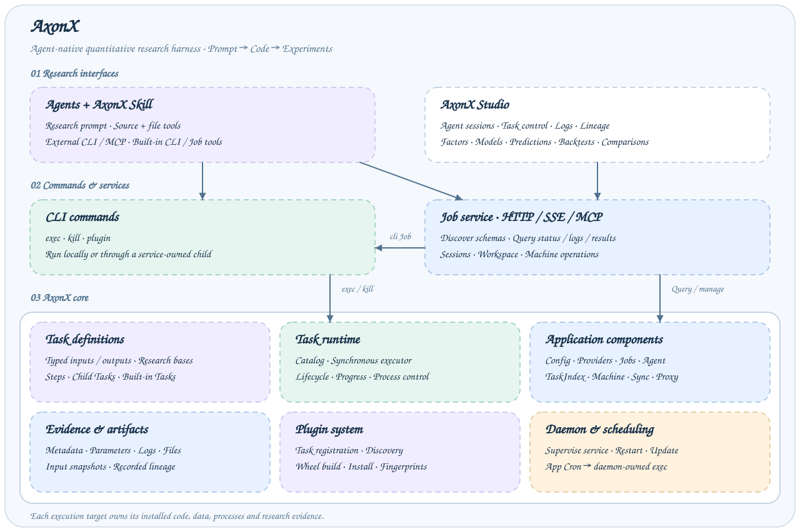
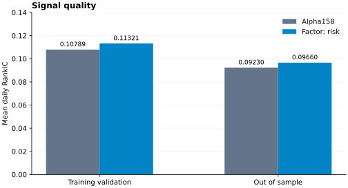
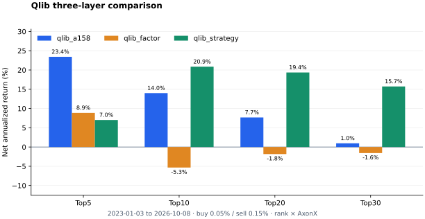

<p align="center">
  
</p>

<p align="center"><strong>Turn research prompts into quantitative code and traceable experiments.</strong></p>

<p align="center">
  <a href="https://github.com/FlowLLM-AI/AxonX/blob/main/pyproject.toml"></a>
  <a href="https://pypi.org/project/axonx/"></a>
  <a href="https://pypi.org/project/axonx/"></a>
  <a href="https://github.com/FlowLLM-AI/AxonX/graphs/commit-activity"></a>
  <a href="https://github.com/FlowLLM-AI/AxonX/graphs/traffic"></a>
  <a href="https://github.com/FlowLLM-AI/AxonX/blob/main/LICENSE"></a>
  <a href="https://flowllm-ai.github.io/AxonX/en/dev_guide"></a>
  <a href="https://flowllm-ai.github.io/AxonX/en/docs"></a>
  <a href="https://flowllm-ai.github.io/AxonX/en/getting-started/overview"></a>
  <a href="https://flowllm-ai.github.io/AxonX/zh/getting-started/overview"></a>
  <a href="https://deepwiki.com/FlowLLM-AI/AxonX"></a>
</p>

<p align="center">⭐ <a href="https://github.com/FlowLLM-AI/AxonX">Give AxonX a Star on GitHub</a>!</p>

<a id="what-is-axonx"></a>

## 🧠 What is AxonX?

**AxonX is an agent-native harness for quantitative research.** Agents develop research plugins, execute experiments, and inspect the same parameters, logs, dependencies and artifacts as researchers.

**You define the question; the Agent implements it; AxonX manages execution and evidence.** Use CLI, HTTP, MCP or Studio. The reference plugins adapt [Microsoft Qlib](https://github.com/microsoft/qlib)'s Alpha158 baseline with configurable factors and portfolio policies.

[Quick start](#quick-start) · [Plugins](#alpha158-and-the-plugin-system) · [Case study](#benchmark-agent-developed-market-cross-sectional-features) · [Documentation](#axonx-documentation) · <a href="https://flowllm-ai.github.io/AxonX/playground/?lang=en" target="_self">Try Playground</a>

<a id="why-axonx"></a>

## ✨ Why AxonX?

- **Develop with Agents:** use the [AxonX Skill](https://flowllm-ai.github.io/AxonX/en/dev_guide), source tools and live Task schemas.
- **Keep traceable experiments:** typed inputs/outputs, process identity, logs and versioned artifact references.
- **Inspect in Studio:** Task control, workspace previews, research charts and strategy comparisons.

## 📰 Latest Updates

- **0.3.0 released:** supports inheritable configuration, unified Task execution, and scheduled Tasks that continue across service restarts.
- **Alpha158 experiments:** risk factors and rank retention improved Top20 net annualized returns by **+1.36 pp and +24.70 pp** over the adapted baseline. See [results and evidence limits](#benchmark-agent-developed-market-cross-sectional-features).
- **Studio Playground:** explore Tasks and charts with simulated data. <a href="https://flowllm-ai.github.io/AxonX/playground/?lang=en" target="_self">Try it online</a>.



<a id="quick-start"></a>

## 🚀 Quick start

This checkout is **AxonX 0.3.1**. Requires **Python 3.12+ on macOS or Linux**. Studio is an optional, independently released package.

### 1. Install and start

Install from pip:

```bash
pip install 'axonx[studio]'
```

Or install the backend and Studio from source:

```bash
git clone https://github.com/FlowLLM-AI/AxonX.git
cd AxonX
pip install -e ./axonx_studio -e '.[studio]'
npm --prefix axonx_studio ci
npm --prefix axonx_studio run build
```

The source install uses editable packages. Building Studio requires **Node.js 22.13+ (22.x), 24.x or 26+**; rebuild after frontend changes.

Then start the service:

```bash
export AXONX_SERVICE_TOKEN='replace-with-your-service-token'
axonx app --service.host 127.0.0.1
```

Defaults: port `1024`, workspace `.axonx`, service/CLI logs `logs/`. Use [example.env](example.env) for optional settings; CLI startup loads the nearest `.env` from the launch directory or its parents, preserving existing environment values. Keep this terminal open and use another with the same Python environment and token.

For custom settings, save a YAML file such as `axonx.local.yaml`:

```yaml
extends: default
workspace_dir: .axonx
service:
  host: 127.0.0.1
```

Start it with `axonx app --config ./axonx.local.yaml`. Custom configs inherit the bundled service, components and Jobs only with `extends: default`; mappings merge, while lists and scalars replace. Installed plugins can also provide named configs. See [configuration](https://flowllm-ai.github.io/AxonX/en/reference/configuration).

<a id="quick-demo"></a>

### 2. Run Demo and open Studio

```bash
axonx get_task_def --task demo
axonx exec --task demo --task-name quickstart --x 2 --y 3
axonx status --task-id 'base#demo#quickstart' --detail full
```

`exec` waits and returns business output (`result=5`) plus the Task exit code. Demo needs no market data or model credentials. Open `http://127.0.0.1:1024/` and enter the token in **Settings → Local service token**.

`axonx --help` shows offline usage; `axonx help` queries the running service's Jobs. Execution settings use **explicit CLI options → service `get_config` → built-in defaults**. The CLI falls back only when the service connection is unavailable; authentication and service errors are reported. Task-specific parameters come from `get_task_def`.

Keep the Task ID and metadata `started_at`. Use different instance names to preserve experiments: same-name reruns replace current records and outputs, retaining `persistent/`. See [Task management](https://flowllm-ai.github.io/AxonX/en/guides/task-management).

<a id="agent-access-and-development-guides"></a>

### 3. Develop with an Agent

For the reference research plugins, use the source checkout above (or clone the repository if you installed from pip). From the repository root, install into the execution service's Python environment:

```bash
axonx plugin install -e ./plugins/qlib_a158
axonx restart_service
```

Research plugins are installed from source. Install **Alpha158** first, then **factor** or **strategy** as needed; the two extensions do not depend on each other. Restart persistent services after code changes; reinstall after dependency or entry-point changes. Wait for the service to be ready before querying definitions.

Provide the checkout, file/command tools and [AxonX Skill](https://flowllm-ai.github.io/AxonX/en/dev_guide). Install the Skill from `main` with GitHub CLI (`--agent claude-code` for Claude Code):

```bash
gh skill install FlowLLM-AI/AxonX axonx --agent codex --scope user --pin main
```

Install AxonX and the research plugins as described above, then choose an access path:

- **External Agent:** the host manages model credentials. Use CLI or Streamable HTTP MCP at `http://127.0.0.1:1024/mcp` with `Authorization: Bearer <token>`. See [MCP integration](https://flowllm-ai.github.io/AxonX/en/agent/mcp-integration).
- **Built-in Agent:** set the following model environment, restart the service, and open **Studio → Agent**. Configure its `cwd` for the checkout; see [Agent configuration](https://flowllm-ai.github.io/AxonX/en/agent/configuration).

```dotenv
CLAUDE_CODE_API_KEY=your-model-api-key
CLAUDE_CODE_BASE_URL=https://api.anthropic.com
CLAUDE_CODE_MODEL_NAME=your-model-name
```

Give the Agent a concrete objective, for example:

> Read the AxonX Skill and Alpha158 implementation. Develop a separate plugin to test residual volatility and downside risk. Fix data, training settings, costs and evaluation windows; use only signal-time information. Test the code, run experiments, and report Task IDs, RankIC, net returns, drawdown and limitations. Reserve an independent confirmation window.

Prepare historical data and `AXONX_TUSHARE_TOKEN` before following the [research workflow](https://flowllm-ai.github.io/AxonX/en/research/workflow).

<a id="alpha158-and-the-plugin-system"></a>

## 🧩 From Qlib Alpha158 to research plugins

The main chain is **ETL → Train → Predict → Backtest**, with optional factor analysis from ETL. `qlib_a158_research` composes these stages; leaf Tasks can reuse compatible upstream artifacts.

| Plugin                                                                       | Capability                                                                         |
| ---------------------------------------------------------------------------- | ---------------------------------------------------------------------------------- |
| [qlib_a158](https://flowllm-ai.github.io/AxonX/en/plugins/qlib-a158)         | 158 price/volume features, LightGBM, factor analysis and TopN backtests            |
| [qlib_factor](https://flowllm-ai.github.io/AxonX/en/plugins/qlib-factor)     | 13 optional features; training defaults to the 158-feature baseline                |
| [qlib_strategy](https://flowllm-ai.github.io/AxonX/en/plugins/qlib-strategy) | Minimum holding periods, rank retention and replacement limits; reuses predictions |

Other research methods use the same [Task and plugin contracts](https://flowllm-ai.github.io/AxonX/en/dev_guide). The baseline adapts Qlib's data, labels, training and trading assumptions; see [differences from original Qlib](https://flowllm-ai.github.io/AxonX/en/plugins/qlib-a158#differences-from-original-qlib).

<a id="benchmark-agent-developed-market-cross-sectional-features"></a>

## 📊 Alpha158 improvement case

This recorded experiment adds two risk features, then applies a rank-retention policy to the factor-model predictions:

| Configuration           | Top20 net annualized | Max drawdown | Daily two-sided turnover |
| ----------------------- | -------------------: | -----------: | -----------------------: |
| Alpha158 baseline       |                7.67% |      -38.65% |                  198.83% |
| Risk-factor model       |                9.03% |      -40.69% |                  199.35% |
| Rank-retention strategy |               32.37% |      -24.91% |                   40.01% |

Training: `[20150101,20230101)`; evaluation: `20230103–20261008` (909 market dates). Buy/sell fees: 0.05% / 0.15%. The strategy uses a 3-day minimum holding period and a 20% replacement count cap per side; initial construction is exempt.





**Evidence limits:** no independent confirmation window; base/factor `feature_fraction` differs (0.9/1.0), so results do not isolate the added factors. All backtests report `incomplete_market_data`, use same-close fill proxies and include a partial 2026. These results do not establish outperformance over original Qlib.

[Full settings, reproduction commands and historical Task provenance](https://flowllm-ai.github.io/AxonX/en/research/alpha158-case).

<a id="axonx-cli-commands-and-remote-execution"></a>

## 🛠️ CLI and remote execution

Set the destination token and keep the same target for execution and observation:

```bash
export AXONX_TARGET_TOKEN='replace-with-target-token'
axonx exec --task demo --task-name remote-check --x 2 --y 3 --target node-b:1024
axonx status --task-id 'base#demo#remote-check' --detail full --target node-b:1024
```

Replace the example address. `--target` uses `AXONX_TARGET_TOKEN`; default local calls use `AXONX_SERVICE_TOKEN`. Remote paths belong to the target. Deploy local plugins by **build → upload → install `location` → clean `path` → restart/verify**; see [plugin management](https://flowllm-ai.github.io/AxonX/en/plugins/management).

Studio uses backend-configured `targets`; `AXONX_TARGET` populates the bundled `remote` config and does not select a CLI destination by itself. See [remote machines](https://flowllm-ai.github.io/AxonX/en/guides/deployment#remote-connections). Service restarts stop service-owned manual commands and preserve daemon-owned scheduled Tasks; schedules accept local `axonx exec --task NAME` commands. See [service updates](https://flowllm-ai.github.io/AxonX/en/guides/operations#service-updates-and-restart).

<a id="axonx-documentation"></a>

## 📚 Documentation

| Goal                    | Guide                                                                                                                                                                                                                     |
| ----------------------- | ------------------------------------------------------------------------------------------------------------------------------------------------------------------------------------------------------------------------- |
| Run research            | [Quickstart](https://flowllm-ai.github.io/AxonX/en/getting-started/quickstart) · [Research workflow](https://flowllm-ai.github.io/AxonX/en/research/workflow)                                                             |
| Use an Agent            | [External Agents](https://flowllm-ai.github.io/AxonX/en/agent/overview) · [Built-in Agent](https://flowllm-ai.github.io/AxonX/en/agent/configuration)                                                                     |
| Develop plugins         | [Development guide](https://flowllm-ai.github.io/AxonX/en/dev_guide) · [Artifact contracts](https://flowllm-ai.github.io/AxonX/en/reference/research-artifacts)                                                           |
| Evaluate results        | [Experiment design](https://flowllm-ai.github.io/AxonX/en/research/experiments) · [Strategy comparison](https://flowllm-ai.github.io/AxonX/en/research/strategy-comparison)                                               |
| Operate or extend AxonX | [CLI](https://flowllm-ai.github.io/AxonX/en/reference/cli) · [Configuration](https://flowllm-ai.github.io/AxonX/en/reference/configuration) · [Architecture](https://flowllm-ai.github.io/AxonX/en/concepts/architecture) |

[English documentation](https://flowllm-ai.github.io/AxonX/en/docs) · [中文文档](https://flowllm-ai.github.io/AxonX/zh/docs)

<a id="contributing"></a>

## 💬 Contributing

Contributions to the framework, plugins, experiments and documentation are welcome. See [CONTRIBUTING.md](https://flowllm-ai.github.io/AxonX/en/development/contributing) for setup and checks, or [GitHub issues](https://github.com/FlowLLM-AI/AxonX/issues) for bugs and proposals.

<a id="license"></a>

## ⚖️ License

[Apache License 2.0](LICENSE).
