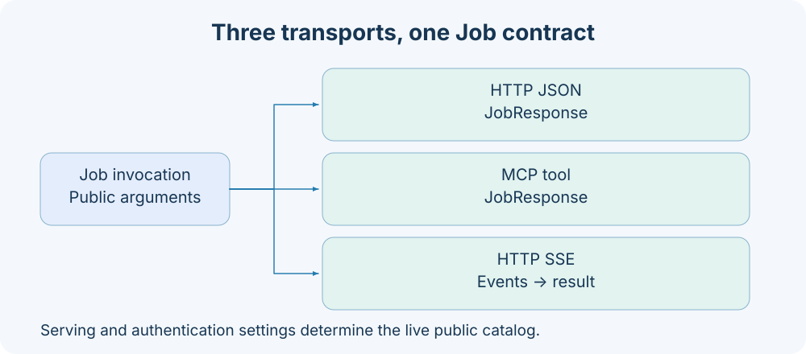

# HTTP and MCP Protocol



## Routes

| Method | Route             | Purpose                              |
| ------ | ----------------- | ------------------------------------ |
| GET    | /health           | JobResponse with answer.running      |
| GET    | /jobs             | JobResponse with catalog items/total |
| POST   | /jobs/NAME        | One JobResponse                      |
| POST   | /jobs/NAME/events | SSE through terminal result          |
| POST   | /upload           | Stage one file; answer is StagedFile |
| DELETE | /upload?path=...  | Discard a staged relative path       |
| —      | /mcp              | Stateless Streamable HTTP MCP        |

## Authentication and public catalog

When service.token is configured, protocol roots and subpaths require `Authorization: Bearer TOKEN` (OPTIONS is exempt). The public Job catalog also filters enable_serve/requires_auth: without a configured service token, authenticated Jobs are not exposed. A requires_auth=false Job does not bypass protocol-wide token middleware on a token-protected service. Studio static pages and upstream proxy routes have their own routing behavior.

## Request envelope

```json
{ "arguments": { "task_id": "base#demo#check", "detail": "full" } }
```

Top-level fields are arguments and optional target. An HTTP forwarding target must be configured on the receiving application; the backend resolves its credential. Client options do not belong in business arguments. MCP tools expose business arguments directly for their configured Job.

## Responses and errors

JobResponse contains answer, success and metadata. Schema validation can return HTTP 422; an unavailable route returns 404; invalid authentication returns 401. Business errors normally return JobResponse success=false, including through HTTP 200. Inspect success and the concrete answer shape. For cli commands also inspect exit_code, stdout and stderr; for Tasks inspect state and business output.

## Execute a Task

POST /jobs/cli with `{"arguments":{"argv":["exec","--task","demo","--task-name","check","--x","1","--y","2"]}}`. The Job owns the command process, waits for completion and returns its output/exit code. Query status separately. No dedicated submission endpoint is configured.

## MCP and events

MCP exposes the same public Jobs and ordinary JobResponse schema. Live presentation uses HTTP SSE; files use /upload. Close streams and inspect the final result rather than assuming a disconnected stream completed successfully.

[Task API](tasks.md) · [Events](events.md) · [Workspace](workspace.md) · [Machines](machines.md) · [Agent](agent.md)
