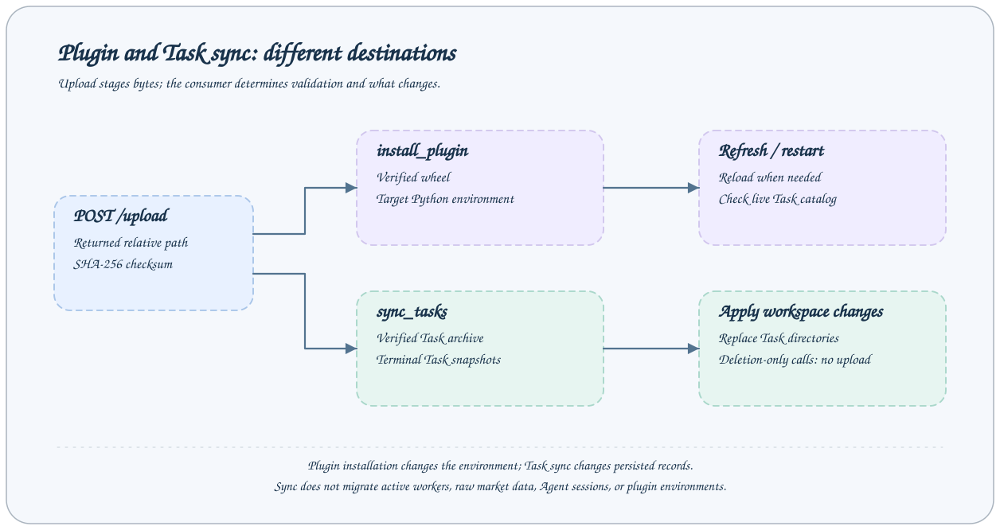

# Plugin Commands and Synchronization API

Plugin management runs through the ordinary `cli` Job; synchronization retains dedicated Jobs.

All Jobs below use `POST /jobs/NAME` with `{"arguments": {...}}`. Streams use `/jobs/NAME/events`; MCP uses the same Job name and business arguments. Discover the target schema with `help --job NAME`. Replace example Task/session IDs with actual values.



## Endpoint list

| Job               | Purpose                                                  |
| ----------------- | -------------------------------------------------------- |
| `task_sync_index` | Read verified display snapshots for reconciliation.      |
| `sync_tasks`      | Replace task directories from one uploaded sync archive. |

## task_sync_index

Read verified display snapshots for reconciliation.

| Argument        | Type    | Required | Default / constraints |
| --------------- | ------- | -------- | --------------------- |
| `task_names`    | `array` | no       | `—`                   |
| `live_task_ids` | `array` | no       | `—`                   |

```json
{
  "arguments": {
    "task_names": ["experiment"]
  }
}
```

Returns verified display-snapshot revisions for reconciliation. `task_names` matches the final Task ID segment (1–32 letters, digits or hyphens); empty or omitted includes all names. `live_task_ids` selects opt-in live parent groups. Snapshot identity uses `root_started_at` and an ordered revision.

## sync_tasks

Replace task directories from one uploaded sync archive.

| Argument    | Type     | Required | Default / constraints           |
| ----------- | -------- | -------- | ------------------------------- |
| `path`      | `string` | no       | `{"minLength":1}`               |
| `deletions` | `array`  | no       | `{"maxItems":200,"default":[]}` |

```json
{
  "arguments": {
    "path": "tmp/ACTUAL_UPLOAD_PATH/archive.tar.gz"
  }
}
```

Applies an uploaded sync archive and optional deletions. Uploads use relative path here, not the absolute plugin-install location. Returns `archive`, `applied`, `deleted` and `files`. The archive must contain verified display-replica metadata and regular files in canonical Task directories; gzip tar archives are bounded by the transfer budget. Applying refuses active original Task directories. Replicas support inspection and cannot execute or serve as research inputs.

## Plugin commands

Call `cli` with argv `["plugin", "list"]`, `["plugin", "show", "DISTRIBUTION"]`, `["plugin", "install", "/absolute/upload/location.whl"]`, or `["plugin", "uninstall", "DISTRIBUTION"]`. The response contains process stdout/stderr, exit_code and truncation flags. Plugin metadata is JSON in stdout. There are no dedicated plugin-management Jobs or automatic live-catalog refresh. Install local wheels with the explicit [deployment flow](../plugins/management.md); upload uses `/upload`.

## Visibility of sync_flush

The default configuration leaves `sync_flush` commented out because it requires a configured sync component. Expose it as a pipeline Job with `backend: sync_flush_step` only when that component exists. Invoke it manually or from a custom host workflow; Cron supports Task exec commands. See [Task synchronization](../guides/task-sync.md).

Source: [Default Job contracts](../../../axonx/app/config/default.yaml) · [Job protocol](overview.md)
