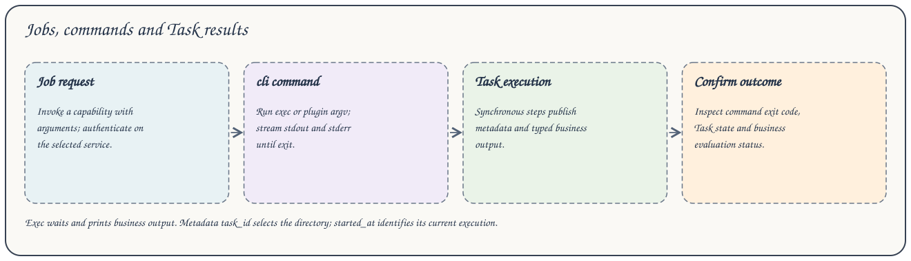

# Jobs and Tasks

Jobs expose application capabilities. Tasks execute synchronous research and persist evidence. CLI, HTTP, MCP and Studio access the same configured Jobs; native Task execution is a separate CLI operation.

## Comparison

| Concept    | Execution                                 | Ownership and output                                 |
| ---------- | ----------------------------------------- | ---------------------------------------------------- |
| Job        | Asynchronous Steps                        | Application; `JobResponse` and optional events       |
| Task       | Synchronous steps and children            | CLI execution process; metadata, files and exit code |
| Task index | Reads workspace records                   | Application; summaries, graphs and streams           |
| Daemon     | Supervises service and scheduled commands | Host; process lifecycle and updates                  |

## From names to execution identity

A registration such as `demo` resolves a class. `task_name` identifies an instance. A Task ID combines type, registration and instance: `base#demo#check`. `started_at` distinguishes successive executions of that directory; machine/PID/process start time identify the executing process.

## Execution results

`axonx exec --task demo --task-name check --x 1 --y 2` waits, prints business output, and returns a process exit code. Inspect `status --detail full` for metadata. A same-name rerun replaces outputs while retaining `persistent/`; use different names for independent experiment records.

## Local and remote execution

Local `exec` runs in the CLI process. `exec --target HOST:PORT` calls the destination's `cli` Job, which owns a child command and streams stdout/stderr until completion. HTTP/MCP callers can invoke `cli` with `argv: ["exec", "--task", "demo", ...]`. A command response contains stdout, stderr, exit_code and truncation flags. Connection cancellation can stop the owned command; inspect evidence before retrying.

## Choosing an abstraction

Use `BaseTask` for research, `run_task()` for synchronous child calls, a Job Step for an asynchronous application capability, and a Component for a reusable managed resource. Plugins register Tasks only; framework providers are supplied explicitly during application composition.

[Lifecycle](task-lifecycle.md) · [Task management](../guides/task-management.md) · [Architecture](architecture.md)
