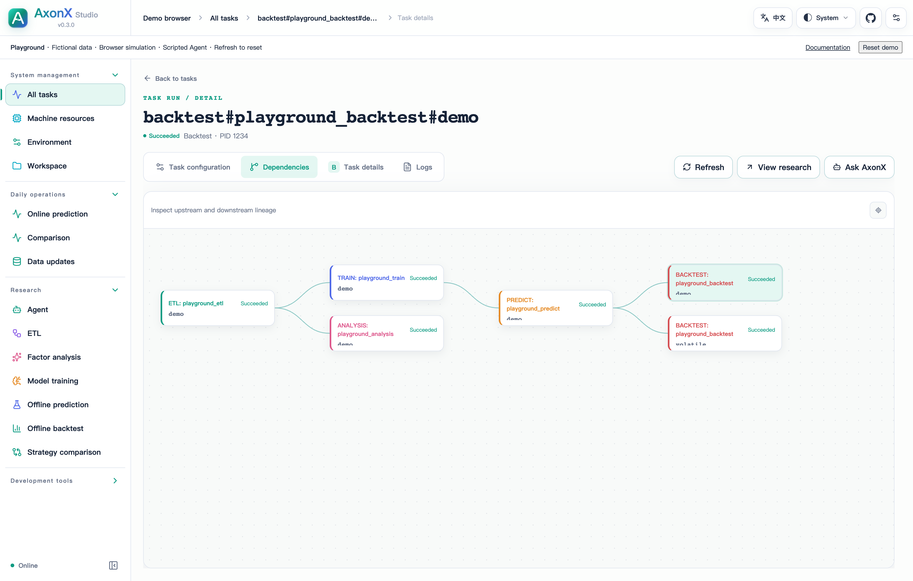

# Task Dependencies and Lineage

The dependency graph records declared input references. Parent/child metadata records synchronous invocations separately. These records provide evidence of relationships; callers still execute stages and validate data compatibility.


The Alpha158 example shows input dependencies above and invocation records below. Only declared upstream references become edges in `get_task_graph`.

## Passing upstream identities

All BaseInputParams contain a list of canonical Task IDs:

```json
{
  "task_name": "prediction-01",
  "upstream_task_ids": ["etl#my-etl#dataset-01", "train#my-train#model-01"]
}
```

Python/HTTP inputs use a JSON array. CLI exec accepts that array or comma-separated IDs. Names must be canonical and unique; the Task cannot depend on itself. Pass each child Task's upstream IDs explicitly. Declaring an upstream does not run it or validate its business compatibility.

## Where the graph comes from

`get_task_graph` builds edges only from `metadata.input_params.upstream_task_ids`. It returns the connected input-dependency component, including missing referenced upstreams. Nodes are `provisional` while their state is not `succeeded`. `parent_task_id` and `children` describe in-process invocations in metadata and do not add graph edges. A parent with no declared input dependencies may therefore appear alone even when it has executed children.

## Querying and inspecting



[Full-resolution screenshot](../../figures/studio/task-lineage.png)

In Studio, open a Task's details and select **Dependencies**. This complete screenshot uses Playground's synthetic ETL, analysis, training, prediction, and backtest records.

```bash
axonx get_task_graph --task-id 'predict#my-predict#prediction-01'
axonx get_task_context --task-id 'predict#my-predict#prediction-01'
```

Inspect actual metadata, start times and artifacts when following an edge. A fixed name can now refer to replaced inputs; pin verified revisions before consumption.

## Reading upstream Tasks in plugins

```python
from axonx.task.models.identity import TaskType

train_id = self.input_params.upstream_task_id(TaskType.TRAIN)
train_dir = self.upstream_task_dir(train_id)
```

The helper requires exactly one matching upstream type. Locating a directory neither downloads nor executes it. Use storage.inputs helpers to read metadata, validate paths and pin artifacts. Missing/failed/incompatible data is a consumer error, not resolved by a graph edge.

## Naming and deletion

Use distinct instances for reproducible experiments and retain input/model revisions. Deletion does not cascade; downstream records may show missing upstreams. Display replicas can support inspection but cannot supply executable research inputs.

Sources: [identity rules](../../../axonx/task/models/identity.py), [input models](../../../axonx/task/models/params.py), [graph](../../../axonx/app/components/task_index/query.py).
