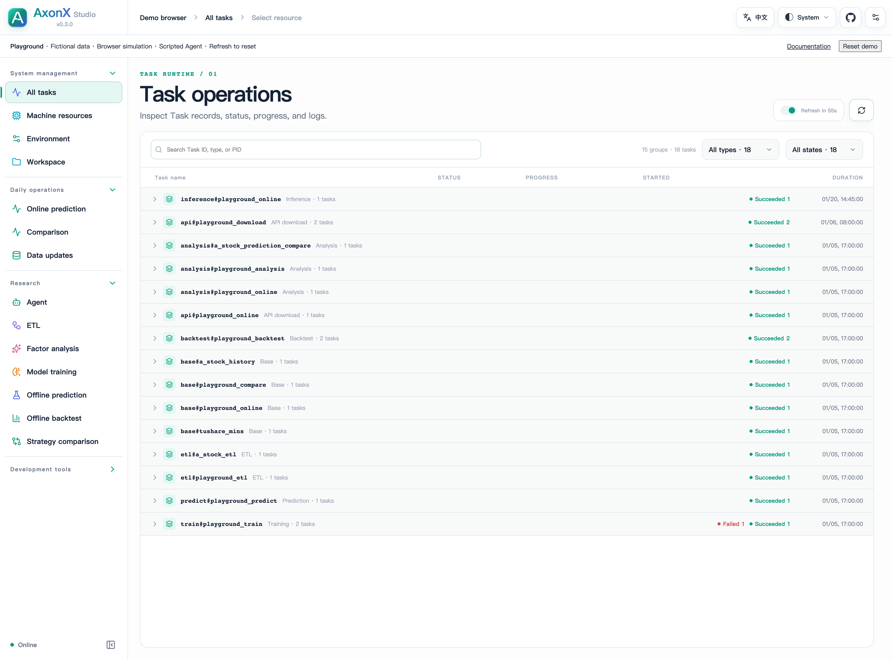

# Task Execution and Observation

## Discover and execute

```bash
axonx get_task_def --task demo
axonx exec --task demo --task-name add-01 --x 1 --y 2
axonx status --task-id 'base#demo#add-01' --detail full
axonx read_task_log --task-id 'base#demo#add-01' --offset -1 --limit 8192
axonx get_task_graph --task-id 'base#demo#add-01'
```

Exec is synchronous and returns business output plus a process exit code. Retain the Task ID and metadata started_at, together with target/workspace. Omitted task_name generates a new instance; fixed names replace current completed outputs and retain persistent/.

## Wait for completion

Observe long executions from another terminal. `axonx wait_task --task-id ID --client-timeout 600` captures the current start time and rejects replacement while waiting. It succeeds only for succeeded. A failed response can still contain complete Task metadata; inspect error/exit_code and response shape.

## Query status and logs

CLI status/wait default to summaries. Full detail includes inputs, outputs, steps and children. Log cursors are byte offsets; use next_offset for continuation and optional started_at to reject a changed execution. `stream_task --stream true` streams progress/logs until a final result. Observations never launch Tasks or repair stale state.

## Termination and reruns

Use `axonx kill --task-id ID --timeout 5 --force false`; force=true selects forced signaling, not a scheduler or service update option. Process identity is checked before signaling. Child Tasks resolve to the root process owner and stop with that execution. Display replicas cannot execute or be killed locally.

Only confirmed dead local processes can be reconciled. A foreign or inaccessible process blocks replacement. Use the source execution_target/workspace; do not turn machine_id into an address. After stopping, inspect the outcome before rerunning.

## Delete stopped task directories

The current file API is `delete_entries --paths '["base/base#demo#add-01"]'`. It has no active-process protection. Confirm all writers are stopped, use workspace-relative paths and coordinate against concurrent execution. It removes persistent/ too. Deletion does not stop a process.

## Studio



[Full-resolution screenshot](../../figures/studio/task-list.png)

The complete screenshot shows Playground's synthetic Task groups and states.

Task definitions provide forms for current input schemas. Execute starts a service-owned CLI command and shows live output; task metadata is observed separately. Distinguish command connection failure from Task failure, compare started_at on reruns and inspect the selected machine. Grouped Task lists reflect records in that workspace, including replicas and other processes.

Sources: [CLI](../../../axonx/cli/commands.py), [observation Steps](../../../axonx/app/steps/task.py), [termination](../../../axonx/task/runtime/lifecycle.py).
