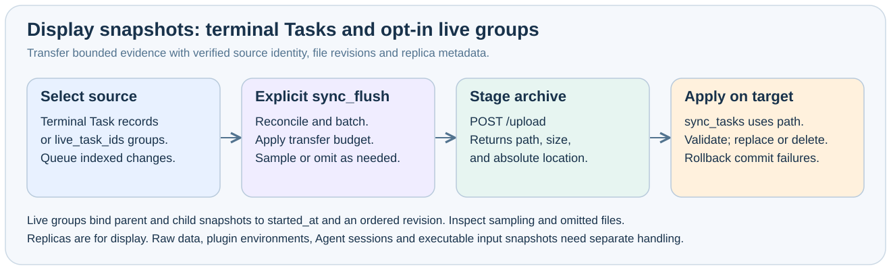

# Result Display Synchronization

Synchronization creates bounded display replicas, not executable workspace backups. Ordinary Tasks are selected after terminal completion. Opt-in live_task_ids select parent groups and their exact child execution snapshots. task_names filters the final Task ID segment; an empty list includes every name.



## Content and semantics

Replicas include metadata, progress evidence and referenced published artifacts. They exclude environments, raw workspaces, unreferenced files and upstream input/model snapshots. Missing files are recorded in replica.omitted; source declarations and metrics remain unchanged. Replicas cannot execute or be reused as mutable research inputs, and are not forwarded as synchronization sources.

## One budget

transfer_budget_bytes (default 512 MiB) bounds upload/archive size including tar overhead. Sender and receiver use the smaller budget. Large date-keyed Parquet outputs may be sampled to a shared suffix of complete trade dates; record sizes, revisions, source rows and coverage distinguish replicas from complete source artifacts. Other files can be omitted rather than silently truncated.

## Configuration

```yaml
extends: default
targets:
  - address: http://display:1024
    token: ${DISPLAY_TOKEN}
components:
  sync:
    default:
      backend: local
      target: http://display:1024
      task_index: default
      task_names: []
      live_task_ids: []
      max_archives_per_flush: 4
      timeout_seconds: 300
jobs:
  sync_flush:
    parameters: { type: object, properties: {}, additionalProperties: false }
    steps:
      - backend: sync_flush_step
        sync: default
```

Invoke `axonx sync_flush` explicitly after configuring this optional Job. The default leaves it disabled. Cron supports local Task exec commands, so do not copy a Job schedule block into cron. A host workflow can invoke flush periodically. The sync component depends on task_index.

## Reconciliation, retries and cleanup

Index events queue eligible source records; flush reconciles missed events, prepares bounded batches, uploads archives and applies them via sync_tasks. Temporary failures remain eligible for later flushes; unsafe or oversized evidence reports errors/omissions. Inspect the returned synchronization report. Upload cleanup and target reconciliation belong to synchronization consumers.

## Continuous parent snapshots

LiveSnapshot records source_id, root_task_id, root_started_at, captured_at and ordered revision. The child set follows the recorded parent invocation, not merely a name match. Stable publication and unchanged source checks prevent mixed snapshots. Replica metadata includes file/policy revisions, sampling, omissions and optional bounded log information.

## Verification

Check source/target, Task start identity, available artifact coverage and target read-only labels. Synchronization does not resume processes, install plugins, transfer credentials or replace backup.

Sources: [sync component](../../../axonx/app/components/sync/local.py), [replica builder](../../../axonx/app/components/sync/replica.py).
