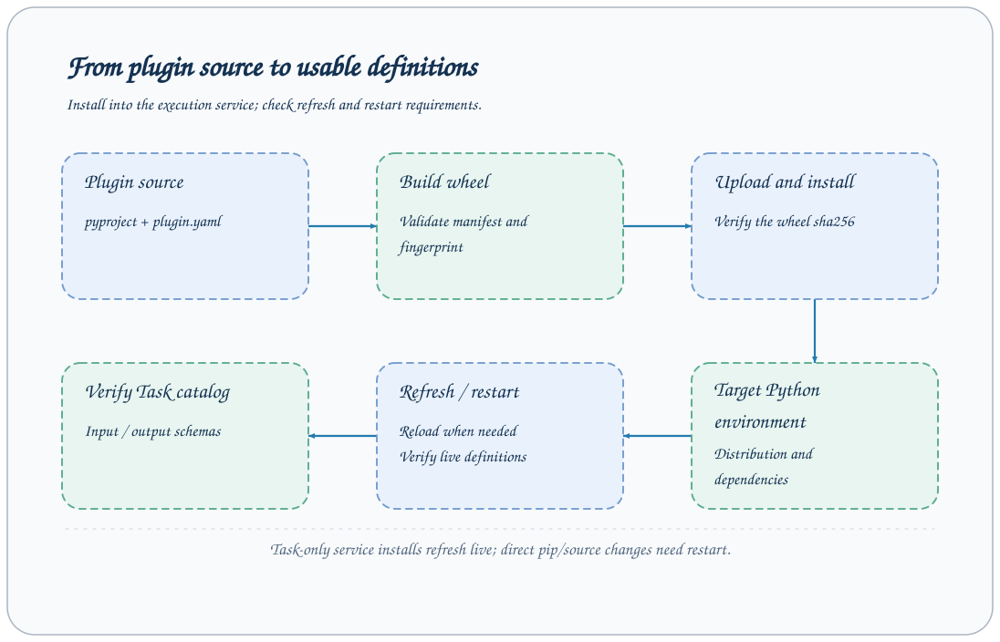

# Plugin installation and deployment

Plugins are Python packages providing AxonX Tasks, Components, and Jobs. Commands operate on the current Python environment; explicit `--target` forwards the CLI to a child process on that service. Building and installation read plugin code and dependencies.



## Three names

| Name                 | Purpose                                        | Source                         |
| -------------------- | ---------------------------------------------- | ------------------------------ |
| distribution         | Python package installation and uninstallation | project.name in pyproject.toml |
| plugin name          | Discover and distinguish plugin entries        | axonx.plugins entry point      |
| Task registered name | exec / definition queries                      | tasks in plugin.yaml           |

These three names may differ. Do not pass a distribution name directly to `--task`; first check the Task registered names in plugin contributions.

## Inspect the current environment

```bash
axonx plugin list
axonx plugin show '<distribution or plugin name>'
axonx plugin inspect '<distribution or plugin name>'
```

Displayed fields include distribution, version, entry name, requirements, and contributions. Query the definition interface separately to obtain the input/output Schema for a Task registered name.

The local CLI checks the current environment directly, without HTTP. If the service uses another virtual environment, local CLI results may not represent the persistent service's environment.

## Prepare plugin sources

Research plugins are not published to PyPI. Install the AxonX core, clone the repository, and run this page's commands from its root:

```bash
pip install axonx
git clone https://github.com/FlowLLM-AI/AxonX.git
cd AxonX
```

Alpha158 is the base plugin; factor depends on Alpha158, and strategy depends on factor. Before using a downstream plugin, install compatible upstream versions in the same execution environment in Alpha158 → factor → strategy order. The installer resolves dependencies through pip; it does not locate other plugin directories in the checkout automatically. Missing or incompatible upstream versions are looked up in the package index.

## Build and inspect from source

The repository's qlib_a158 directory is an example source path:

```bash
axonx plugin inspect ./plugins/qlib_a158
axonx plugin build ./plugins/qlib_a158 --output ./dist/plugins
```

Source builds require pyproject, manifest, and valid contributions. The tool builds a wheel and checks its contents. Building does not run a research task or require Task submission.

Without `--output`, the CLI's default cache is `.axonx/plugins/artifacts/<content_sha256>` under the current directory. The plugin CLI chooses this cache path itself; it does not automatically follow another service's workspace_dir.

Source hashing skips `node_modules`, `.axonx`, Python environments/tool caches, and root build outputs without traversing them. These ignored files and directories do not invalidate the build cache. Nested source packages named `build` or `dist` remain included; symlinks in included source paths are rejected. These rules are independent of `.gitignore`.

Existing wheels can be inspected/installed directly, but cannot be combined with `--output`:

```bash
axonx plugin inspect './dist/plugins/<actual wheel filename>.whl'
```

## Local installation

```bash
# Local Agent / plugin development: install in dependency order in the current environment
axonx plugin install -e ./plugins/qlib_a158
# Install factor and strategy extensions as needed
axonx plugin install -e ./plugins/qlib_factor
axonx plugin install -e ./plugins/qlib_strategy
```

Editable installation requires a source directory in the selected environment and cannot use `--output`. The execution service must use this Python environment. Python source changes do not require reinstallation, but restart persistent services to reload Tasks, Jobs, and Components; reinstall after dependency or entry-point metadata changes. Editable installation still builds and checks a wheel first.

For fixed-version experiments or deployment, use ordinary installation to build and install a wheel. Reinstall after source changes and restart any running local service:

```bash
axonx plugin install ./plugins/qlib_a158
```

The service's `plugins.sources` configuration can install sources at startup; see [Configuration reference](../reference/configuration.md) for path resolution. Installed valid plugins are discovered through entry points, rather than an explicit enablement list copied from another project.

## Deploy remotely

Remote CLI arguments refer to paths on the target machine. Upload and installation are separate operations:

```bash
axonx plugin build ./plugins/qlib_a158 --output ./dist/plugins
curl -s http://research.example:1024/upload \
  -H "Authorization: Bearer $AXONX_TARGET_TOKEN" \
  -F 'file=@./dist/plugins/<actual wheel filename>.whl'
axonx plugin install '<answer.location returned by upload>' \
  --target research.example:1024 --client-timeout 300
axonx plugin list --target research.example:1024
```

The upload response contains workspace-relative `path`, absolute server-local `location`, and `size`. Pass `location` to the remote installation command. Clean up the upload explicitly with `DELETE /upload?path=<returned path>`; `plugin install` does not delete its input. Build upstream plugin wheels and install them in dependency order.

`plugin build`, `inspect`, and editable installation also work with `--target`; their paths belong to the target. Editable installation cannot use `--output`. There is no automatic local build or upload when passing `--target`.

## Checksums and service state

Wheel inspection and installation retain content and wheel checksums. Installation changes the selected interpreter's environment without refreshing the running service's imported modules or tracking `restart_required`. New CLI processes load the installed environment; already loaded service objects may remain old until restart. Later imports by an existing process may read updated files, so this is not version isolation.

Plugin operations do not coordinate concurrent pip changes or Task launches. Finish installation before executing dependent commands. Task execution, metadata publication, repository refresh, deletion, and replica application do not acquire framework Task or workspace locks. Metadata files are still written by atomic replacement. Run ID, process ownership, and observed lifecycle checks remain, but checking and writing are not a transaction. Callers must sequence changes to the same Task directory; concurrent same-name execution, reset, deletion, and synchronization are not coordinated.

## Uninstallation and troubleshooting

```bash
axonx plugin uninstall '<distribution or plugin name>'
axonx plugin uninstall '<distribution or plugin name>' \
  --target 'http://research.example:1024'
```

Uninstallation affects future code loading but does not automatically delete historical research artifacts. Existing metadata remains readable, though reruns may require restoring the original plugin version.

| Problem                                       | Check                                                                    |
| --------------------------------------------- | ------------------------------------------------------------------------ |
| Registered name conflict                      | Whether plugin contributions share names with built-ins or other plugins |
| Invalid manifest                              | Types, module:Class, and class base classes                              |
| Installation succeeded but UI has not updated | target machine, loaded service objects, and runtime environment          |
| Wheel checksum failed                         | Use the local wheel SHA256 and transfer the correct file again           |
| Missing model dependencies                    | requirements and device libraries in the target environment              |

[Plugin manifest](../reference/plugin-manifest.md) · [Remote machines](../guides/remote-machines.md) · [Existing development guide](../dev_guide.md)

Source: [Plugin CLI](../../../axonx/plugin_kit/cli.py), [Wheel building](../../../axonx/plugin_kit/wheel.py), [Installer](../../../axonx/plugin_kit/installer.py).

## Research plugins

[Alpha158](../../../plugins/qlib_a158/README.md) · [Qlib Factor](../../../plugins/qlib_factor/README.md) · [Qlib Strategy](../../../plugins/qlib_strategy/README.md)
