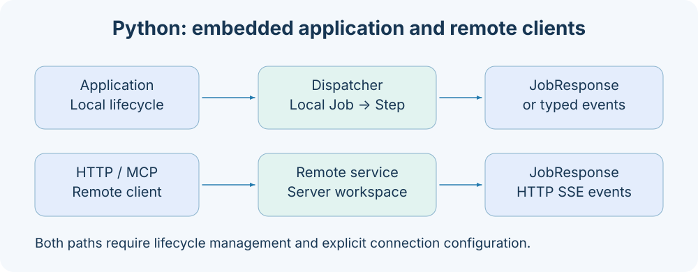

# Client and connection configuration



## ClientOptions

| Field         | Type                 | Default | Meaning                                                |
| ------------- | -------------------- | ------- | ------------------------------------------------------ |
| target        | string/null          | null    | Explicit connection address; null uses discovery rules |
| timeout       | Positive float       | 60.0    | HTTP/MCP request wait budget                           |
| token         | Nonempty string/null | null    | Protocol Bearer token                                  |
| stream        | boolean              | false   | CLI uses the event endpoint                            |
| stream_format | blocks/json          | blocks  | CLI event display format                               |

ClientOptions is a strict, frozen model that prohibits extra fields. Pass actual numeric and boolean values in Python; do not pass `stream="true"`. The CLI first performs natural-value conversion and maps `--client-timeout` to timeout. HttpClient/McpClient constructors accept only connection-related values; callers choose consumption methods for stream and stream_format.

## Address rules

```text
127.0.0.1:1024              → http://127.0.0.1:1024
https://node-b:443/         → https://node-b:443
http://[::1]:1024           → http://[::1]:1024
```

Every address must provide a port; https://node-b fails without an explicit port. Credentials, query, fragment, and non-root paths are prohibited. Do not include `/mcp` in target; McpClient appends it automatically.

When target is not explicitly supplied, the following are used in order:

1. AXONX_SERVICE_TARGET published by the service process.
2. The default http://127.0.0.1:1024.

When the service binds to 0.0.0.0, it publishes the client-accessible 127.0.0.1. This environment variable is in-process discovery information, rather than a remote-machine registry. Invalid addresses are logged and fall back to the default address.

## CLI token sources

```bash
axonx version --token your-service-token
axonx version --target node-b:1024 --token your-target-token
```

When --token is omitted, the CLI loads .env without overriding existing environment variables, then uses:

| Scenario             | Environment variable used |
| -------------------- | ------------------------- |
| No explicit --target | AXONX_SERVICE_TOKEN       |
| Explicit --target    | AXONX_TARGET_TOKEN        |

An explicit target selects AXONX_TARGET_TOKEN even when it points to the local machine. Do not assume direct connections automatically extract credentials from ApplicationConfig.targets.

```bash
axonx wait_task --task-id 'base#demo#example' \
  --run-id your-returned-run-id --client-timeout 600
axonx stream_task --task-id 'base#demo#example' \
  --stream true --stream-format json --client-timeout 600
```

Control local exec processes through their execution environment. The service exposes no Task cancellation or deletion interface. Disconnecting read-only observation does not change an independent Task execution.

## Explicit Python connections

```python
import asyncio
import os
from axonx.app.components.client import HttpClient

async def main():
    async with HttpClient(
        target="node-b:1024",
        token=os.environ["AXONX_TARGET_TOKEN"],
        timeout=120.0,
    ) as client:
        response = await client.run_job("version", {})
        print(response.model_dump(mode="json"))

asyncio.run(main())
```

Python BaseClient does not read AXONX_SERVICE_TOKEN/AXONX_TARGET_TOKEN for automatic credentials; pass token explicitly. It uses environment discovery rules only for target. Enter async with or explicitly call start/close.

## Studio same-origin forwarding

The browser requests the current same-origin `/jobs` and stores the local token in local-machine settings. After a remote machine is selected, JobInvocation's top-level target points to a configured address. The local backend matches targets and sends a remote request using that target's token.

```yaml
# Target settings in server-side app.yaml
extends: default
targets:
  - address: node-b:1024
    token: ${NODE_B_TOKEN}
```

```json
{
  "arguments": {},
  "target": "http://node-b:1024"
}
```

This example is for the local `/jobs/machine_status`. Local and remote 401 responses indicate different failures: check the browser's saved local token for the former and the backend targets token for the latter. An unconfigured address returns 422; this cannot be used to proxy arbitrary network requests.

## Worker handoff variables

Execute Tasks through CLI exec. The observing service does not create Tasks. Confirm the plugin, inputs and execution environment first.

## Handling connection failures

health() maps connection failures, protocol rejection, or invalid health responses to false. run_job() may instead raise RemoteServiceError, whose status_code is populated on HTTP rejection. JobResponse.success=false is a business failure and usually does not become that exception.

For further troubleshooting, see [Authentication](../guides/authentication.md), [Remote machines](../guides/remote-machines.md), and [Operations](../guides/operations.md).

Implementation references: `components/client/base.py`, `cli/main.py`, `utils/target.py`, `components/service/http/app.py`.
