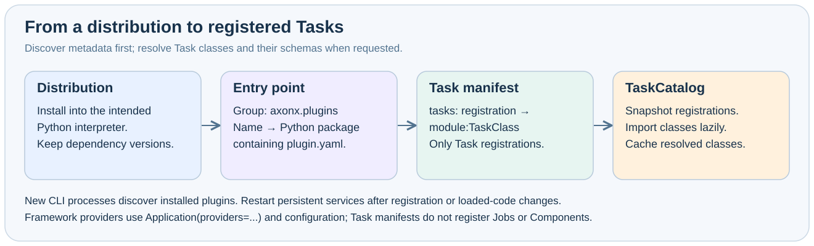

# Plugin packages and contribution contracts

A plugin is a Python distribution with an `axonx.plugins` entry point and a packaged `plugin.yaml` declaring Tasks. Discovery, installation and execution are separate.



## Three kinds of names

| Name                   | Example       | Where it is used                                         |
| ---------------------- | ------------- | -------------------------------------------------------- |
| distribution           | axonx-example | pip metadata, installation, and uninstallation           |
| plugin entry point     | example       | Plugin discovery and the package containing the manifest |
| Task registration name | example_task  | exec --task, get_task_definition.task                    |

These names need not match. A Task ID is separately composed of task type, registration name, and instance name; a distribution name cannot substitute for a registration name when executing a task.

## Minimal package layout

```text
example-project/
  pyproject.toml
  axonx_example/
    __init__.py
    plugin.yaml
    tasks.py
```

pyproject.toml:

```toml
[build-system]
requires = ["setuptools>=84.0.0"]
build-backend = "setuptools.build_meta"

[project]
name = "axonx-example"
version = "0.1.0"
requires-python = ">=3.12"
dependencies = ["axonx>=0.1.0"]

[project.entry-points."axonx.plugins"]
example = "axonx_example"

[tool.setuptools.packages.find]
where = ["."]
include = ["axonx_example*"]

[tool.setuptools.package-data]
axonx_example = ["plugin.yaml"]
```

The entry point targets a Python package; plugin.yaml must be included in the wheel. A manifest present only in source without package-data inclusion causes discovery to fail after installation.

## Manifest fields

```yaml
tasks:
  example_task: axonx_example.tasks:ExampleTask
components: {}
jobs: {}
```

| Field | Type                                       | Default | Contract                            |
| ----- | ------------------------------------------ | ------- | ----------------------------------- |
| tasks | dict[nonempty_name,nonempty_symbol_target] | {}      | Symbols must be BaseTask subclasses |

Extra top-level fields are prohibited, and the root must be a YAML mapping. Names and string targets are stripped of surrounding whitespace and must be nonempty. A `module:Class` target imports the module, then resolves attributes one level at a time. Invalid target format, missing attributes, or a symbol that does not extend the required base class causes failure. Tasks may import helpers from additional packages or standalone modules shipped in the same wheel; service installation refreshes those modules as well as the entry-point package.

Tasks must declare a fixed TaskType, input_cls, and output_cls. A detailed class docstring is recommended; description is extracted from it when definitions are queried, or returned as an empty string if it is missing or whitespace-only. See the [Existing development guide](../dev_guide.md) for a minimal Task development workflow.

All registered Tasks must follow the public authoring contract in
[`BaseTask`](../../../axonx/task/core/task.py). The research base classes in
[`axonx.task.contracts`](../../../axonx/task/contracts/) are optional standard contracts; adopting them requires
preserving their parameter fields and validation rules. See [Required authoring contracts](../dev_guide.md#required-authoring-contracts)
for implementation requirements and the distinction between core and research contracts.

## Extension boundary

`plugin.yaml` accepts only `tasks: {registration: module:Class}`. Component/Job contributions and startup `plugins.sources` are removed. Install explicitly through Plugin CLI; new exec/definition subprocesses load the installed environment. App itself does not load research plugins.

Use `Application(providers=...)` and application configuration for service components and Jobs. Duplicate Task registrations across plugins or built-ins are rejected.

## Wheels and content fingerprints

| Field          | Meaning                     | Purpose                               |
| -------------- | --------------------------- | ------------------------------------- |
| sha256         | SHA-256 of wheel file bytes | Installation artifact verification    |
| content_sha256 | Plugin content fingerprint  | Build caching and content identity    |
| requirements   | Wheel dependency metadata   | Installation environment requirements |

Identical source content and caching do not guarantee identical wheel bytes; do not substitute content_sha256 for the wheel SHA256 calculated by the local builder. Remote install must receive the path returned by POST /upload and that local wheel SHA256. Editable installation applies only to local source environments and cannot be deployed remotely.

```bash
axonx plugin inspect ./plugins/example
axonx plugin build ./plugins/example --output ./dist
axonx plugin install ./plugins/example
axonx plugin list
```

These commands inspect, build, or install using paths in the selected environment. Installation does not refresh loaded service objects. New exec/definition processes load current schemas. See [Plugin management](../plugins/management.md#checksums-and-service-state).

## Named configuration contributions

The same package can also publish an axonx.configs entry point:

```toml
[project.entry-points."axonx.configs"]
example = "axonx_example.config:example"

[tool.setuptools.package-data]
axonx_example = ["plugin.yaml", "config/*.yaml"]
```

If attr is an existing object, the resolver loads it and, if callable, calls it to obtain a YAML/JSON path. Otherwise, it treats the target package as a directory and locates the corresponding configuration file by attr/name. The result must identify an actual configuration file. Ambiguous identical configuration names are rejected rather than silently selecting one.

The repository's qlib_a158 uses the separate distribution axonx-qlib-a158, plugin entry point qlib_a158, and package axonx_qlib_a158, providing a real package-layout reference.

## Related documentation

- [Plugin management](../plugins/management.md)
- [Plugin API](../api/plugins-sync.md)
- [CLI reference](cli.md)

Implementation references: `axonx/plugin/manifest.py`, `loading.py`, `contributions.py`, `wheel.py`.
