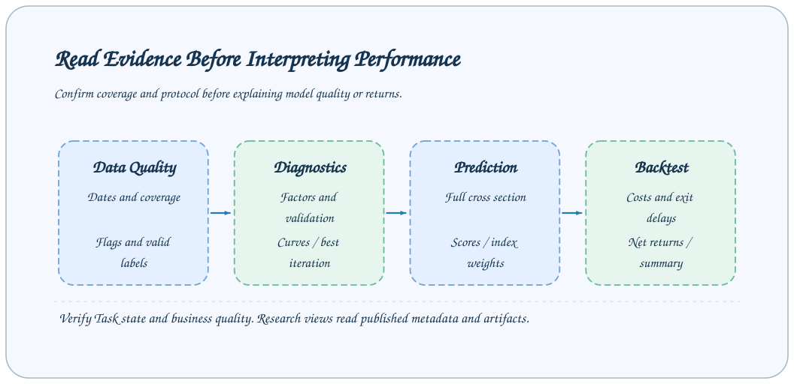

# Research artifacts and Studio presentation contracts

Research file records use `revision="<size>:<mtime_ns>"`, not content checksums. Publication, input snapshots, online history and replay check file size and modification time rather than hashing payload bytes. Copies preserve nanosecond mtime; published files must be immutable and replaced atomically. Metadata checks cannot detect edits preserving both size and mtime. Model identity fingerprints member revisions; configuration and source-code fingerprints remain SHA-256.

Research Tasks publish results through typed `output_params`. Studio extracts presentation fields from successful tasks' `metadata.json`, then reads artifacts through file previews. This page distinguishes three layers of requirements: required Python base-class fields, fields actually read by Studio, and extension contracts of specific plugins.



## Shared protocol v1

AxonX owns the shared research protocol in `axonx.task.models.artifacts`. Research protocol headers require `version=1` and a `TaskType` value in `task_type`. Readers reject missing headers and other versions.

Training uses `ModelCollection`: the registered `artifacts.model_manifest` points to one `models.json` containing the feature contract, training context, named members, model configurations and verified artifact references. Each member references an artifact by name; its revision lives only in that artifact record. Task outputs retain training summaries and curves, without duplicating the collection or model paths.

Offline and online prediction use `PredictionProtocol`, with producer type `predict` or `inference`. It stores one nonempty `model_identity: dict[str, str]`, covered `dates`, `score_columns` and `predictions_revision`. The Qlib plugin uses `models_sha256` and `features_sha256` identity entries; the shared type allows plugin-defined string keys and values. Dates and paths are not model identity. Predictions do not duplicate identities for each date. Qlib feature contracts and fingerprints come from the plugin module `axonx_qlib_a158.internal.protocol`; fingerprints include semantic rules and ordered features, excluding locations, date coverage and quality counters. `snapshot_model_collection` in `axonx.task.storage.inputs` verifies portable model snapshots. Artifacts remain exclusively in `output_params.artifacts` on Task records; package release versions are independent.

## Mapping metadata to artifacts

Standard Task records store identity, input parameters, output parameters, and related information at the metadata top level. Research fields belong in `output_params`; placing them at the top level does not make Studio recognize them automatically.

The following is a structural excerpt, rather than complete TaskMetadata:

```json
{
  "output_params": {
    "artifacts": {
      "dataset": {
        "path": "alpha158.parquet",
        "size": 1024,
        "revision": "1024:1700000000000000000"
      }
    }
  }
}
```

The example size and revision only illustrate fields; calculate actual values from generated files. `artifact_record(path, task_dir)` generates a relative path, byte size, and revision. `verify_artifact(task_dir, ArtifactRecord.model_validate(record))` resolves a record and checks that a regular file matches its recorded size and revision. Paths escaping the Task directory or traversing symlinks are rejected.

`BaseOutputParams.artifacts` is `dict[str, ArtifactRecord]`. Every output validates each relative path, nonnegative byte size and file revision. `task.artifact_path(name)` resolves a published output without a separate absolute-path field.

`task.artifact_path(name)` resolves a path without verifying file contents or revision. Use `upstream_artifact()` to require a successful non-replica producer and verify one artifact; use `pin_upstream_artifacts()` to copy verified inputs into the consumer's `inputs/` directory. `snapshot_model_collection()` verifies the manifest and each referenced model member. These checks use size and mtime, rather than content hashes, and do not establish semantic data compatibility.

## Five base output types

Required below means the model has no default; not every field is displayed separately in Studio.

| Type     | Required base-class fields                  | Optional or default base-class fields                      |
| -------- | ------------------------------------------- | ---------------------------------------------------------- |
| ETL      | `rows`, `date_range`                        | `feature_columns=[]`, `label_columns=[]`                   |
| Analysis | `rows`                                      | `scores={}`                                                |
| Train    | `train_rows`                                | `model_name`, columns, metrics, parameters, training_curve |
| Predict  | `protocol`, `rows`, `date_range`            | `output_columns=[]`, `statistics={}`                       |
| Backtest | `default_universe`, `universes`, `protocol` | Shared `artifacts={}`                                      |

A `model_manifest` artifact is required by the Qlib prediction consumer, rather than by `BaseTrainOutputParams` itself.

All types extend `BaseOutputParams`; output subclasses must declare extra fields or `extra=forbid` validation fails. `date_range` is a string mapping; pages read `start` and `end`, so producers should use these keys.

Training members are declared only in the model manifest. Prediction score mappings are declared only in `protocol.score_columns`, and prediction data is registered as `artifacts.predictions`. Single-member producers use the same collection contract. Stock plugins select or aggregate raw scores before invoking the shared backtest ledger; `pred` is the final selection score.

Member count distinguishes single-member from multi-member output, independently of prediction target count.

## ETL artifacts

The base class stores output-file descriptions and column names. qlib_a158 adds feature_count, symbols, schema, protocol, market_state, and related information, producing:

| Artifact name | File               | Purpose                                                   |
| ------------- | ------------------ | --------------------------------------------------------- |
| `dataset`     | `alpha158.parquet` | Source data for training, factor analysis, and prediction |
| `statistics`  | `alpha158.csv`     | Quality statistics for each feature column                |
| `labels`      | `labels.parquet`   | Fixed-next-market-day raw returns and availability        |
| `market`      | `market.parquet`   | Quotes, adjustment factors, execution flags and states    |
| `calendar`    | `calendar.parquet` | Market dates independent of prediction eligibility        |

All consumers resolve output files through the task-relative `artifacts` registry. ETL, analysis, prediction and training register task-relative output paths.

## Factor-analysis scores

`scores` has the shape “group name → metric name → value”:

```json
{
  "scores": {
    "quality": { "mean_abs_ic": 0.03, "positive_ratio": 0.6 },
    "coverage": { "valid_days": 120.0 }
  }
}
```

This illustrates a valid shape rather than a fixed qlib_a158 metric set. Studio dynamically iterates groups and metrics. Plugins should ensure metric names and definitions are understandable and explain samples, units, and calculation scope in detailed files or extended definition fields.

qlib_a158 actually generates `factor_analysis.csv` and `factor_quantiles.csv`, mapped as `result` and `quantiles`, respectively, and stores extension fields such as definitions and labels.

## Training curve model

`TrainingCurve` is an explicitly validated model:

```json
{
  "x": ["1", "2", "3"],
  "y_left": {
    "train_l2": [0.09, 0.07, 0.06],
    "validation_l2": [0.1, 0.08, 0.085]
  },
  "y_right": {
    "validation_l1": [0.22, 0.2, 0.205]
  }
}
```

Requirements:

- x contains ordered string labels; all series align by position.
- Every series has exactly the same length as x, and every numeric value is finite.
- Nonempty x requires at least one left-axis series; the right axis cannot exist alone.
- Series names cannot repeat across the left and right axes.
- Empty x and empty groups on both axes indicate no curve data.

Series within the left-axis group should use similar units and numeric ranges; the right axis is only for a second scale group. The protocol does not support a third numeric axis. Studio reads the validated training curve directly from `output_params.training_curve`; chart rendering filters mismatched series and nonfinite values.

qlib_a158 places L2 on the left axis and L1 on the right; the curve is the tuning model's training/validation history. `model`, `feature_importance`, and `evaluation_history` reference the final model, feature importance, and history CSV, respectively.

## Prediction statistics

The base-class `statistics` field is an extensible mapping. Studio currently reads:

```text
statistics.days / symbols
statistics.pred.mean / min / median / max
statistics.buyable_rows / candidate_rows
statistics.indices.<column>.constituents / days_with_weights / null_rows
```

Missing fields appear as empty values on the page; this does not mean every prediction plugin must provide qlib_a158's stock statistics. qlib_a158 uses the artifact name `predictions` and file `predictions.parquet`.

Stock backtesting uses the shared `axonx.task.builtins.stock` contract. Prediction rows contain `trade_date`, `trade_time`, `ts_code`, `pred`, `is_model_candidate`, `is_buyable_at_signal`, `signal_price`, and `signal_adjustment_factor`; eligibility flags are non-null Boolean values. qlib_a158 also publishes `name`, `rank`, `buyable_rank`, and index weights. Predictions contain no future labels. ETL publishes independent `dataset`, `labels`, `market`, and `calendar` artifacts; `labels` stores `label_target_date`, `label_return`, `label_valid`, and `label_status` alongside the signal keys. Rank/CSZ targets are computed only during training after cutoff and sample filtering.

## Prediction inputs for stock backtesting

`BaseStockBacktestTask` reads these 8 required columns from prediction Parquet files. Both Alpha158 plugins publish this contract in `predictions.parquet`.

| Required column            | Type and constraints                                            | Meaning                                                              |
| -------------------------- | --------------------------------------------------------------- | -------------------------------------------------------------------- |
| `trade_date`               | Non-null string, valid YYYYMMDD, present in the market calendar | Signal date                                                          |
| `trade_time`               | Non-null string, valid HHMM; one signal time per backtest       | Signal time, for example `1500`                                      |
| `ts_code`                  | Non-null string                                                 | Stock identifier                                                     |
| `pred`                     | Non-null finite numeric value                                   | Ranking score; higher ranks first; not a return or probability       |
| `is_model_candidate`       | Non-null Boolean                                                | Model candidate eligibility                                          |
| `is_buyable_at_signal`     | Non-null Boolean                                                | Signal-time buyability filter                                        |
| `signal_price`             | Non-null finite numeric value                                   | Signal reference quote, stored separately from its adjustment factor |
| `signal_adjustment_factor` | Non-null finite numeric value                                   | Adjustment factor for the signal reference quote                     |

The prediction table must be nonempty, and the composite key `(trade_date, trade_time, ts_code)` must be unique and non-null. Stock identifiers and signal times must use the same conventions as the market table. Reference prices and adjustment factors should be positive according to their price meaning. Both eligibility flags must be `true` to enter the selection candidate pool, intersected with the plugin-selected universe.

These columns are optional for the base backtest:

| Optional column        | Use                                                                                                                                                                       |
| ---------------------- | ------------------------------------------------------------------------------------------------------------------------------------------------------------------------- |
| `name`                 | Display name in details; defaults to `ts_code` when omitted                                                                                                               |
| `rank`, `buyable_rank` | Prediction-side helper ranks; backtesting computes target ranks from `pred` descending and `ts_code` ascending                                                            |
| `index_weight_<code>`  | Decimal index weights; positive weights indicate index membership; plugins select index universes with these columns; weight columns also supply benchmark return proxies |

Predictions need no feature columns, `actual_return`, future labels or future execution dates. `signal_price` and `signal_adjustment_factor` are signal reference information; execution and daily valuation use `price`, `adjustment_factor` and trading states from the independent `market` table.

Backtesting also requires independent `market` and `calendar` artifacts. Optional `labels` supplies IC, RankIC, NDCG, target label returns and benchmark returns; the portfolio ledger can run without labels. For explicit files, pass `input_file`, `market_file`, `calendar_file` and optional `labels_file`, where `input_file` is prediction Parquet.

When resolving a Predict Task ID, prediction metadata must publish an artifact record (relative `path`, `size`, `revision`) under `output_params.artifacts.predictions` and declare `output_params.protocol.version=1`. `protocol.market_source_task` identifies the ETL Task supplying market, calendar and labels; an ETL source can also be supplied explicitly in `upstream_task_ids`, or the corresponding file paths can be provided. Task resolution verifies source artifact sizes and modification times. `statistics` is presentation information, not a selection input.

## Backtest dimensions and protocol

```json
{
  "default_universe": "all",
  "universes": {
    "all": {
      "label": "All market",
      "parameters": {},
      "dimensions": {
        "top_ns": [1, 5, 10, 30],
        "holding_detail_top_n": 30,
        "benchmarks": [
          {
            "key": "universe",
            "label": "Universe"
          }
        ]
      },
      "date_range": {
        "start": "20230103",
        "end": "20231229"
      },
      "days": 250,
      "evaluation_status": "done",
      "artifacts": {
        "daily": "all_daily",
        "summary": "all_summary"
      }
    }
  },
  "protocol": {
    "version": 1,
    "task_type": "backtest",
    "return_unit": "decimal"
  },
  "artifacts": {
    "all_daily": {
      "path": "universes/all/daily.parquet",
      "size": 1234,
      "revision": "1234:1700000000000000000"
    },
    "all_summary": {
      "path": "universes/all/summary.parquet",
      "size": 1234,
      "revision": "1234:1700000000000000000"
    }
  }
}
```

This illustrates a valid base-class structure. The shared stock Task publishes execution, valuation, allocation, fee, cutoff, and input-digest definitions in `protocol`, and `evaluation_status` identifies incomplete market data. The page is not a backtest engine that automatically validates protocol text; plugin authors must clearly state actual execution behavior and units.

Studio loads two tables from the selected report’s `artifacts.daily` and `artifacts.summary` references in the root artifact registry, requesting 5000 rows per page and continuing according to `has_more` until the complete tables are read. Satisfying the Backtest output model alone does not guarantee usable charts.

Each universe is an independent report with its own dimensions, dates, status and artifact references. Studio selects `default_universe` initially and offers a dropdown; comparison selects a universe independently on each side.

Plugins inherit `BaseStockBacktestTask`, implement `build_universes()` returning `BacktestUniverse` definitions and `select_universe(signals, universe)` returning unique `(trade_date, trade_time, ts_code)` keys. The selector receives signal-time data; labels and future prices are not selector inputs. The framework verifies keys, runs separate ledgers, and publishes each report under `universes/<key>/`. Optional `universe_events()` creates fresh event state per report. Shared predictions and labels are loaded once.

## Unified backtest signals

The `signals.parquet` table retains every input signal and contains non-null Boolean `is_backtest_candidate`, nullable `target_rank`, and nullable `label_return`. Filtering the candidate flag yields the backtest candidate table. Missing labels do not remove candidate membership.

Backtest outputs and online reports declare `signals_format: stock-signals-v1`. Readers validate this field before loading the selected universe’s artifact references.

## Presentation fields in the daily table

| Field                                    | Current Studio use                                                         |
| ---------------------------------------- | -------------------------------------------------------------------------- |
| `trade_date`                             | Date axis and date alignment between two strategies; uses YYYYMMDD strings |
| `candidate_count`                        | Candidate count                                                            |
| `ic`, `rank_ic`                          | Signal curves and moving averages                                          |
| `topN_net_return`, `topN_gross_return`   | Net compounded and gross additive curves                                   |
| `topN_turnover`, `topN_transaction_cost` | Turnover and cost inspection                                               |
| `topN_ndcg`                              | Ranking diagnostics for each configured Top N                              |
| `benchmark_<key>_return`                 | Benchmark return curves declared in dimensions                             |
| `top30_holdings`                         | Currently fixed Top 30 details                                             |

Details are arrays of structures; the frontend reads `rank`, `ts_code`, `name`, `prediction`, `daily_return`, and `weight`. `daily_return` is the fixed-next-market-day label and is null when unavailable at the cutoff. Actual entry/exit dates and delayed exits belong to the `positions` and `trades` artifacts; fills and unfilled reasons belong to `orders`.

The current page hardcodes `top30_holdings`; changing holding_detail_top_n does not automatically select another column. In qlib_a158, this field represents signal targets and includes candidates that did not trade; it must not be described as an actual holdings ledger.

## Presentation fields in the summary table

Each row uses `period_type` to identify `overall`, `year`, `quarter`, or `month`, and supplies `period`, `period_start`, `period_end`, and `trading_days`.

Signal fields include `ic_mean`, `icir`, and `rank_ic_mean`. Each Top N has:

```text
topN_net_cumulative_return
topN_net_annualized_return
topN_net_annualized_volatility
topN_net_max_drawdown
topN_net_win_rate
topN_average_turnover
topN_gross_cumulative_return
topN_gross_sharpe
topN_information_ratio_<benchmark key>
```

Replace N with the actual numbers in dimensions. The summary table is plugin output; return charts and strategy comparisons are calculated in the browser. qlib_a158 compounds gross cumulative summary returns, while its gross return chart is additive. See [Backtest interpretation](../research/backtest.md) for calculation conventions.

## Windowed work, online history and replay

`BaseWindowTask` runs ordered `ExecutionWindow` inputs with timezone-aware start/end times. It publishes each `WindowResult` as `done`, `skipped`, `incomplete` or `failed`. These are business outcomes, separate from the Task lifecycle state. `BaseRealtimeApiTask` polls `collect()`; `BaseInferenceTask` fixes a nonempty model identity for the entire execution. Bound network calls and retries by `DeadlineBudget.remaining_seconds`.

`OnlineStore` stores immutable commit files under `persistent/online/commits/<commit_id>/` and atomically publishes selected history through `persistent/online/manifest.json`. Commits record the producing `task_id`, `started_at`, signal date/time, consecutive per-signal revision, model identity, protocol and artifact records. A changed strategy identity requires a new instance name. Use `read_online_history()` for both full manifests and frozen history chains, and `pin_online_history()` to verify and snapshot referenced files into a consumer before reporting or replay.

`ReplayStream.create()` snapshots files and publishes `stream.json` into a new directory; it refuses to overwrite an existing dataset. Opening a stream verifies every referenced payload by size/revision. Events are ordered by timezone-aware `available_at`. Inject `ReplayClock` into the Task and use `ReplayCursor` to deliver events strictly before the business deadline. Only the creating thread advances replay time; lifecycle timestamps and execution measurements still use real time.

## Producer acceptance checks

1. Validate output_params with the actual output subclass.
2. Write files first, then call artifact_record and publish metadata.
3. Resolve and verify every registered artifact with `verify_artifact`; pin upstream files before consuming them.
4. Check dates, numeric units, boolean columns, and arrays of structures against current Studio fields.
5. Validate curves and downstream contracts, retaining explicit execution descriptions in protocol.

Do not manually substitute placeholder digests for real files or alter metadata to conceal a failed execution. All charts depend on shared contracts between their producers and readers.

## Studio wire contracts

Studio keeps the task record and its nested `output_params`, without a flattened research copy. Research and comparison pages share a filtered task-index query; filtering precedes deep copying. Online report settings live only in `report.commit.protocol.report`. Agent history responses expose display blocks; original transcripts stay in the session store. Run `npm run contracts:generate` and `npm run contracts:check` in `axonx_studio/` after changing Python wire contracts.

## Implementation references

- [`Base research models`](../../../axonx/task/models/)
- [`Artifact helpers`](../../../axonx/task/storage/artifacts.py)
- [`Studio reading mappings`](../../../axonx_studio/src/features/research/ResearchPage.tsx)
- [`Backtest presentation types`](../../../axonx_studio/src/features/research/backtest/types.ts)
- [`qlib_a158 output implementations`](../../../plugins/qlib_a158/axonx_qlib_a158/)
