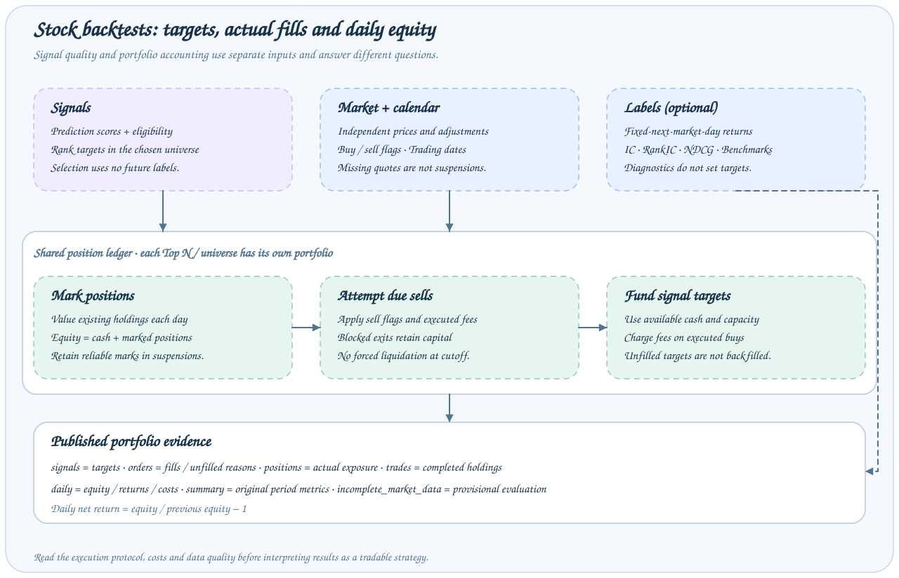
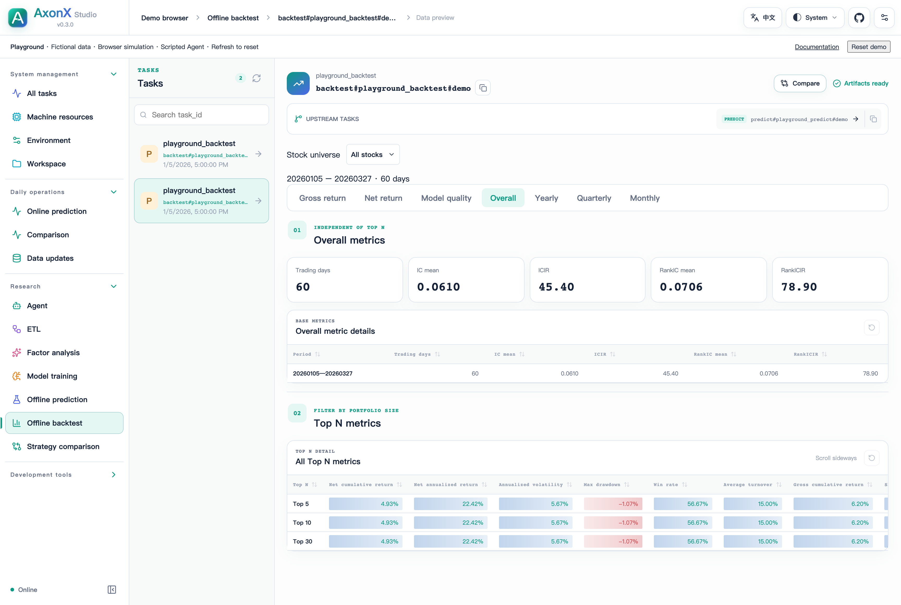
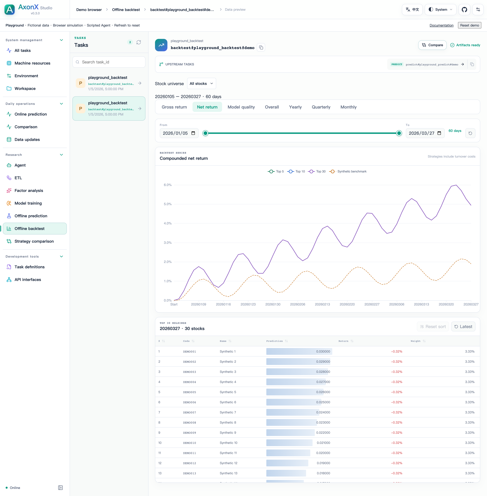

# Interpreting Backtest Results

Alpha158 and enhanced Alpha158 use the same `BaseStockBacktestTask` and position ledger. The ETL publishes separate signal-time features, fixed-day labels and market data artifacts.

The shared implementation lives in `axonx.task.builtins.stock`; new plugins should import from this package.



## Data contracts



[Full-resolution screenshot](../../figures/studio/backtest-overall.png)

The complete screenshot shows Playground's synthetic backtest with **Overall** selected. Its metrics illustrate the UI and are not an Alpha158 result.

The Studio backtest page places the universe selector and report before the artifact inventory. Each published file appears once in the inventory below the report.

ETL publishes four independent artifacts:

| Artifact   | Meaning                                                                                         |
| ---------- | ----------------------------------------------------------------------------------------------- |
| `dataset`  | Signal-time features, eligibility, reference price and adjustment factor                        |
| `labels`   | Raw decimal return to the next market date at the same time, target date and availability state |
| `market`   | Independent quotes, adjustment factors, buy/sell proxies and market status                      |
| `calendar` | Market trading dates, including dates without eligible predictions                              |

Keys are `trade_date` (YYYYMMDD string), `trade_time` (HHMM string), and `ts_code`. Labels never remove feature rows or prediction candidates. A suspension invalidates the corresponding fixed-day label; it does not substitute a later resumption return. Training computes rank/CSZ only after filtering the exclusive cutoff, selecting eligible rows and handling tails. Temporal fitting and validation use their own reference samples.

`market_status` is `quoted`, `suspended`, or `missing_data`. ETL can consume a separate `market_status_file` with the keys and explicit suspension/missing states. Absent quotes are not evidence of suspension. Confirmed signal-day suspension or missing status disables signal buyability even if a stale quote remains; model candidate rows are retained.

## Inputs

For required prediction columns, optional columns and metadata requirements, see [Prediction inputs for stock backtesting](../reference/research-artifacts.md#prediction-inputs-for-stock-backtesting).

```bash
axonx exec --task qlib_a158_portfolio --upstream-task-ids '["<Predict Task ID>"]' --top-ns '[5,10,30]' --holding-days 1
axonx exec --task qlib_a158_backtest --upstream-task-ids '["<Portfolio Task ID>"]' --buy-cost-rate 0.0005 --sell-cost-rate 0.0015
```

Construct Portfolio before Backtest. Universe, score aggregation, TopN and strategy parameters belong to Portfolio; each readable identity has an independent account. Backtest resolves ETL through its Portfolio source or takes explicit `market_file`, `calendar_file`, and optional `labels_file`. `portfolio_ids` selects a subset and `as_of_date` sets the valuation cutoff. Default side fees are 0.0005/0.0015, annualization uses 252 days, and the annual risk-free rate is 0.012.

## Execution and valuation

Signals rank by score descending, then symbol ascending. Selection does not consult future labels. The engine marks existing positions, attempts due sells, and then funds same-day targets from available cash. An unfilled target is not replaced by a lower-ranked stock. Already-held stocks, position capacity and available cash constrain new purchases.

A blocked exit retains both its position and its capital. Confirmed suspension carries the last reliable adjusted-price mark; a later quoted date updates valuation and permits another exit attempt. Missing data affecting held or selected stocks sets `evaluation_status=incomplete_market_data`; the provisional result remains inspectable. No position is forcibly liquidated at the cutoff.

`missing_market_as_suspension=true` temporarily treats absent quotes and explicit `missing_data` as suspensions during backtesting. It retains the last mark, blocks trading and does not mark the evaluation incomplete for those gaps. This assumption is recorded in task inputs; it does not rewrite market artifacts or labels. The shared default is `false`. TODO: integrate independently sourced suspension intervals to distinguish suspensions from data gaps.

The same-time quote is an execution proxy. It does not guarantee that a signal computed after a bar or closing auction can fill at that price, nor model queues or partial fills. Inspect the stored execution protocol before interpreting results as a tradable strategy.

```text
Equity = cash + pending event receivables + marked position value
Daily net return = equity / previous equity - 1
Daily cost = (executed buy/sell costs + event costs) / previous equity
Daily gross return = daily net return + daily cost
Turnover = (executed buy/sell notional + cash-event notional) / previous equity
```

Adjusted-price units preserve value across corporate-action price changes. Marked gains are not booked again on exit. Costs apply to the initial purchase as well as later trades.

Plugins can supply an `events` handler that resets per Top N, processes the book before trading and exposes `pending_cash`, `transaction_cost` and `executed_notional` for each step. Net receivables count toward NAV but cannot fund buys until released. Event costs enter daily cost and gross return; event notional enters turnover. The book maps each security to a list of original position records, preserving individual costs, entry dates and exit dates when conversions combine holdings. A non-null `tradable_at` locks a position until the handler releases it. Adjusted `units` remains null while any converted position awaits its first tradable quote, avoiding sums of physical shares and adjusted units. Position rows aggregate by security; completed trades retain the original position dates and costs. Event terms and audits belong to the plugin.

## Outputs

| Artifact    | Meaning                                                                       |
| ----------- | ----------------------------------------------------------------------------- |
| `daily`     | Calendar-aligned returns, equity, cash, open positions and signal diagnostics |
| `summary`   | Overall, yearly, quarterly and monthly statistics                             |
| `orders`    | Actual fills and unfilled reasons                                             |
| `positions` | Actual daily holdings, adjusted units, weights and market values              |
| `trades`    | Completed holding periods, actual entry/exit prices, returns and fees         |

`daily` retains `topN_*` columns and `dimensions` describes available portfolio sizes and benchmarks. `top30_holdings` is a signal target list; it is not the actual position book. Use `positions` for actual exposure. Unfinished positions remain in that artifact even when no completed trade exists.

## Signal diagnostics and benchmarks



[Full-resolution screenshot](../../figures/studio/backtest-net-return.png)

The **Net return** tab combines the date window, return chart, and signal-target table. This complete screenshot uses the same synthetic backtest.

IC, RankIC and NDCG use the same signal-day buyable candidate pool as target selection, including the selected plugin universe. IC and RankIC compare scores with valid fixed-one-market-day raw returns. NDCG measures top-ranked signal quality against the same available return sample; missing labels do not refill the selected ranking. These diagnostics belong to the signal date. Returns and valuation belong to the portfolio calendar date.

`benchmark_universe_return` is an available-signal cross-section mean. `index_weight_*` produces weighted return proxies only when coverage meets the configured threshold. They are not official total-return index series. Benchmark returns use the label target date, so their period aligns with portfolio valuation.

Studio selects a report through one dropdown per top-level `portfolio_id` key, such as `universe`, `strategy`, and `top_n`. Choices cascade to existing portfolios and retain other values where possible; fields with one choice are disabled. Nested values display their parameters in the dropdown. This selector is shared by the Portfolio, Backtest, and comparison pages.

Studio reads the selected `portfolios[index]` report, resolving its daily and summary references through the root artifact registry. Net-return charts compound daily net returns, while the accumulated-gross chart sums daily gross returns; the latter need not equal compounded gross return in the summary. Period tables are task-generated and do not automatically rerun when the chart range changes.

Studio derives return and NDCG series from `dimensions.top_ns`, displays incomplete market-data evaluations as provisional, and exposes all portfolio artifacts. Prediction statistics describe signal-time scores and eligibility; prediction outputs contain scores and signal-time eligibility without future returns or valid-return coverage. Empty statistics and missing labels display as unavailable.

Studio comparison preserves `signals_format` from Task metadata and reads available display-replica artifacts. Stock backtests declare `signals_format: stock-signals-v3` and register their daily and summary tables through artifact references. Benchmark information-ratio headers use the labels declared in `dimensions.benchmarks`.

`net_relative_max_drawdown_<benchmark>` shares daily active returns with net IR (net strategy return minus the same-day benchmark). Compound these as `∏(1 + active return)`, then measure maximum drawdown from the running peak, including initial equity of 1. Values are nonpositive decimals; overall, year, quarter and month reset independently. Only paired finite observations are used; no valid observations yields null. Studio displays each declared mean/index benchmark. Unavailable values display `—`.
