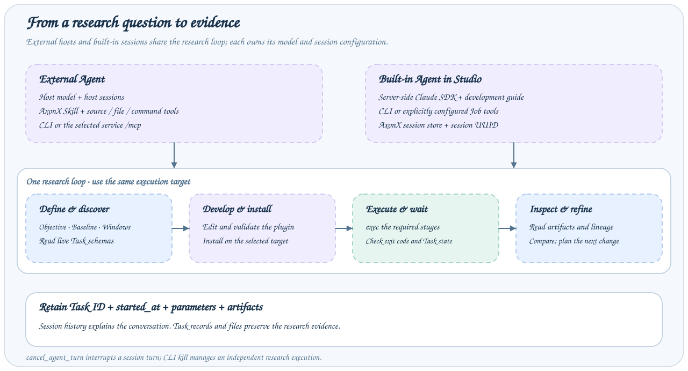

# Agent 开发

AxonX 为 Agent 开发研究插件、执行实验和检查证据提供工具。先选择宿主，准备代码工具与执行服务，再明确研究目标。



## 选择路径

|            | 外部 Agent                                              | 内置 Agent                             |
| ---------- | ------------------------------------------------------- | -------------------------------------- |
| 入口       | Codex、Claude Code 等宿主                               | Studio → Agent，或 `agent_chat` Job    |
| 模型配置   | 外部宿主负责                                            | 服务端 Claude Agent SDK 配置           |
| AxonX 连接 | CLI 直连或服务 `/mcp`                                   | 内置组件通过 Dispatcher 调用配置的 Job |
| 操作说明   | [AxonX Skill](../../../skills/axonx/SKILL.md)与开发指南 | 可按需加载随包分发的开发指南           |
| 工具范围   | CLI 可用命令或服务公开 MCP 目录                         | `job_tools` 与 SDK 自身工具、权限设置  |
| 会话记录   | 外部宿主管理                                            | AxonX 会话存储管理                     |

外部 Agent 接入不要求配置 `CLAUDE_CODE_*` 或开启内置开发指南。内置 Agent 默认加载开发指南，按指南使用 CLI；进程内 `job_tools` 桥接为可选配置。外部 MCP 公开目录可能包含查询、文件变更和 `cli` 命令 Job。Task 执行、停止和插件安装分别使用其 `exec`、`kill` 和 `plugin` 命令。实际能力以所用路径的配置与 Schema 为准。

## 准备环境

1. 提供 AxonX 源码仓库与待修改插件。仅安装 Python 包不会提供示例插件源码。
2. 让 Agent 阅读 [AxonX Skill](../../../skills/axonx/SKILL.md)，或按宿主支持的机制安装。内置 Agent 也可加载随包提供的[开发与运行指南](../dev_guide.md)。
3. 提供可访问源码的文件与命令工具。内置 Agent 的 `cwd`、SDK 工具与指南加载分别配置，见[内置配置](configuration.md)。
4. 确定执行服务，准备该服务中的插件、依赖和数据。后续安装、提交、等待与查询使用同一目标。

外部 Agent 的模型由宿主配置；内置 Agent 的模型由服务端配置。AxonX 服务 token 与模型凭据分别设置。

先完成[快速开始](../getting-started/quickstart.md)。Skill 使用绝对源码 URL，可独立复制；示例源码路径相对于仓库根目录。不要将 token 放入 Prompt 或报告。

## 验证 CLI 接入

使用 CLI 的 Agent 需要能运行 `axonx`。远程连接先设置 `AXONX_TARGET_TOKEN`，后续保持相同 `--target`。不带目标的 `plugin list` 查询 CLI 解释器，带目标则查询该服务。连接方式见[远程接入](../guides/deployment.md#远程接入)与[客户端配置](../reference/client-configuration.md)。

```bash
axonx version --target 192.0.2.10:1024
axonx get_task_def --task demo --target 192.0.2.10:1024
axonx exec --task demo --task-name agent-check --x 2 --y 3 --target 192.0.2.10:1024
axonx status --task-id 'base#demo#agent-check' --detail full --target 192.0.2.10:1024
```

替换示例地址。Exec 等待并输出业务结果，核对退出码、Task 状态和 `started_at`。连接取消可能停止所拥有的进程，重试断开的命令前先检查记录。

## 研究 Prompt

```text
阅读 AxonX Skill 与 qlib_a158 源码，开发独立研究插件，
探索残差波动与下行风险能否改善 Alpha158 排序。

仅使用信号时点可得的信息。比较因子时固定数据快照、标签、
样本筛选、训练参数、窗口与交易成本。先明确开发窗口、
候选选择规则和独立确认窗口；缺少必要条件时先列出缺口。

实现并测试量化代码，注册插件，再安装到指定执行服务。
查询该服务的实际 Task Schema，核对上游兼容性，
依次执行 ETL、训练、预测与回测，每次等待上游成功。

保留代码版本、数据设定、参数、成本、实际 Task ID 和 metadata `started_at`。
报告 RankIC、净收益、回撤、换手、失败与证据限制。
锁定候选后再做独立确认，根据证据提出下一轮改动。
```

也可以指定训练性能优化或持仓策略改进。改特征通常重跑完整研究链；改模型可复用兼容 ETL；改持仓策略可复用兼容预测。是否可复用取决于实际 Task Schema、字段、特征顺序与产物协议。

## 共同的研究循环

1. 明确研究目标与控制条件，提供 Skill、源码仓库和代码工具。
2. 开发或优化插件，验证代码，再安装到选定的执行服务。
3. 查询实际 Task Schema，检查上游兼容性，执行所需阶段。
4. 记录各 Task ID 与 metadata `started_at`，确认上游成功后再运行下一阶段。
5. 检查产物、比较结果，根据证据继续调整代码或参数。

通过 CLI 直连时，各阶段持续使用同一 `--target`；在 Studio 中选择机器时，请求经同源后端转发。任务、数据和插件位于执行服务的环境，接入 Agent 不会自动迁移它们。

## 验证与后续阅读

源码修改、执行服务安装与 Task 提交分开完成。代码测试通过说明实现得到检查；研究指标与独立确认决定是否支持改进结论。Task 成功表示执行完成。

开发步骤见[开发与运行指南](../dev_guide.md)，阶段命令见 [Alpha158 研究流程](../research/workflow.md)，比较方法见[实验设计](../research/experiments.md)，完整实例见 [Alpha158 改进实验](../research/alpha158-case.md)。

报告执行目标、Task ID 与启动时间、终态、参数、产物、指标和证据限制。内置 Agent 的配置与会话操作见[配置](configuration.md)和[使用](usage.md)，外部工具发现见 [MCP 接入](mcp-integration.md)。
