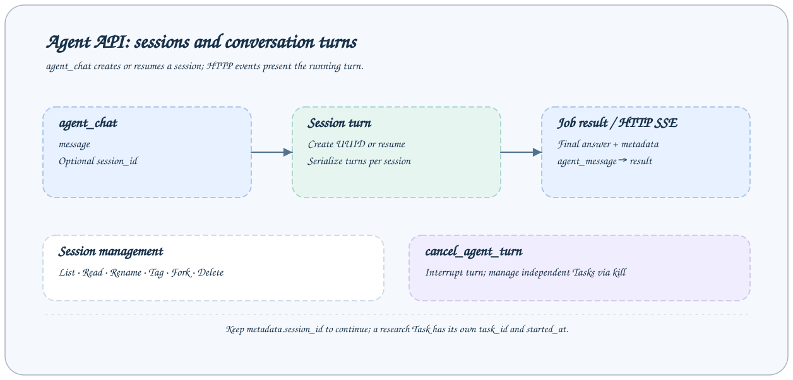

# Agent 会话 API

会话属于配置的 Agent 后端并存储在 session store，使用实际后端会话 UUID。

所有下列 Job 使用 `POST /jobs/NAME` 和 `{"arguments": {...}}` 请求体。流式入口为 `/jobs/NAME/events`，MCP 使用相同 Job 名和业务参数。先调用 `help --job NAME` 获取目标服务实际 Schema。示例中的 Task/会话 ID 必须替换为实际值。



## 接口列表

| Job                    | 用途                                            |
| ---------------------- | ----------------------------------------------- |
| `agent_chat`           | 在工作区内执行一轮交互式 Agent 对话。           |
| `list_agent_sessions`  | 列出工作区的 Agent 会话，按最新时间排序。       |
| `get_agent_session`    | 读取一个 Agent 会话及其可见消息历史。           |
| `rename_agent_session` | 设置 Agent 会话的自定义标题。                   |
| `tag_agent_session`    | 设置或清除 Agent 会话标签。                     |
| `delete_agent_session` | 永久删除 Agent 会话及其子 Agent 的 transcript。 |
| `fork_agent_session`   | 分叉 Agent 会话，可指定截止消息 UUID。          |
| `cancel_agent_turn`    | 中断 Agent 会话正在执行的对话轮次。             |

## agent_chat

在工作区内执行一轮交互式 Agent 对话。

| 参数         | 类型     | 必填 | 默认/约束                                                                                                  |
| ------------ | -------- | ---- | ---------------------------------------------------------------------------------------------------------- |
| `message`    | `string` | 是   | `{"minLength":1}`                                                                                          |
| `session_id` | `string` | 否   | `{"pattern":"^[0-9a-fA-F]{8}-[0-9a-fA-F]{4}-[1-8][0-9a-fA-F]{3}-[89aAbB][0-9a-fA-F]{3}-[0-9a-fA-F]{12}$"}` |

```json
{
  "arguments": {
    "message": "Inspect the workspace and summarize available evidence"
  }
}
```

省略 session_id 创建会话，传入则恢复已存上下文。展示补丁建议使用 SSE，模型轮次与研究进程生命周期独立。

## list_agent_sessions

列出工作区的 Agent 会话，按最新时间排序。

| 参数     | 类型      | 必填 | 默认/约束                     |
| -------- | --------- | ---- | ----------------------------- |
| `limit`  | `integer` | 否   | `{"minimum":1,"maximum":200}` |
| `offset` | `integer` | 否   | `{"minimum":0,"default":0}`   |

```json
{
  "arguments": {
    "limit": 20,
    "offset": 0
  }
}
```

## get_agent_session

读取一个 Agent 会话及其可见消息历史。

| 参数         | 类型      | 必填 | 默认/约束                                                                                                  |
| ------------ | --------- | ---- | ---------------------------------------------------------------------------------------------------------- |
| `session_id` | `string`  | 是   | `{"pattern":"^[0-9a-fA-F]{8}-[0-9a-fA-F]{4}-[1-8][0-9a-fA-F]{3}-[89aAbB][0-9a-fA-F]{3}-[0-9a-fA-F]{12}$"}` |
| `limit`      | `integer` | 否   | `{"minimum":1,"maximum":1000}`                                                                             |
| `offset`     | `integer` | 否   | `{"minimum":0,"default":0}`                                                                                |

```json
{
  "arguments": {
    "session_id": "01234567-89ab-4cde-8f01-23456789abcd",
    "limit": 20
  }
}
```

## rename_agent_session

设置 Agent 会话的自定义标题。

| 参数         | 类型     | 必填 | 默认/约束                                                                                                  |
| ------------ | -------- | ---- | ---------------------------------------------------------------------------------------------------------- |
| `session_id` | `string` | 是   | `{"pattern":"^[0-9a-fA-F]{8}-[0-9a-fA-F]{4}-[1-8][0-9a-fA-F]{3}-[89aAbB][0-9a-fA-F]{3}-[0-9a-fA-F]{12}$"}` |
| `title`      | `string` | 是   | `{"minLength":1}`                                                                                          |

```json
{
  "arguments": {
    "session_id": "01234567-89ab-4cde-8f01-23456789abcd",
    "title": "Research"
  }
}
```

## tag_agent_session

设置或清除 Agent 会话标签。

| 参数         | 类型                 | 必填 | 默认/约束                                                                                                  |
| ------------ | -------------------- | ---- | ---------------------------------------------------------------------------------------------------------- |
| `session_id` | `string`             | 是   | `{"pattern":"^[0-9a-fA-F]{8}-[0-9a-fA-F]{4}-[1-8][0-9a-fA-F]{3}-[89aAbB][0-9a-fA-F]{3}-[0-9a-fA-F]{12}$"}` |
| `tag`        | `['string', 'null']` | 是   | `—`                                                                                                        |

```json
{
  "arguments": {
    "session_id": "01234567-89ab-4cde-8f01-23456789abcd",
    "tag": "research"
  }
}
```

## delete_agent_session

永久删除 Agent 会话及其子 Agent 的 transcript。

| 参数         | 类型     | 必填 | 默认/约束                                                                                                  |
| ------------ | -------- | ---- | ---------------------------------------------------------------------------------------------------------- |
| `session_id` | `string` | 是   | `{"pattern":"^[0-9a-fA-F]{8}-[0-9a-fA-F]{4}-[1-8][0-9a-fA-F]{3}-[89aAbB][0-9a-fA-F]{3}-[0-9a-fA-F]{12}$"}` |

```json
{
  "arguments": {
    "session_id": "01234567-89ab-4cde-8f01-23456789abcd"
  }
}
```

## fork_agent_session

分叉 Agent 会话，可指定截止消息 UUID。

| 参数               | 类型     | 必填 | 默认/约束                                                                                                  |
| ------------------ | -------- | ---- | ---------------------------------------------------------------------------------------------------------- |
| `session_id`       | `string` | 是   | `{"pattern":"^[0-9a-fA-F]{8}-[0-9a-fA-F]{4}-[1-8][0-9a-fA-F]{3}-[89aAbB][0-9a-fA-F]{3}-[0-9a-fA-F]{12}$"}` |
| `up_to_message_id` | `string` | 否   | `{"pattern":"^[0-9a-fA-F]{8}-[0-9a-fA-F]{4}-[1-8][0-9a-fA-F]{3}-[89aAbB][0-9a-fA-F]{3}-[0-9a-fA-F]{12}$"}` |
| `title`            | `string` | 否   | `{"minLength":1}`                                                                                          |

```json
{
  "arguments": {
    "session_id": "01234567-89ab-4cde-8f01-23456789abcd"
  }
}
```

## cancel_agent_turn

中断 Agent 会话正在执行的对话轮次。

| 参数         | 类型     | 必填 | 默认/约束                                                                                                  |
| ------------ | -------- | ---- | ---------------------------------------------------------------------------------------------------------- |
| `session_id` | `string` | 是   | `{"pattern":"^[0-9a-fA-F]{8}-[0-9a-fA-F]{4}-[1-8][0-9a-fA-F]{3}-[89aAbB][0-9a-fA-F]{3}-[0-9a-fA-F]{12}$"}` |

```json
{
  "arguments": {
    "session_id": "01234567-89ab-4cde-8f01-23456789abcd"
  }
}
```

中断该会话活动模型轮次，不是停止 Task 的接口；研究执行使用目标机 CLI kill。

## 会话证据

列表/历史支持 offset 和可选 limit。分叉生成独立存储会话，删除是永久操作并包含子 Agent 记录。恢复轮次使用已存上下文。检查最终 result 和展示事件，对轮次中启动的研究还需独立核对 Task 记录。详见[事件](events.md)和 [Agent 使用](../agent/usage.md)。

源码：[默认 Job 契约](../../../axonx/app/config/default.yaml) · [Job 协议](overview.md)
