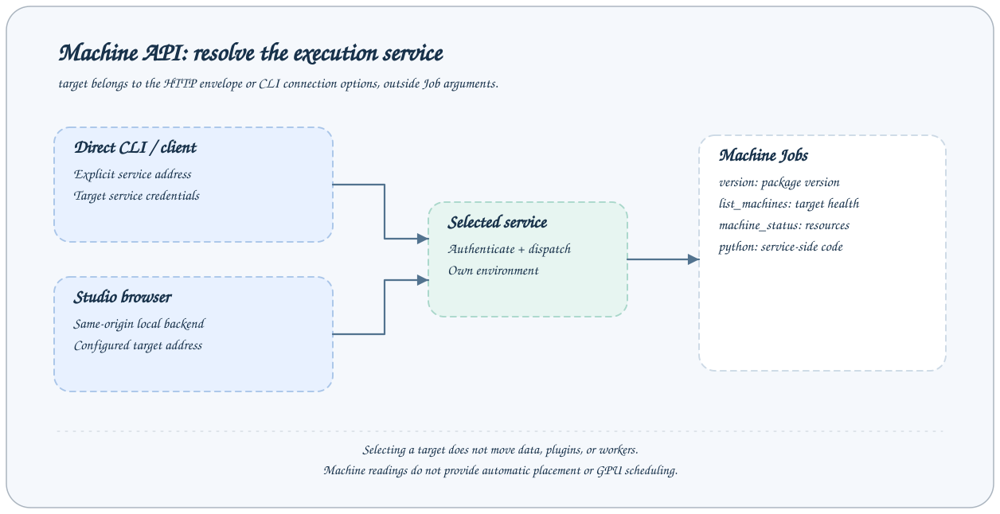

# 机器 API

查询版本、已配置目标健康与机器资源，或在所选服务机器执行命令。target 属于 HTTP 请求封装或 CLI 连接选项，不属于这些 Job 的业务字段。



## 调用约定

以下均为 `POST /jobs/{name}`，请求体是 `{"arguments":{...}}`。远程转发时在封装顶层添加 `target`，不能放进 arguments。每个响应使用 [JobResponse](overview.md#响应与错误)，表格默认值依据当前内置配置和 Step。部署可修改 Job Schema，运行服务的 `/jobs` 是最终依据。

所有示例 JSON 均为结构示例；任务、会话、文件路径与哈希必须替换为本服务实际返回的值。完整通用 TaskMetadata 字段见 [Task 协议](../reference/task-contracts.md)。

## 接口清单

| Job              | 用途                                             |
| ---------------- | ------------------------------------------------ |
| `help`           | 发现公开 Jobs 并查询实际 schema。                |
| `diagnose`       | 诊断构建、Python、workspace、资源和已安装插件。  |
| `version`        | 读取安装包的版本。                               |
| `list_machines`  | 检查全部配置的 targets 健康。                    |
| `machine_status` | 采样服务机器资源。                               |
| `python`         | 使用所选服务的 Python 环境执行多行 Python 代码。 |

## help

用 `{"arguments":{}}` 列出选定服务公开的 Jobs；answer 包含 CLI 语法 `usage` 和名称/描述列表 `jobs`。用 `{"arguments":{"job":"python"}}` 查询一个 Job；answer 包含 `usage` 和 `job`，后者是包含 `name`、`description`、`input_schema` 和 `output_schema` 的 JobInfo。schema 来自运行时目录，包含配置和插件贡献的 Jobs。隐藏 Job，以及未启用认证服务上不可用的受保护 Job，不会列出；未知名称返回 `success=false`。

```bash
axonx help --target node-b:1024
axonx help --job python --target node-b:1024
```

`help` 默认设置 `requires_auth=false`，因此服务未配置 token 时仍可发现；`diagnose` 保持默认的认证要求。服务配置 token 后，包含 help 在内的所有 HTTP/MCP 调用仍须提供该 token。它也是普通 HTTP/MCP Job。CLI `--target` 选择服务，不属于 help 的业务参数。离线语法说明使用 `axonx`。

## diagnose

无业务参数，使用 `{"arguments":{}}`。此只读 Job 返回：

- `axonx`、`cpu`、`memory`、`gpus`：与 `machine_status` 相同的构建和资源信息。
- `python`：解释器 `version` 和 `executable`；`platform` 和 `cwd`：服务操作系统与工作目录。
- `workspace`：解析后的 `path`、`exists` 和 `disk`（`path`、`total_bytes`、`used_bytes`、`free_bytes`）。workspace 不存在时使用最近已存在的祖先目录统计磁盘，不创建目录。
- `plugins`：已安装 distribution/version、插件名、可用时的内容与 wheel SHA-256、发现错误。这不保证所有代码都已加载。
- `service_auth_enabled`：服务是否配置 token。
- `credentials_configured`：服务进程环境中 `AXONX_SERVICE_TOKEN`、`AXONX_TARGET_TOKEN`、`AXONX_TUSHARE_TOKEN` 是否配置的布尔值。不返回凭据值；已配置不代表凭据有效。

插件发现错误保留在 `plugins` 中，不会将已完成的诊断查询变为 Task 失败。文件系统或资源检查失败时，Job 返回失败，不伪造测量结果。此 Job 不安装包或重启服务。

```bash
axonx diagnose --target node-b:1024
```

## version

读取安装包的版本。

无公开业务参数；使用 `{"arguments":{}}`。

**请求**

```json
{
  "arguments": {}
}
```

**响应**

answer 是版本字符串，metadata.version 同时提供该版本。

```json
{
  "answer": "0.1.0",
  "success": true,
  "metadata": { "version": "0.1.0" }
}
```

**行为与失败情况**

版本值仅为示例；构建分支/提交信息从 machine_status 查看。

## list_machines

检查全部配置的 targets 健康。

无公开业务参数；使用 `{"arguments":{}}`。

**请求**

```json
{
  "arguments": {}
}
```

**响应**

answer 为 MachineHealth 数组，每项 address、healthy。

```json
{
  "answer": [
    {
      "address": "http://node-b:1024",
      "healthy": true
    }
  ],
  "success": true,
  "metadata": {}
}
```

**行为与失败情况**

默认 targets=[] 因而结果为空。healthy=false 可能是网络、token 或服务异常，不等价于资源不足。

## machine_status

采样服务机器资源。

无公开业务参数；使用 `{"arguments":{}}`。

**请求**

```json
{
  "arguments": {}
}
```

**响应**

answer 为 MachineInfo：axonx、cpu、memory、gpus。

```json
{
  "answer": {
    "axonx": {
      "version": "0.1.0",
      "git_commit": null,
      "git_branch": null
    },
    "cpu": {
      "total_cores": 8,
      "physical_cores": 4,
      "usage_percent": 12.0
    },
    "memory": {
      "total_bytes": 16000000000,
      "used_bytes": 4000000000,
      "available_bytes": 12000000000,
      "usage_percent": 25.0
    },
    "gpus": []
  },
  "success": true,
  "metadata": {}
}
```

**行为与失败情况**

cpu 的 total_cores/physical_cores 可为 null；内存单位字节。GPU vendor 仅 nvidia/amd，探测命令不可用或无设备时列表可为空；不承诺检测 Apple GPU。

## python

在所选服务机器上，用服务自身的解释器（`sys.executable`）及已安装依赖启动独立子进程执行 Python 源码。源码通过 stdin 传入，不受命令行长度限制。每次调用的 Python 变量独立，继承服务的工作目录和环境，以服务用户的权限运行。

| 参数      | 类型   | 必填 | 默认值      | 约束与含义                                                          |
| --------- | ------ | ---- | ----------- | ------------------------------------------------------------------- |
| `code`    | string | 是   | `—（省略）` | 支持换行的 Python 源码；minLength=1。用 print 将结果输出至 stdout。 |
| `timeout` | number | 否   | `30`        | 执行超时秒数；exclusiveMinimum=0、maximum=300。                     |

调用 `POST /jobs/python`：

```json
{
  "arguments": {
    "code": "from pathlib import Path\nprint(Path.cwd())",
    "timeout": 30
  }
}
```

MCP 客户端按发现的 Schema 将 `code` 作为普通多行字符串传入。JSON 仍需正常的字符串转义。CLI 示例：`axonx python --code 'print(1 + 1)' --timeout 30`。远程执行使用请求顶层 `target` 或 CLI `--target`。

**响应**

`answer` 为 PythonOutput，包含 stdout、stderr、exit_code、stdout_truncated、stderr_truncated。执行在超时前完成且退出码为零时，`success=true`。

```json
{
  "answer": {
    "stdout": "/srv/axonx\n",
    "stderr": "",
    "exit_code": 0,
    "stdout_truncated": false,
    "stderr_truncated": false
  },
  "success": true,
  "metadata": {}
}
```

**行为与失败情况**

每个输出流最多保留 1 MiB，超出的输出会丢弃，并设置对应的截断标记。Python 异常和语法错误返回 `success=false`、非零 `exit_code`，错误信息写入 `stderr`。超时返回 `success=false`、`exit_code=null`，保留已捕获的输出，并在 `stderr` 中追加超时说明。超时或取消会终止进程组、关闭输入输出管道，并回收主进程，无需等待脱离进程组的子进程关闭继承的管道。

内置 Agent 默认的 `job_tools` 名单不暴露 `python`。启用该 Agent 的 Python 执行时，将其加入 `components.agent.default.job_tools`；外部 MCP 暴露范围由服务的 Job 目录决定。

## 失败响应示例

Python 的非零退出与超时都是正常协议返回的业务失败。请求 `code="import sys; sys.exit(3)"` 时：

```json
{
  "answer": {
    "stdout": "",
    "stderr": "",
    "exit_code": 3,
    "stdout_truncated": false,
    "stderr_truncated": false
  },
  "success": false,
  "metadata": {}
}
```

超时时 exit_code=null；stderr 包含 `Command timed out after ... seconds`。timeout=0 或 timeout>300 则在 Schema 校验阶段返回 HTTP 422。list_machines 中某个目标 healthy=false 不会让整次列表查询自动失败，应逐台解释结果。

## 相关文档

- [协议、鉴权与错误](overview.md)
- [远程机器](../guides/remote-machines.md)
- [CLI 参考](../reference/cli.md)
- [事件协议](events.md)

实现依据：`axonx/config/default.yaml`、`axonx/steps/machine/` 与 `axonx/components/service/http/jobs.py`。

带 `--target` 的 CLI 调用使用经过认证的远端 `cli` Job。安装不刷新服务已加载对象，诊断也不追踪待重启状态。
