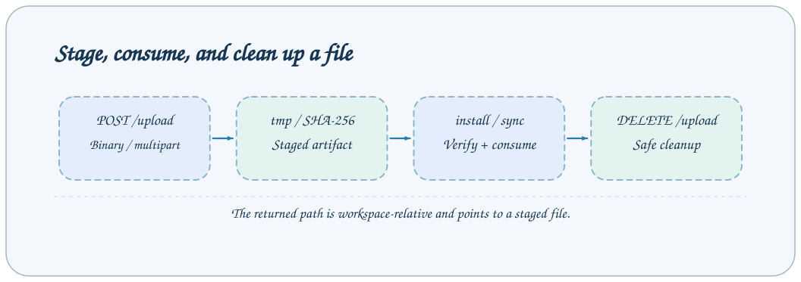

# 工作区与上传 API

文件 Job 操作所选工作区，产物路径来自当前 Task metadata。

所有下列 Job 使用 `POST /jobs/NAME` 和 `{"arguments": {...}}` 请求体。流式入口为 `/jobs/NAME/events`，MCP 使用相同 Job 名和业务参数。先调用 `help --job NAME` 获取目标服务实际 Schema。示例中的 Task/会话 ID 必须替换为实际值。



## 接口列表

| Job                     | 用途                                              |
| ----------------------- | ------------------------------------------------- |
| `list_entries`          | 列出工作区内一个目录的条目。                      |
| `list_task_directories` | 列出指定类型目录下含 metadata.json 的 Task 目录。 |
| `preview_file`          | 预览工作区内一个受支持格式的文件。                |
| `delete_entries`        | 删除工作区内多个文件或目录。                      |

## list_entries

列出工作区内一个目录的条目。

| 参数     | 类型      | 必填 | 默认/约束                   |
| -------- | --------- | ---- | --------------------------- |
| `path`   | `string`  | 否   | `{"default":""}`            |
| `offset` | `integer` | 否   | `{"minimum":0,"default":0}` |

```json
{
  "arguments": {
    "path": ""
  }
}
```

`answer` 包含 `path`、绝对 `workspace_root`、`entries` 和 `truncated`。目录优先，其后按忽略大小写的名称及原始名称排序；从 `offset` 起最多返回 5000 项。截断时以 `offset + entries.length` 继续。条目包含 name、相对 path、kind、preview_kind、supported、size、modified_at；可列出符号链接，但不能沿其访问。

## list_task_directories

列出指定类型目录下含 metadata.json 的 Task 目录。

| 参数        | 类型     | 必填 | 默认/约束                                                 |
| ----------- | -------- | ---- | --------------------------------------------------------- |
| `task_type` | `string` | 是   | `{"minLength":1,"pattern":"^[A-Za-z0-9][A-Za-z0-9_-]*$"}` |

```json
{
  "arguments": {
    "task_type": "base"
  }
}
```

列出指定 task_type 下含 metadata.json 的目录，这是文件发现，不是不可变执行历史。

## preview_file

预览工作区内一个受支持格式的文件。

| 参数        | 类型      | 必填 | 默认/约束                                    |
| ----------- | --------- | ---- | -------------------------------------------- |
| `max_bytes` | `integer` | 否   | `{"minimum":1,"maximum":33554432}`           |
| `path`      | `string`  | 是   | `—`                                          |
| `offset`    | `integer` | 否   | `{"minimum":0,"default":0}`                  |
| `limit`     | `integer` | 否   | `{"minimum":1,"maximum":5000,"default":200}` |

```json
{
  "arguments": {
    "path": "base/base#demo#api-check/metadata.json",
    "limit": 20,
    "max_bytes": 8192
  }
}
```

## delete_entries

删除工作区内多个文件或目录。

| 参数    | 类型    | 必填 | 默认/约束                       |
| ------- | ------- | ---- | ------------------------------- |
| `paths` | `array` | 是   | `{"minItems":1,"maxItems":200}` |

```json
{
  "arguments": {
    "paths": ["base/base#demo#api-check"]
  }
}
```

删除工作区相对路径。这是通用文件操作，不保护活动 Task 进程，删除目录前应确认已停止并与执行串行协调。

## 文件上传与清理

`POST /upload` 接受带 `x-file-name` 的二进制请求体，或 multipart `file` 和可选 `directory`；`x-file-directory` 优先于 multipart 目录。目标限制在工作区 `tmp`，使用 UUID 目录避免冲突。默认传输预算 512 MiB，multipart 额外允许 64 KiB 封装。

```bash
curl --fail-with-body 'http://HOST:1024/upload' \
  -H "Authorization: Bearer $AXONX_TARGET_TOKEN" \
  -F 'file=@dist/plugins/ACTUAL_FILENAME.whl'
```

JobResponse.answer 为 `StagedFile`：`{ "path": "tmp/UUID/file.whl", "location": "/absolute/workspace/tmp/UUID/file.whl", "size": 123 }`。目标机原生插件安装使用 location，`sync_tasks` 和 `DELETE /upload?path=...` 使用 path。上传和清理使用同一服务 token。上传不安装或执行文件，插件安装也不自动消费/删除上传文件，应在 finally 中清理。过期文件在后续上传时机会性清理（默认保留七天），不是安装后的即时清理。

## 预览响应类型

所有预览都包含 `kind` 与字节 `size`，限制按格式区分：

| 格式           | 响应字段与限制                                                                                                                                     |
| -------------- | -------------------------------------------------------------------------------------------------------------------------------------------------- |
| 文本           | `content`、`truncated`；默认前 512 KiB，可用 `max_bytes` 覆盖                                                                                      |
| Markdown       | 正文 `content`、解析后的 `frontmatter`、`frontmatter_error`、`truncated`；字节预算同文本                                                           |
| JSON / YAML    | 解析的 `data`，或带 `parse_error` 的原文 `content`；不传 `max_bytes` 时最多解析 32 MiB，更大的文件返回错误                                         |
| CSV            | `columns`、行数组、`offset`、`limit`、`has_more`；表头不计入行偏移                                                                                 |
| JSONL / NDJSON | `rows` 含 line、content、data、parse_error、逐行 truncated；每页另有独立的 512 KiB 预算，不受 `max_bytes` 控制，并返回页级 `truncated`、`has_more` |
| Parquet        | `columns`、`column_schema`、行数组、`row_count`、`row_group_count`、`offset`、`limit`、`has_more`                                                  |
| 不支持的格式   | `kind="unsupported"`、`size`，不预览内容                                                                                                           |

行格式默认每页 200 行，最多 5000 行。`max_bytes` 仅作用于文本、Markdown、JSON 和 YAML，上限为 32 MiB。截断的 JSON/YAML 返回带标记的原文前缀和解析错误，不返回解析对象。CLI 额外设置默认 20 行和 8192 字节；普通 HTTP/MCP Job 使用上述服务端默认值。行分页依据 `has_more`，将预览作为完整证据前还需检查展示副本的采样与遗漏。

源码：[默认 Job 契约](../../../axonx/app/config/default.yaml) · [Job 协议](overview.md)
