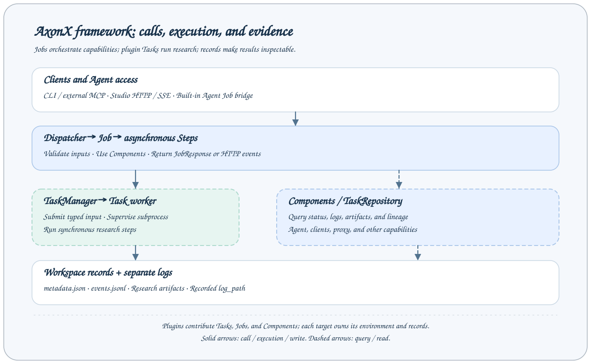

# 架构总览

AxonX 分离应用能力、同步研究执行和文件证据。

## 各层职责

| 层     | 职责                                 | 所属模块       |
| ------ | ------------------------------------ | -------------- |
| 客户端 | JSON、SSE、上传、MCP                 | `axonx.client` |
| 应用   | 配置、分发、provider、受管理生命周期 | `axonx.app`    |
| Daemon | 监督服务、定时进程和更新             | `axonx.daemon` |
| 插件   | 已安装 Task 注册和 wheel             | `axonx.plugin` |
| Task   | 类型化开发、执行、记录和产物         | `axonx.task`   |

## 查询执行链

客户端向 `/jobs/status` 提交 `task_id`。认证和 Dispatcher 校验请求，Job Step 通过 `task_index` 读取并返回 `JobResponse`。索引观察文件，读取记录不会执行或修复 Task。

## 研究执行链

本地 CLI `exec` 发现 Task 注册并解析执行配置，构造 Task 后调用 `TaskExecutor`。同步步骤和子任务在该进程执行。执行器保存 metadata/进度、关闭资源、校验输出并发布终态。CLI 等待完成并返回输出及退出码。

远程原生命令通过目标的 `cli` Job，在服务工作区启动配置的 AxonX 命令新进程，传输 stdout/stderr 并清理其进程组。定时 `exec` 由 Daemon 启动，在应用服务替换后继续执行。两者的进程所有者不同。

## 应用装配

`Application` 在局部 registry 中装配 provider，注入有类型的依赖，按拓扑顺序启动受管理组件并逆序关闭。框架扩展通过 `providers=...` 提供。启动层显式注入 TaskCatalog、更新后端和定时命令启动器。嵌入式应用可省略产品适配器，Cron 需要宿主启动器。

## 插件与 Agent

插件 manifest 只注册 Task。安装修改所选 Python 环境，不刷新常驻服务的注册快照或已缓存类。远程部署显式构建、上传、安装、清理，然后重启验证。

Agent 通过 CLI 或已配置的 Job 工具检查相同证据。内置 Claude 后端管理 SDK 会话并附加规范开发指南。研究执行独立于 Agent 对话轮次。

## 设计边界

- `upstream_task_ids` 声明输入依赖，`parent_task_id`/`children` 记录调用，都不自动执行整个 DAG。
- Task 查询属于观察，运行时启动和停止负责修正确认已退出的本机进程。
- 同名写入由调用方协调，metadata 原子替换不是锁。
- 展示同步复制有大小限制的证据，不迁移活动进程、环境或整个工作区。
- 每个目标有独立解释器、文件和配置。显式 CLI target 直接连接，Studio 可通过已配置的后端转发。

[Job 与 Task](jobs-and-tasks.md) · [Task 契约](../reference/task-contracts.md) · [框架扩展](../development/framework-extensions.md)
