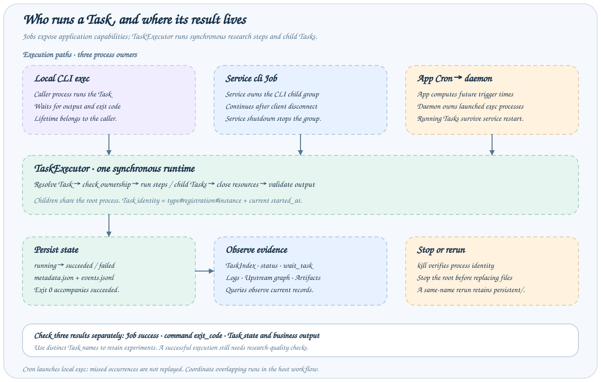

# Task 生命周期

## 名称与执行身份

`task_type`、注册名和 `task_name` 组成 `type#registration#instance`。metadata 的 `started_at` 标识当前执行。运行所有权还包括 `machine_id`、`pid`、`process_started_at`、可选的可达 `execution_target` 和源 `workspace_dir`。

## 状态含义

Task 状态为 `running`、`succeeded`、`failed`。成功结果退出码为 0，进程停止和异常会导致失败。步骤状态还包括 pending、waiting、done、missed、skipped。业务窗口 incomplete 不一定使整个 Task 失败。

## 步骤进度

执行器运行 `build_task_steps()` 生成的同步 callable，记录进度和计时，关闭资源后构建最终输出。`report_progress()` 支持命名子步骤，生命周期完成前应停止后台生产者。`publish_output()` 持久化经校验的部分业务结果。

## 生命周期记录发布

`metadata.json` 是当前生命周期文档，通过原子替换发布完整快照；步骤事件日志支持观察。最终业务输出和终态在同一 metadata 中发布。目录没有协调锁，同名执行和并发变更需要调用方串行化。

## 固定名称重跑

运行时核对旧执行已停止，拒绝展示副本以及未确认或异机的 running 记录，再替换当前文件并保留 `persistent/`。自动名称发生冲突时拒绝执行。显式重跑会推进 `started_at`，目录不是不可变历史。替换生产任务前应消费或固定其产物。

## 等待与停止

`wait_task` 内部捕获当前 `started_at`，等待时改变则失败。查询不修正失效 running 状态。启动检查和显式 `kill` 可修正确认已退出的本机记录；权限不足和异机进程保持未验证。

`axonx kill --task-id ID --timeout 5 --force false` 核对身份，停止后代和根执行并重新读取记录。子任务共享根执行进程。远程停止使用源机器和源工作区，不使用副本观察机的挂载路径。观察或删除不能代替停止进程。

[Task 契约](../reference/task-contracts.md) · [任务管理](../guides/task-management.md)
