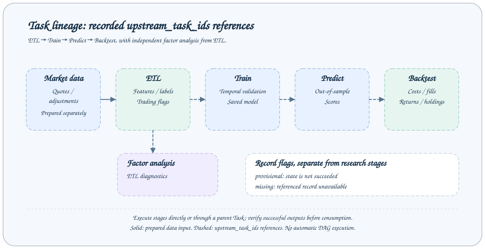

# Task 依赖与关系

依赖图记录声明的输入引用，父子 metadata 单独记录同步调用关系。这些记录提供关系证据；阶段执行与数据兼容性校验仍由调用方完成。



## 传递上游身份

所有 BaseInputParams 都包含规范 Task ID 列表：

```json
{
  "task_name": "prediction-01",
  "upstream_task_ids": ["etl#my-etl#dataset-01", "train#my-train#model-01"]
}
```

Python/HTTP 入参使用 JSON 数组，CLI exec 也接受逗号分隔 ID。名称必须规范且唯一，不能依赖自己。各子任务上游需要显式传入。声明上游不运行它，也不验证业务兼容性。

## 关系图来源

`get_task_graph` 仅根据 `metadata.input_params.upstream_task_ids` 建边，返回包含缺失上游引用的输入依赖连通图。状态不是 `succeeded` 的已有节点标记为 `provisional`。`parent_task_id` 和 `children` 在 metadata 中描述进程内调用，不会增加依赖图边。因此，没有声明输入依赖的父 Task 即使执行了多个子任务，也可能在图中单独出现。

## 查询与检查

```bash
axonx get_task_graph --task-id 'predict#my-predict#prediction-01'
axonx get_task_context --task-id 'predict#my-predict#prediction-01'
```

沿边检查实际 metadata、启动时间和产物。固定名称可能已指向替换后的输入，消费前固定经核验修订。

## 插件读取上游

```python
from axonx.task.models.identity import TaskType

train_id = self.input_params.upstream_task_id(TaskType.TRAIN)
train_dir = self.upstream_task_dir(train_id)
```

辅助方法要求恰好一个对应类型的上游。定位目录不下载或执行任务。用 storage.inputs 读取 metadata、校验路径并固定产物。缺失、失败或不兼容数据由消费者报告，关系边不会自动解决。

## 命名与删除

可复现实验使用独立实例并保留输入/模型修订。删除不级联，下游可能显示上游缺失。展示副本支持观察，不能作为可执行研究输入。

源码：[身份规则](../../../axonx/task/models/identity.py)、[输入模型](../../../axonx/task/models/params.py)、[关系图](../../../axonx/app/components/task_index/query.py)。
