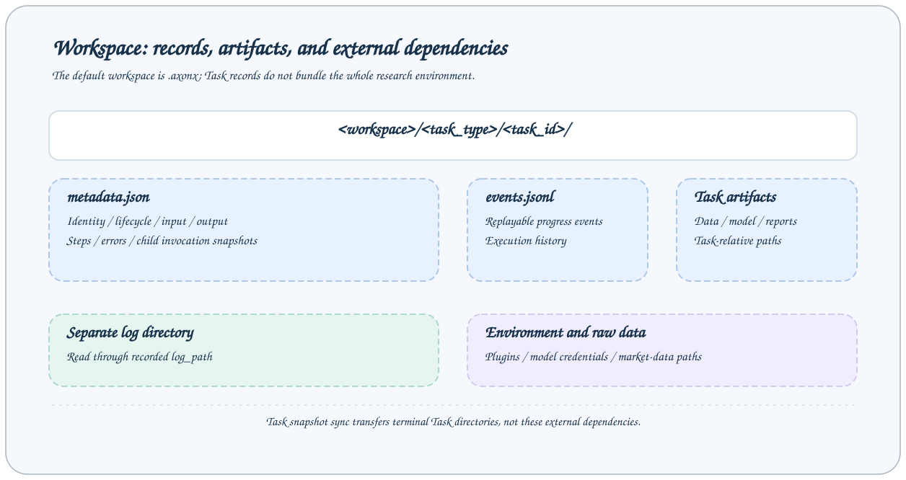

# 工作区与持久记录

工作区保存任务状态、成功结果与研究产物，是 Studio 和任务查询共同读取的数据来源。默认根目录为启动目录下的 `.axonx`，内置默认配置支持通过 shell 或 `.env` 中的 `AXONX_WORKSPACE_DIR` 指定根目录，也可通过配置项 `workspace_dir` 或 CLI 参数 `--workspace-dir` 显式设置。日志目录独立配置，默认是 `logs`。



## 共享 Python Workspace

`axonx.common.workspace.Workspace` 是 App、Task、CLI、Cron 和 Task 归档应用共同使用的文件操作入口。构造时只规范化根目录，不创建目录。`ApplicationContext` 持有一个实例，应用通过 `app.workspace`、组件和 Step 通过 `self.workspace` 使用；Task 暴露以同一配置工作区为根的独立实例。原有 `workspace_path` 属性继续保留。

实现统一归 `axonx/common/workspace/`：`core.py` 提供文件操作，`preview.py` 处理文件格式，`models.py` 定义共享结果模型。从包入口导入 `Workspace`，从 `axonx.common.workspace.models` 显式导入模型；基础入口不加载 Pydantic 或可选格式库。App 保留 Job/HTTP 适配，Task 保留 metadata 与执行策略。

```python
from axonx.common.workspace import Workspace

workspace = Workspace(".axonx", transfer_budget_bytes=512 * 1024 * 1024)
workspace.ensure()  # 显式创建；构造本身只读。
listing = workspace.list_entries("", offset=0)
staged = workspace.stage_bytes(b"hello", "note.txt")
preview = workspace.preview_file(staged["path"])
workspace.discard_staged(staged["path"])
```

| 需求                                   | 共享机制                                                                                  | 调用方规则                                                                             |
| -------------------------------------- | ----------------------------------------------------------------------------------------- | -------------------------------------------------------------------------------------- |
| 根目录初始化、子进程工作目录和环境变量 | `root`、`ensure()`                                                                        | App 启动和 Cron 启动配置                                                               |
| 不可信相对路径                         | `resolve()`、`resolve_file()`、`resolve_directory()`、`resolve_deletable()`、`relative()` | 拒绝绝对路径、父目录穿越、符号链接和根目录删除                                         |
| Agent 配置路径与研究输入               | `locate()`                                                                                | 默认限制在根目录内；Task 输入显式使用 `external=True`，保留外部文件支持                |
| 目录浏览和 Task Run 列表               | `list_entries(path, offset=..., include=...)`                                             | 支持根目录隐藏名称及分页前过滤                                                         |
| 有界格式预览                           | `preview_file(path, offset=..., limit=..., max_bytes=...)`                                | App 用自己的响应模型校验返回数据                                                       |
| 批量删除                               | `delete_entries(paths)`                                                                   | 修改前校验完整选择并合并父子路径；可选 `before_delete(root, targets)` 回调保护业务文件 |
| 上传和同步输入暂存                     | `stage_bytes()`、`stage_stream()`、`staged_file()`、`discard_staged()`                    | App 传入自身传输预算，默认使用 `tmp/` 暂存目录                                         |

Workspace 返回普通字典和列表，不导入Workspace 结果模型或 Task 代码，格式依赖按需加载。省略传输预算表示不限制字节数，应用始终传入配置中的预算。应用还接入 `task/storage/records.py` 提供的 `.task-records` 可见性和 Task 删除保护。

Task 身份与目录布局、元数据事务和状态收敛、事件/日志读取、产物校验、持久数据和展示副本同步继续归 `task/`，使用共享文件机制，不把生命周期和模型规则放入 Common。独立 daemon worker 继续只用标准库处理路径。旧 `ConfinedPaths`、`WorkspacePaths`、`StagedFiles` 和应用工作区操作函数已删除，Python 调用方改用 `Workspace` 方法；CLI/HTTP 响应和持久化格式保持不变。

## 目录布局

下面是包含 demo 和一个研究插件任务的示意布局，插件文件名以实际产物为准：

```text
.axonx/
  base/
    base#demo#trial-01/
      metadata.json
      events.jsonl
  etl/
    etl#my-etl#dataset-01/
      metadata.json
      events.jsonl
      dataset.parquet
  train/
  predict/
  backtest/
  analysis/
  inference/
  tushare/                       # 数据下载任务写入的原始数据
  plugins/artifacts/             # CLI 默认 wheel 构建缓存
  agent/                         # 默认 Agent 配置下的会话相关数据
logs/                            # 独立日志目录，不一定在工作区内
```

目录规则是 `<task_type>/<task_id>`，不是 `<task_type>/<注册名>/<run_id>`。Task 类型目录来自枚举，某个目录存在并不代表对应算法插件已经安装。

保留目录 `persistent/` 用于 Task 的累计业务数据。同名重跑保留它并清理其他运行文件；显式删除 Task 时一并删除，展示同步则以所选发布产物替换目标目录。插件负责其数据格式、更新和加锁，该路径必须是普通目录，不能是符号链接。

## 运行记录

| 文件            | 生命周期              | 内容                                                                   |
| --------------- | --------------------- | ---------------------------------------------------------------------- |
| `metadata.json` | 从受理到所有终态      | 身份、Run ID、输入输出、状态、步骤、错误、退出码、日志路径和子调用记录 |
| `events.jsonl`  | worker 报告进度时追加 | 可回放的进度事件，每行一个 JSON 对象                                   |

一个原子 metadata 快照是唯一 Task 记录。执行期间由 Runner 更新；确认本机原始进程已停止后，由 Task 记录校验逻辑收敛未完成记录。不再使用独立状态或组合文件，不重复保存结果封装，也不回退读取旧格式。

子调用记录保存在 `metadata.json.children`；子目录仍位于各自类型目录下，不嵌套在父目录内。同步或删除父任务不会自动包含子任务。

读取端将损坏、不安全或身份不匹配的记录视为缺失，不读取 FIFO 或跟随符号链接。生命周期操作可以重试临时 I/O 错误。

## 产物的相对路径

研究 Task 的 `output_params.artifacts` 可以记录产物：

```json
{
  "artifacts": {
    "dataset": {
      "path": "data/dataset.parquet",
      "size": 10240,
      "revision": "<size>:<mtime_ns>"
    }
  }
}
```

这里的 path 相对 Task 目录。因此工作区预览路径为：

```text
etl/etl#my-etl#dataset-01/data/dataset.parquet
```

不能把 artifact 的 path 直接当工作区根路径，也不能用绝对路径或 `../` 逃离任务目录。生产插件应在文件写完后记录 size 和 revision。

## 日志在哪里

`status.log_path` 记录具体日志位置。日志系统由 `log_dir` 控制，Task 日志不保证固定存在于任务目录中。通过 `read_task_log` 或 Studio 任务详情读取，而不是猜测 `<task_dir>/log.txt`。

`events.jsonl` 是进度事件日志，不等于 Python 文本日志。备份任务目录能保留进度事件，若文本日志放在外部目录，应单独备份。

## 索引与文件的关系

TaskRepository 只扫描和监听类型目录下的 metadata，维护一个任务索引。重启可从有效记录重建查询信息，不会重新训练模型或下载原始数据。

任务列表包含所有有效生命周期记录。Studio 研究页面选择 `state=succeeded` 的记录，metadata 存在不代表实验成功。

## 备份范围

要复现实验，应保留任务目录、原始数据、服务配置、插件版本和模型依赖。Agent 会话、日志和插件源码按实际使用情况单独保留。

停止写入后复制整个工作区最容易得到一致文件。任务同步仅复制终态 Task 目录，不能代替原始数据、Agent 会话、日志与软件环境的完整备份。

固定名称重跑会替换旧目录；删除上游目录会让下游血缘出现 missing 节点，也可能使重跑下游无法读取原始产物。

## 相关文档

[工作区浏览](../guides/workspace-files.md) · [Task 契约](../reference/task-contracts.md) · [研究产物](../reference/research-artifacts.md) · [备份恢复](../guides/operations.md)

源码：[工作区布局](../../../axonx/task/storage/workspace.py)、[元数据](../../../axonx/task/storage/workspace.py)、[产物路径](../../../axonx/task/storage/artifacts.py)。
