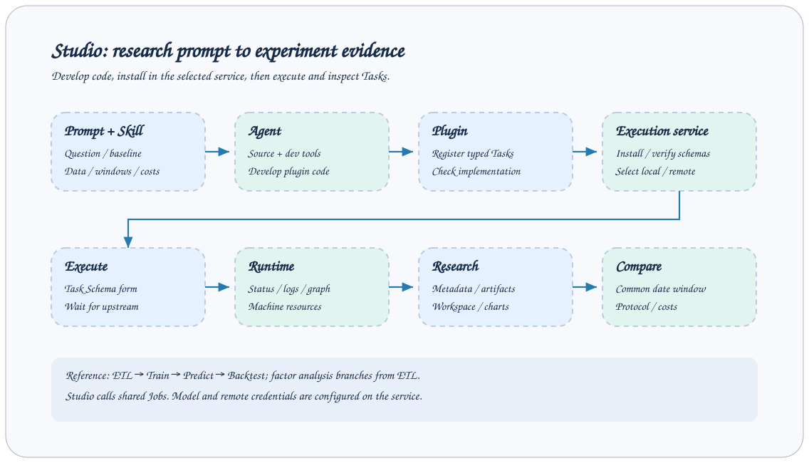

# 扩展 Studio

本页说明如何在现有 Studio 中增加页面、表单或图表。后端 Task、Step、Job 的扩展见 [开发指南](../dev_guide.md)；首次运行见 [Studio 入门](../getting-started/studio.md)。

## 开发环境

在仓库根目录启动服务，再在另一个终端运行前端：

```bash
cd axonx_studio
npm ci
npm run dev
```

完整开发工具链需要 Node.js 22.13+（22.x）、24.x 或 26+，以满足锁定的 Vite、ESLint 和 Vitest 依赖。Vite 默认监听 4173，开发代理默认连接 `http://127.0.0.1:1024`。可通过 `AXONX_DEV_SERVER` 指向另一个后端；修改后重启 Vite。代理覆盖 `/health`、`/jobs`、`/files`、`/mcp` 和 `/proxy`。

`npm run build` 先执行 TypeScript 检查，再输出 `dist`。从仓库根目录执行 `pip install ./axonx_studio`，AxonX 即可通过 Python 包加载这些资源。开发服务器用于热更新。

如果运行期间已挂载的 Studio 构建资源被删除，页面请求返回 `503` 和恢复提示；缺失的静态资源请求返回 `404` 或 `503`。API 路由保持可用。可在原路径恢复构建资源；如果包安装路径发生变化，需要重启服务。本处理覆盖发送响应头之前的文件缺失，已经开始传输的响应无法替换。

## 目录职责

| 位置                | 职责                                              |
| ------------------- | ------------------------------------------------- |
| `src/app`           | Hash 路由、导航、机器选择、页面分派和共享应用状态 |
| `src/features`      | 提交、运行中心、Agent、研究和工作区等业务页面     |
| `src/shared/api`    | Job 请求、响应解包、SSE 和公共类型                |
| `src/shared/schema` | JSON Schema 的字段类型和表单值转换                |
| `src/shared/ui`     | SchemaForm、面板拖拽等复用组件                    |
| `src/shared/hooks`  | 异步加载、轮询和复制反馈                          |
| `src/styles`        | 设计变量、外壳和业务样式                          |
| `src/locales`       | 中文、英文翻译资源                                |



单选下拉统一使用 `src/shared/ui/Select.tsx`：`Select` 保留原生 option 写法、change 事件及表单校验；带内联标签的工具栏选择器可使用接受选项列表的 `Picker`。两者共用 `styles/select.css` 的主题样式、键盘导航及视口避让，不再新增可见的原生 select 或重复的菜单实现。

## 增加页面

路由格式为 `#<machineId>/<section>/<view>/<resource>`。例如 `#local/task-defs/catalog/demo` 表示本机 demo 提交表单。`routeHash` 负责编码资源标识，`parseHash` 负责解码；不要手工拼接包含 `#` 的 Task ID。

1. 在 `features/<feature>` 中创建页面和必要的类型、API 封装。
2. 在 `app/routes.ts` 注册 section 与默认 view。
3. 在 `app/navigation.ts` 添加导航项。
4. 在 `app/PageOutlet.tsx` 接入页面分派，并传递选中的机器。
5. 将用户可见文本写入两份 locale，并同步维护 `docs/zh` 与 `docs/en` 中对应的文档正文。

区分页面路由状态与临时 UI 状态。可分享的资源选择适合放在 Hash 中；展开面板、加载进度等留在组件状态。无效 section 会回到首页。

## 调用后端

统一通过 `shared/api/client.ts` 的 `axonx.invoke` 或现有 feature API 封装调用 Job：

```typescript
const definitions = await axonx.invoke(
  "list_installed_task_definitions",
  {},
  { target: selectedMachine, signal: controller.signal },
);
```

请求体为 `{ arguments, target }`，响应外层为 JobResponse。客户端统一处理 HTTP 错误及 `success: false`，业务页面拿到解包后的 `answer`。返回数据类型应来自实际后端协议，不要通过强制类型断言掩盖协议差异。

机器选择必须贯穿列表、详情、提交和文件预览。同源 `/jobs` 请求携带浏览器设置中的服务 token；远程目标地址和凭据由后端解析。详见 [机器指南](../guides/remote-machines.md)。

## 表单与实时状态

优先复用 SchemaForm。整数与浮点数字段转为数字，枚举从 JSON 值解码，数组与对象输入为 JSON，可选空字段省略。没有默认值的可选布尔字段在关闭时也会省略。服务端仍负责最终校验。

需要取消过期请求时传入 AbortSignal。轮询复用共享的 `useRefresh` 调度器；长任务事件读取复用 SSE 解析器，不要把一次 Job 调用结束当成后台 Task 已完成。事件协议见 [实时事件](../api/events.md)。

Agent 工具卡片在参数流式生成时展示累积的 JSON 片段。收到完整工具消息后，在原卡片中更新格式化的输入并清除片段文本，因此命令在执行过程中持续可见，无需等待整轮结束后的历史记录刷新。

任务详情分为任务配置、关系、运行详情（默认选中）和日志四个 Tab，保留标题图标。切换 Tab 保留日志和报告控件状态。复用共享异步资源 Hook，在切换 Task 或机器时取消过期请求并隐藏上一项内容，迟到的取消响应也不能重新加载旧任务。运行详情中，普通 Task 仅展示步骤列表，子步骤缩进显示；复合 Task 仅展示直接子 Task 的状态和跳转入口，同一节点取最后一次调用，子任务详情进入其自身页面查看。业务报告、质量、文件及原始输出通过专门的报告页面查看。连续同名的已完成步骤默认合并折叠，展开可查看每条记录；完成与否以步骤状态为准，进度达到 100% 的运行中步骤仍显示为进行中。进行中或失败的步骤单独显示。各 Tab 的内容框填满屏幕剩余高度，超出内容在框内滚动，日志保留原始行格式。

## 图表与文件

研究页面读取任务产物，新增计算沿用已明确的口径，并说明与插件汇总值的差异。训练曲线、收益率、持仓等字段来源见 [研究产物参考](../reference/research-artifacts.md)。缺失文件和空数据应有明确空状态。

文件预览保持工作区相对路径。`/files` 提供暂存上传与清理，不提供通用下载；完整产物需在执行机器工作区取得。不要将服务器绝对路径拼进公共界面。多图表页面注意容器 resize 与组件卸载时的资源释放。

## 验证与提交

```bash
npm run test
npm run lint
npm run format:check
npm run build
```

根据修改选择相关测试；路由、Schema 值转换、事件解析和请求解包已有测试可扩展。界面检查至少包含英文与中文、空数据、加载失败、长文本和窄窗口。不要在截图中暴露 token、私人会话、任务标识或机器地址。

更新用户文档时同步补充功能入口、前置条件、步骤和失败处理。截图与 SVG 采用英文，截图中不包含凭据、私人路径或会话内容。

## 实现依据

- `axonx_studio/src/app/routes.ts`、`PageOutlet.tsx`、`navigation.ts`
- `axonx_studio/src/shared/api/client.ts`、`event.ts`
- `axonx_studio/src/shared/schema/values.ts`
- `axonx_studio/vite.config.ts`、`package.json`

## 静态 Playground

官网在 `/AxonX/playground/` 提供独立 Studio，复用正式应用的页面、Job 响应和 SSE 解析器。无需 Python 服务、数据库或 LLM；证券及研究结果均为合成数据，Agent 回复为脚本演示。

```bash
npm ci
npm run dev:playground
# 打开 http://localhost:4173/AxonX/playground/
npm run build:playground
```

`DOCS_BASE` 决定部署前缀，默认为 `/AxonX/`。独立的 `dist-playground/` 输出不会覆盖 Python 打包所用的普通 `dist/`。文档构建会生成 Playground 并合并到 Pages 发布产物。构建官网前，需要分别在 `axonx_studio/` 与 `github-pages/` 安装依赖。

所有请求（包括事件流）统一经过 `AxonXClient.request`。默认 transport 调用同源 HTTP；Playground 模式由 `main.tsx` 在挂载前注入 `createPlayground()`，该客户端禁用认证。业务 API 无需按模式分支。未知 Job、文件与远程 target 返回明确错误，不回退到网络请求。

`playground/fixtures.ts` 创建虚拟工作区，包含 ETL → 训练 → 预测 → 回测主链、从 ETL 独立分出的因子分析与两组回测。JSON 表格预览实现现有 Parquet 预览协议，无需附带 Parquet 解码器。收益与汇总指标由同一组序列生成。

`playground/runtime.ts` 维护任务与文件状态，`agent.ts` 维护脚本会话及工具消息，`stream.ts` 负责事件订阅清理，`catalog.ts` 声明支持的 Job。提交任务按经过时间推进，即使没有订阅者也会继续；状态查询和事件流同步这些状态。取消任务停止执行；AbortSignal 只关闭过期订阅并释放计时器。所有状态均保留统一 metadata，成功任务生成业务产物。`strategy` 选择合成结果，`outcome` 选择成功或失败，提交配置不会执行真实研究算法。

刷新或点击「重置示例」恢复初始状态，不持久化执行状态。测试覆盖数据契约、分页、生命周期、删除、事件流清理、脚本会话和网络隔离。应检查正式与 Playground 两种构建；站点验证会检查合并后的入口与资源路径。

## 应用运行页面

侧栏顺序为 **系统管理 → 日常运行 → 研究分析 → 开发工具**。系统管理包含全部任务、机器资源、运行环境；日常运行默认依次显示在线预测、比对、数据更新、同步。研究分析从智能体开始，随后按 ETL → 因子分析 → 模型训练 → 离线预测 → 离线回测 → 策略对比排列。开发工具包含提交任务、工作区、API 接口。系统管理和日常运行默认展开，其余默认收起；浏览器本地存储记住各组展开选择。进入页面（包括直接链接）时自动展开所属组，当前组仍可手动收起。应用可通过 `studio.pages` 的声明顺序调整业务入口顺序。

`default.yaml` 声明同步、数据更新、在线预测、比对四个通用入口。应用通过 `studio.pages` 关联具体调度并覆盖名称；AxonX 使用支持认证及远程目标的 `list_studio_pages` Job 提供配置。导航跟随当前机器，框架不硬编码插件的 Task 名称或调度名称。页面显示在 **日常运行** 分组，地址为 `#local/operations/<page-id>`。移除混合的 `online/runs` 路由；独立报告使用 `#local/report/task/<编码后的-task-id>`。

```yaml
studio:
  pages:
    downloads:
      title: { en: Data updates, zh: 数据更新 }
      view: tasks
      schedules: [daily_download]
      category: data_update
```

`view: schedules` 用于仅运行 Job 的调度（不允许 category；空 schedules 表示未配置同步调度）；`tasks` 展示 Task 进度、递归子任务及日志；`pipeline` 展示在线／比对报告。Task 页面必须选择 `TaskCategory`：`data_update`、`online_prediction` 或 `comparison`。插件类可声明 `category = TaskCategory.DATA_UPDATE`。分类与 `TaskType`、存储身份及 `report_kind` 独立，相同的复合执行类型可以属于不同页面。已安装定义、排队记录、运行记录及列表摘要均包含分类。没有分类的旧记录仍可在 **全部任务** 查看，重新执行后生成带分类的记录。复合子任务保留分类并记录 `parent_run_id`，页面索引只列顶层运行；手动和定时启动的顶层任务都可见。

执行记录直接挂在所属调度名称下；没有调度来源的 Task 平铺展示，不再添加来源标题或空分组。点击调度名称查看配置，点击箭头折叠其记录；选择只切换详情，不隐藏其他分组。归属依据调度名称、Job、调度器身份及持久化触发来源确认；无法匹配的定时 Task 放在历史调度下，不归为手动运行。已有 Task 的触发只显示一次 Task 记录。成功的 `submit` 执行在没有保留 Task 时不显示历史行；尚未关联 Task 的运行中、失败或取消的提交保留以便诊断，关联到 Task 后由 Task 行替代；提交状态、错误及最近结果可在调度详情查看，原始历史继续保留。其他 Job 执行仍然展示。无效页面与服务不可用有明确的空／错误提示。导航仅在首次进入、切换机器或凭据、主动重载导航时加载。整个 Studio 共用一个 60 秒调度器，统一刷新服务状态、任务列表、报告、子任务进度及日志；回到可见窗口时不会额外刷新。日常运行每页仅保留历史列表上的一个手动刷新按钮，点击后刷新整页，保留当前 Tab。

日常运行页面共用紧凑的历史列表，详情采用与离线研究一致的无外框布局。数据更新在同一工具栏内切换结果、日志与下载任务，其他运行页面按各自报告保留标签导航。比对流水线默认显示模型流程，刷新保留当前 Tab，切换时保留日志与报告控件状态。数据质量报告合并在对应采集步骤内，不再单独追加列表。采集卡片直接显示文件；在线预测的质量内容按来源放在第二行 Tab；股票明细与完整报告的来源详情都在当前页展开，不使用侧边面板。模型阶段与子 Task 详情直接展示，质量汇总在进入对应来源时加载，完整明细在展开时加载。已提交文件直接展示为紧凑的文件名链接，点击进入当前机器的工作区预览。绝对路径根据该工作区返回的根目录映射；旧服务目录接口未返回根目录时，从所选机器的诊断接口读取。根目录外的文件仍不可访问。调度详情将 cron／时区／并发策略、触发时间与结果指标分区展示；运行记录显示名称、时间和状态。在线预测与晚间比对使用一致的报告间距、阶段卡片和日志工具栏。调度标题处的状态表示最近一次 Job 执行结果，每个 Task 保持独立状态。

在线预测按交易日查看，最多两行 Tab。第一行左侧为独立的“运行准备”入口，右侧为时间流程框，框内用短小箭头连接相邻时间；按时间显示 09:45 等信号时点及已完成、失败、准备数据、等待执行、执行中或待准备状态，采集的 before/bar 合并在对应时点。运行准备的第二行包含基础采集、存在独立公共 ETL 时的公共 ETL、开盘行情和日志；特定时点使用“数据采集／模型准备／预测结果／时点前行情／当前时点行情／模型输入／日志”七个入口；模型准备合并历史输入、特征处理与模型来源，成功的历史复用压缩为单行摘要，预测结果合并评分、信号和组合。历史准备按模型与时间点执行，其失败归入对应时点状态，不影响公共准备状态。右上角模型下拉框在时间切换时保留模型名称，模型相关阶段及日志随选择切换；公共采集不随模型切换。历史准备内部的 ETL 留在历史准备中，不重复列为公共 ETL。时点状态优先体现任一必要阶段或模型的失败。仅历史准备运行时显示“准备数据”；采集或推理实际运行时显示“执行中”。只有全部计划模型都有明确完成的历史准备记录、且采集／推理仍在等待时，才显示“等待执行”。“待准备”表示准备尚未开始或状态尚未确认，缺失或仅部分完成的历史记录不会被判为就绪。父任务已经结束时，仍在等待的窗口显示“未完成”，不暗示后续还会执行。悬浮说明补充这些状态的含义。标签反映最近一次执行快照，不根据浏览器时间推断就绪或错过窗口。

交易日期统一控制内容。日常运行的预测结果直接展示信号表，组合、表现和提交记录保留在任务完整报告中。信号表股池类型与回测一致，默认选择已记录的策略股池并勾选“仅可买”，股池选择放在搜索工具栏。池内排名及排名变化按所选股池计算，保留原始排名供追溯。百分比股池先筛模型候选和可买股票，再按有效正数的信号时点字段、向上取整及代码顺序处理同值，每个日期／时点独立计算；取消“仅可买”不改变百分比股池边界。缺失上下文字段的股池不可选，当前策略股池缺字段时明确提示；查看其他股池不会重算或修改已发布策略结果。内容区不重复模型名与模型总状态，已完成且无指标、产物或说明的阶段卡片省略，运行中和失败阶段保留；子任务详情入口统一放在日志工具栏。已发布结果不再重复显示成功的计算与提交阶段；搜索、股池、筛选后行数与“仅可买”合并在表格工具栏。各 seed 分数列合并为一列“均值 ± 总体标准差”，复用回测表格的柱状条（以全部候选均值及零点为统一刻度；仅统计有效数值，单 seed 标准差为 0，无有效 seed 时标准差为空）；非均值聚合仍保留原始排序分数，排名不变。缺失行情处理策略仅在组合／表现视图中作紧凑说明，评估不完整等真实告警仍保留。质量按来源使用 Tab，每个来源只展示一张检查主表；每条检查可在行下展开／收起问题样例，不新增表格，完整股票明细在检查主表下方按需展开并加载，保留导出功能。结果默认使用 manifest 的最新有效版本，查看旧版本后可返回有效版本。采集、历史准备及模型日志只显示准确匹配的 Task/Run；历史日期无运行记录时明确提示，无信号日期不借用其他日期的结果。时间统一使用上海时区，刷新保留交易日期、时间点、处理环节和模型选择。信号历史读取失败时保留上次成功的 manifest 并提示。

即使当前运行尚未创建预测子任务，也会从模型对应的在线推理 Task 独立发现已提交信号历史。日期列表与已提交时点数包含先前运行的已有提交；执行阶段和状态仍表示当前运行。多个 Task 同时匹配时提示历史查询异常，不任意选择结果。

离线回测仅展示专用分析报告，不再附加通用的产物数量和文件清单。报告仍通过产物元数据读取结果，文件可在工作区访问。

Cron 调度器把执行状态和有限大小的结果原子写入 `workspace/schedules/<名称-sha256>.json`，保留全部正在运行的触发及最近 50 条已结束记录。超过 16 KiB 的结果改为截断摘要。服务重启后恢复已结束记录，未完成记录标记为取消并说明中断原因；scheduler_id 仍属于本次服务进程。调度页展示上次结果指标、错误、完成时间与各次触发详情。Job 执行成功表示 Job 已完成；提交的 Task 有独立生命周期。Task 记录与产物沿用既有持久化语义，同名重跑替换当前 Run。

在线报告展示实时采集、历史准备及定时模型预测；比对报告展示公共下载、各模型 ETL、在线来源检查、预测差异及回测。两者复用报告组件，使用独立的配置页面。子任务详情及可切换日志同时匹配 Task ID 与准确的 Run ID，被替换的运行不会冒充原运行。信号发布与任务执行状态分别展示。

晚间比对将流程导航合并为一排：流程日志、数据补全、特征更新、离线预测、预测比对、回测分析；同一排右侧切换模型，切换模型保留当前环节。默认显示公共调度日志；数据补全直接显示晚间补数任务及下载子任务日志。模型环节显示对应阶段状态、错误和准确归属的任务日志；比对表将差异项排在一致项前。回测分析直接复用已有回测视图，并保留组合账本比对明细。文件名链接进入工作区预览。日志只读取准确归属的 Task ID 与 Run ID，刷新保留选择，Run 被替换时不借用其他运行记录。页面保留每 60 秒刷新与手动刷新。

运行 `npm run dev:playground`，打开 `http://localhost:4173/AxonX/playground/#local/operations/online` 可预览合成样例。同步、数据更新、晚间页面各自独立；Playground 刷新后重置，不演示磁盘持久化，也不执行插件算法。

被引用的子 Task 再次运行后，当前状态接口无法提供旧 Run 元数据。在线预测将这类提示合并为一条说明，不再要求反复刷新，也不将父任务误报为被替换。已提交信号历史仍可独立读取，同时排除新 Run 的阶段与日志；其他请求和快照错误仍保留。

有检查数据且未命中问题的质量检查显示“通过”，无检查数据时显示“无可检查数据”，历史报告也按此展示；只有命中问题时才显示告警或过滤等处理。

三个来源 Tab 保持不变，内部统一使用“检查项、结果、说明、问题样例”四列，告警排在通过之前；无数据检查仅在汇总中提示，不计入通过。模型输入主表只显示模型自身检查，上游采集检查在对应行情 Tab 中查看；原始完整明细仍可展开追溯。

数据更新在同一页展示结果、有实际信息的进度与下载子任务结果。更新数量、日期范围、失败信息，以及带数量或覆盖率的进度直接显示；移除空进度占位、重复子任务表和内部步骤卡片。工具栏左侧保留数据接口、数据结果、日志，右侧选择下载任务。整条链路汇总准确归属的子 Run 接口与结果，不依赖复合父任务是否有摘要。接口页用格式化 JSON 展示去重接口清单，每个接口一行，并展示有效进度；结果页用格式化 JSON 展示各下载任务结果，省略已在接口页展示的接口清单。JSON 直接展开，不再重复展示标签和指标卡。切换任务同步切换三个视图与准确归属的 Run 日志，日志首次进入时加载。同步默认打开最近一次执行，使用单页布局：名称、时间和状态只展示一次，四类结果计数横向紧凑排列，有内容的项目直接展示。左侧 Job 记录只展示时间和状态，结果及完整持久化 JSON 直接平铺，不使用折叠；调度配置仍可独立选择。暂未同步、拒绝和超限项目单独提示；deferred 表示本轮未完成同步，可能由于批次限额或准备／传输异常，统一标为“暂未同步”，明细标题为“本轮未同步项目”；无待同步项目与尚无结果使用不同空状态。执行成功不替代同步内容完整性判断，保留准确的 Task/Run 归属、60 秒轮询和手动刷新。

晚间比对的特征更新仅展示一行摘要，下面直接显示当前模型的特征 ETL 日志；失败的前置任务优先显示，跳过下载时说明复用已有原始数据。

同步执行页平铺展示完成时间、耗时、Job 名称、执行 ID 和调度器 ID；未结束或时间无效时不计算耗时。

晚间比对仅包含流程日志、数据补全、特征更新、离线预测和预测比对，不再展示回测阶段或报告入口；历史效果由独立离线研究评估。旧 compare 运行的回测产物保留归档。

预测比对按代码展示 Top 5/10/20/30/50 的在线、离线排名、分数和 seed 总体标准差。点击股票展开 seed 明细，支持策略可买名单、全市场模型预测切换及仅看差异。此页不加载日志；差异诊断默认展开，差异文件仍可访问。旧产物缺失、数据无效和加载错误均明确提示。

Top N 与股池使用下拉菜单，统一筛选在线和离线名单。代码与名称分列，行高保持紧凑，筛选旁显示名单重合数。差异诊断默认展开，按阶段展示结构、样本覆盖与差异字段明细，明细区限高滚动。

Top N 和股池复用模型选择器的页面内浮层，支持键盘导航与选中标记，放在表格搜索栏右侧。表格上方仅保留结果、时间、覆盖与重合数的一行摘要，分数口径收进提示。
