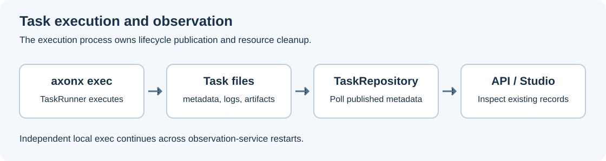

# 定时调度

调度启动本地同步 Task 命令。应用计算后续触发时点，Daemon 拥有已经启动的进程。



## 最小配置

```yaml
extends: default
timezone: Asia/Shanghai
cron:
  - expression: "0 16 * * 1-5"
    command: "axonx exec --task download_tushare_task --days-back 7"
```

使用 `axonx app --config scheduled.yaml` 启动。`cron: []` 关闭继承计划；列表整体替换父列表，配置变化后重启。

## Cron 与时区

表达式恰好五个数字字段：分、时、日、月、星期。支持数字范围、列表、步长和通配符，拒绝星期名称和秒字段。触发使用应用时区。到期条目触发一次，然后从当前时间推进，不补跑错过时点。

## 命令参数

命令必须以 `axonx exec` 开始并包含非空 `--task NAME`。通过 `shlex` 解析，不经过 shell，不支持管道、重定向、环境赋值或 `--target` 等客户端选项。执行默认值和环境配置在应用层，也可显式传入 Task 执行字段。

## 并发与身份

调度不提供命名计划记录、并发策略或自动 skip/replace 队列。一次触发请求启动一个 Daemon 命令。自动生成的任务名称保留独立记录；固定 `--task-name` 复用目录，需要调用方协调，旧同名执行仍在运行时会拒绝启动。业务重叠策略应在 Task 或宿主集成中显式实现。

## 检查与关闭

检查 Daemon/服务日志和 `logs/cron/entry-N.log`，再检查 Task metadata 和产物。启动进程不代表成功。关闭应用停止后续触发；Daemon 已启动的定时执行在应用服务重启后继续，服务拥有的手动 CLI 命令则随服务关闭而停止。定时进程仍活动时更新源码或依赖需要协调，因为进程不固定代码版本。

## 嵌入式应用

`Application(cron=..., launch_scheduled=callback)` 要求宿主提供启动器。回调接收条目索引和 `CronConfig`，进程生命周期归宿主管理。CLI 启动注入 Daemon 启动器，详见[框架扩展](../development/framework-extensions.md)。

源码：[CronConfig](../../../axonx/app/config/models.py)、[触发循环](../../../axonx/app/components/cron/scheduler.py)、[Daemon 启动器](../../../axonx/daemon/launcher.py)。
