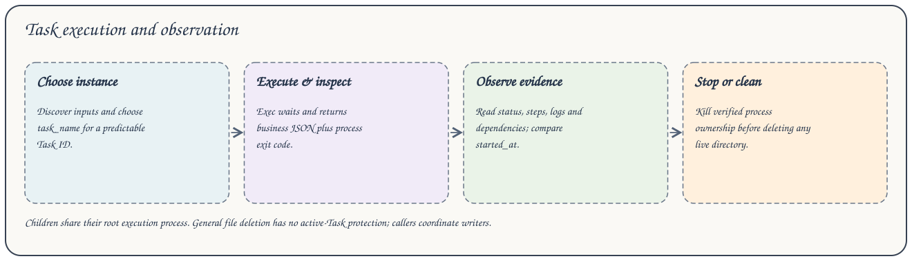

# Task 执行与观察



## 发现并执行

```bash
axonx get_task_def --task demo
axonx exec --task demo --task-name add-01 --x 1 --y 2
axonx status --task-id 'base#demo#add-01' --detail full
axonx read_task_log --task-id 'base#demo#add-01' --offset -1 --limit 8192
axonx get_task_graph --task-id 'base#demo#add-01'
```

Exec 同步执行，返回业务输出和进程退出码。记录 Task ID、metadata.started_at、目标和工作区。省略 task_name 会生成新实例，固定名称替换当前已完成输出并保留 persistent/。

## 等待完成

在另一终端观察长任务。`axonx wait_task --task-id ID --client-timeout 600` 捕获当前启动时间，等待期间重跑则报错，只有 succeeded 时成功。失败响应仍可能包含完整 Task metadata，应检查 error/exit_code 和实际响应形态。

## 状态与日志

CLI status/wait 默认摘要，完整详情包含输入输出、步骤和子任务。日志游标按字节计，用 next_offset 继续读取，可传 started_at 拒绝替换执行。`stream_task --stream true` 传输进度/日志直到最终 result。观察不启动任务，也不修复失效状态。

## 停止与重跑

使用 `axonx kill --task-id ID --timeout 5 --force false`。force=true 选择强制信号，不是调度或服务更新选项。发送信号前检查进程身份。子任务解析到根进程所有者，随整次执行停止。展示副本不能本地执行或停止源进程。

只能修正确认已退出的本机进程，异机或无法访问的进程会阻止替换。使用源 execution_target/工作区，不把 machine_id 当作地址。停止后先核对结果再重跑。

## 删除已停止目录

当前文件接口为 `delete_entries --paths '["base/base#demo#add-01"]'`，不保护活动进程。确认写入者均停止，使用工作区相对路径并与并发执行协调。该操作也删除 persistent/，删除不能代替停止进程。

## Studio

任务定义使用当前输入 Schema 构造表单，执行通过服务拥有的 CLI 命令并展示实时输出，metadata 独立观察。区分命令连接失败与 Task 失败，重跑比较 started_at，并确认所选机器。任务分组反映工作区记录，包括副本和其他进程结果。

源码：[CLI](../../../axonx/cli/commands.py)、[观察 Step](../../../axonx/app/steps/task.py)、[停止执行](../../../axonx/task/runtime/lifecycle.py)。
