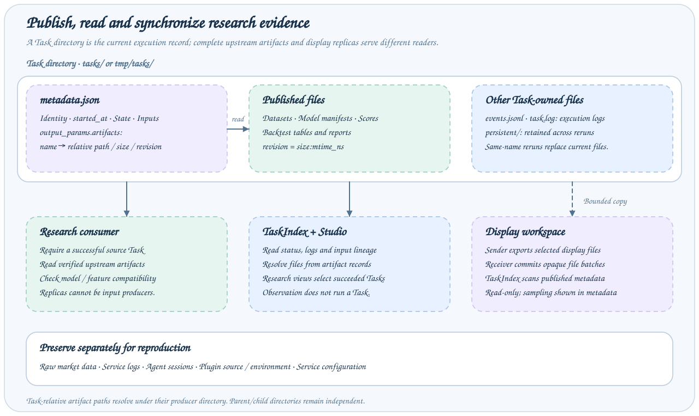

# 结果展示同步

同步创建有大小限制的展示副本。每条规则指定工作流注册名和发布时间：`terminal` 等待父任务及选中子任务成功或失败后同步；`live` 在每次 flush 时同步当前状态。`model_names` 使用通配模式筛选模型分支，空列表包含全部模型；`rules` 映射为空时不选择任何工作流。



沿虚线复制路径读取右侧展示工作区。研究消费方仍读取经过验证的源产物，副本路径用于查看证据。

## 内容与语义

副本包含 metadata、进度证据和引用的已发布产物，不包含环境、原始工作区、未引用文件。缺失文件记录在 replica.omitted，源声明和指标保持原样。副本不能执行、不能作为可修改的研究输入，也不继续转发为同步源。

## 统一预算

transfer_budget_bytes（默认 512 MiB）限制上传和含 tar 封装的归档大小，发送/接收使用较小预算。较大的日期键 Parquet 可采样为共同的完整交易日后缀，大小、修订、源行数和覆盖范围区分副本与完整源产物。其他文件可省略，不会悄悄截断。

## 配置

```yaml
extends: default
targets:
  - address: http://display:1024
    token: ${DISPLAY_TOKEN}
components:
  sync:
    default:
      backend: local
      target: http://display:1024
      task_index: default
      model_names: ["experiment-*"]
      rules:
        research: terminal
        online: live
        compare: terminal
      max_archives_per_flush: 4
      timeout_seconds: 300
jobs:
  sync_flush:
    parameters: { type: object, properties: {}, additionalProperties: false }
    steps:
      - backend: sync_flush_step
        sync: default
```

配置可选 Job 后显式调用 `axonx sync_flush`，默认未启用。Cron 支持本地 Task exec，不能将 Job 调度块直接移入 cron；可由宿主工作流周期调用 flush。同步组件依赖 task_index。

## 协调、重试与清理

索引事件将符合条件的源记录加入待处理队列。发送端在本地完成工作流快照选择和校验、元数据裁剪、日志捕获及产物采样，再通过 `sync_index` 查询本来源的文件回执，上传完整清单与变化文件，通过 `sync_files` 提交。源发布未变化时跳过传输。临时失败可在后续 flush 重试，不安全或超预算证据报告错误或省略。

接收端只校验文件路径、清单、大小、归属和修订顺序，从匹配的回执复用未变文件，将目录与回执一同替换，失败时回滚。它不解析 `TaskMetadata`、`DisplayReplica`、模型名或父子关系。已有 `task_index` 在下一次扫描时发现落盘元数据，默认间隔五秒；能否展示取决于扫描器是否支持该元数据格式，与文件是否成功传输独立。

`sync/receipts/` 中的传输回执只支持增量、重试与目录归属清理，不是第二套任务索引。每次查询只核对一次各目录；共享目录的组使用其最新落盘文件清单，缺文件或大小不符时才触发相关组重传。无归属回执的已有目录不会被接管或覆盖。回执还记录本地目录身份，目录被本地重新创建后，旧回执不能再授权覆盖它。检查返回的同步报告；归档应用后清理暂存上传。

## 工作流分支快照

`TaskSnapshot` 记录 `source_id`、`root_task_id`、`root_started_at`、`captured_at`、有序 `revision`、`when` 和 `model_names`。两种发布时间共用发送端的任务树选择与预算，再执行文件增量传输和批次替换。子任务成员依据记录的 Task ID 与启动时间确定；固定名称子任务已有更新执行时，源 metadata 和执行历史保留旧调用，同步视图排除已被覆盖的分支，不把新产物关联到旧调用。子任务缺失及捕获期间的变化仍报错；被排除的分支不读取，因此其重跑不会阻塞另一模型的快照。

分流复用输入 `models`、模型 `task_name` 和现有子调用 `node_name`。模型列表的节点为 `模型名-注册名`，按信号时点配置的节点为 `模型名-时点-注册名`。普通 `run_task(task_name=...)` 自动生成这种节点名；哈希 Task 目录显式提供逻辑 `node_name`，共享调用保留默认注册节点名。选中分支保留仍可用且执行匹配的后代 Run；父进度在已有步骤 `group` 或按冒号分隔的 `name` 中精确匹配模型节点（模型名或模型名-时点）。部分选择的父任务如果包含无法识别的子节点会被拒绝。

部分视图会裁剪父任务输入/结果中的模型条目，保留选中及共享的子任务/步骤，并省略父任务聚合产物和混合日志。选中子任务的已发布产物与有限日志仍可查看，源 metadata 不变。模型筛选为空时移除先前发布的视图。任务树通过 Task ID 和执行启动时间关联子任务；共享子任务可以来自更新的展示发布，不要求与父任务使用相同的快照修订。替换视图时会移除同一来源/根任务组中不再包含的展示副本，其他 Task 保留。

## 验证

核对源/目标、执行启动身份、产物覆盖和目标只读标识。同步不恢复进程、不安装插件、不传凭据，也不代替备份。

源码：[同步组件](../../../axonx/app/components/sync/local.py)、[副本构建器](../../../axonx/app/components/sync/replica.py)。
