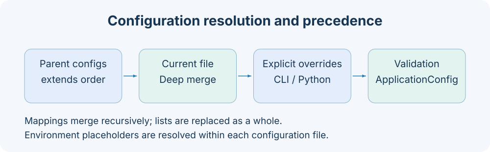

# 服务端配置参考

服务配置描述一个 Application 的工作区、组件、Job、调度与 HTTP 服务。CLI `start` 使用 ConfigResolver 先解析 YAML/JSON，再以 ApplicationConfig 校验。Python 直接构造 Application 时不会自动读取 default.yaml，需要显式调用 resolver 或传入完整配置。



## 最小覆盖配置

```yaml
extends: default
workspace_dir: .axonx
log_dir: logs
service:
  host: 127.0.0.1
  port: 1024
  token: ${AXONX_SERVICE_TOKEN}
```

```bash
axonx start --config app.yaml
axonx start --config app.yaml --service.port 2024
```

extends 不是 ApplicationConfig 的持久字段，由解析器先消除。Python 调用见 [Python 参考](python.md)。

## ApplicationConfig

下表为模型默认值，不等于内置 default.yaml 展开的结果；例如模型 components/jobs 为空，但 default.yaml 已配置任务组件、Agent 和多个 Job。

| 字段                  | 类型                                  | 模型默认值    | 含义与限制                                  |
| --------------------- | ------------------------------------- | ------------- | ------------------------------------------- |
| app_name              | string                                | AxonX         | 日志与协议显示名称                          |
| workspace_dir         | string                                | .axonx        | 任务、产物与应用状态根目录                  |
| transfer_budget_bytes | integer                               | 536870912     | 上传与压缩前展示副本的唯一预算（512 MiB）。 |
| log_dir               | string                                | logs          | 服务与任务日志目录                          |
| timezone              | string                                | Asia/Shanghai | 默认应用/任务时区                           |
| language              | `en` / `zh`                           | en            | Agent 内置指南语言                          |
| enable_logo           | boolean                               | true          | CLI start 打印启动标识                      |
| log_to_console        | boolean                               | true          | 控制台日志                                  |
| log_to_file           | boolean                               | true          | 文件日志                                    |
| plugins               | PluginConfig                          | sources=[]    | 启动插件来源                                |
| targets               | TargetConfig[]                        | []            | 后端可转发的服务目标                        |
| environment           | dict[string,string]                   | {}            | 注入 worker、Agent 的应用环境               |
| components            | dict[类别,dict[名称,ComponentConfig]] | {}            | 命名组件组                                  |
| jobs                  | dict[公开名,JobConfig]                | {}            | Job 定义                                    |
| cron                  | string/null                           | null          | 命名 crontab 或明确的 .cron 文件路径        |
| service               | ComponentConfig/null                  | null          | 服务组件；CLI start 必须有 service          |

模型禁止未知顶层字段。目标地址规范化后不得重复。environment 值必须是字符串，不应放数字或嵌套对象。

`timezone` 同时控制服务与任务 worker 的日志时间、日志文件名中的启动时间及午夜轮转，不依赖服务器系统时区。日志行包含 UTC 偏移量（例如 `2026-10-12 15:47:25 +08:00`）。直接使用 `LoggingConfig` 时默认采用 `Asia/Shanghai`，可通过其 `timezone` 覆盖。Loguru 自动生成的归档后缀仍使用服务器系统时区。已有日志文件保持原样。

进程日志、独立 Run 日志和轮转归档按最后修改时间保留 7 天。清理由服务统一负责：启动后在后台清理一次，随后每小时清理一次。CLI、Task worker 和 GPU worker 配置日志时只打开日志输出，不扫描共享日志目录。未启动服务的独立执行不启动周期清理。仍在运行的进程日志及持有文件锁的 Run 日志会跳过，即使暂时没有新日志也不会删除。清理仅处理 `log_dir` 直属目录中由 AxonX 生成的日志文件，不删除 Task metadata 和产物。日志过期或被删除后，日志查询会提示日志不可用，终态 stream 仍会回放保留的进度事件。

## 配置发现与继承

`--config default`、`--config remote` 查找内置命名配置。安装包可通过 `axonx.configs` entry point 贡献其他名称；内置和外部同名、外部多个同名都拒绝。文件路径支持 .yaml/.yml/.json；相对文件路径先按当前工作目录尝试，再按内置配置目录尝试。

```yaml
extends:
  - default
  - ./research-base.yaml
service:
  port: 2024
```

父配置按列表从左到右合并，当前文件覆盖父配置，显式 CLI/Python overrides 最后覆盖。字典递归合并，列表整体替换；不会将两个 steps 或 targets 数组合并追加。extends 相对文件优先在当前配置文件目录寻找，循环继承报错。

```yaml
# 父配置的 targets 将被整个替换；jobs 中其他名称保留。
extends: default
targets:
  - address: http://node-b:1024
    token: ${NODE_B_TOKEN}
jobs:
  version:
    enable_stream: false
```

## 环境展开与路径

`${VAR}` 要求变量存在；`${VAR:-default}` 在变量不存在时用默认文本。变量存在但为空时不会使用 default。每个文件在继承合并前递归展开；只有环境替换改变了内容的字符串才会进一步将 true/false、null、数字和 JSON 转换为自然值，未发生替换的字符串保持原类型。

```yaml
workspace_dir: ${AXONX_WORKSPACE_DIR:-.axonx}
service:
  token: ${AXONX_SERVICE_TOKEN:-null}
  web_enabled: ${AXONX_SERVICE_WEB_ENABLED:-true}
  shutdown_timeout: ${AXONX_SERVICE_SHUTDOWN_TIMEOUT:-1}
  cleanup_timeout: ${AXONX_SERVICE_CLEANUP_TIMEOUT:-15}
```

内置 `default` 配置及继承它的配置（包括 `remote`）从 `AXONX_WORKSPACE_DIR` 读取 `workspace_dir`；变量未设置时仍使用 `.axonx`。可在 shell 或 `.env` 中设置，例如 `AXONX_WORKSPACE_DIR=/srv/axonx/workspace`。子配置显式指定的 `workspace_dir` 会覆盖该值；`--workspace-dir` 或 Python resolver 的显式覆盖优先于两者。直接构造 `ApplicationConfig` 时仍使用模型默认值 `.axonx`，不会读取此变量。

CLI start 先加载 .env，并合并到 environment；普通客户端与 exec 以 override=false 读取环境。Python 的 ConfigResolver 本身不负责加载 .env，调用者需要自己建立环境。

plugins.sources 的相对路径按声明它的配置文件目录解析成绝对路径。workspace_dir/log_dir 等普通路径没有该特殊转换，运行时通常相对进程工作目录，并支持用户目录展开。不要将 config 文件所在目录误当成全部路径的基准。

## ComponentConfig 与命名组件

ComponentConfig 要求非空 backend，允许额外字段，由对应实现构造函数解释或校验。

本地仓库在启动时读取一次任务元数据，随后在线程中仅轮询分类目录、任务目录及其 `metadata.json`。只有文件属性变化时才重读记录，不递归监听产物或日志。`poll_interval` 是每轮完成后的等待秒数，默认 `1`，必须为有限正数。扫描失败时保留旧索引并重试；无效记录保留最后一次有效值，直到修复或删除。仓库关闭时会等待正在执行的扫描结束。原有 `recursive`、`force_polling`、`debounce`、`step`、`poll_delay_ms` 配置已移除，请替换为 `poll_interval`。

## JobConfig

| 字段          | 类型               | 默认值                    | 含义                                |
| ------------- | ------------------ | ------------------------- | ----------------------------------- |
| backend       | 非空 string        | pipeline                  | Job 实现                            |
| description   | string             | 空字符串                  | 公开描述                            |
| parameters    | JSON Schema object | type=object,properties={} | 必须描述对象；缺 type 自动补 object |
| enable_serve  | boolean            | true                      | 进入 HTTP/MCP 候选公开目录          |
| enable_stream | boolean            | true                      | 允许 HTTP 实时流                    |
| requires_auth | boolean            | true                      | 无服务 token 时筛除该 Job           |
| steps         | ComponentConfig[]  | []                        | 顺序执行异步 Step                   |
| defaults      | object             | {}                        | Job context 默认值                  |

PipelineJob 还支持 event_buffer_size（默认 64，正整数），作为 backend 特有额外字段。parameters 的 JSON Schema default 是描述信息，不能假定框架统一注入；需要真实默认值时由 defaults 或 Step 处理。system 注入值与公开参数隔离。

PipelineJob 按 `defaults` → caller arguments → system 递归合并，并在每次调用时深拷贝结果。嵌套对象保留未指定的字段，空对象覆盖也遵循此规则；列表和标量整体替换。公共参数在合并前校验。详见 [框架扩展](../development/framework-extensions.md#参数、默认值与-system)。

## Cron 配置

`cron` 指定命名 crontab 或明确的 `.cron` 路径；`null` 禁用调度。`axonx start --config default --cron research` 复用配置文件定位逻辑，使用独立的 `axonx.crons` entry-point 分组。cron 解析五字段条目，只启动本地 `axonx exec --task`，在启动时读取一次并使用应用时区，服务关闭后已启动 Task 继续运行。详见 [定时调度](../guides/scheduling.md)。

## PluginConfig 与 TargetConfig

plugins 只接受 sources 字段，为非空字符串数组，默认 []。已安装环境中的插件也会被发现，sources 不是“唯一启用白名单”。启动来源可能触发安装，应先确认所用源码与依赖。

TargetConfig 严格禁止额外字段：address 必填非空，token 默认 null 或非空字符串。地址接受 host:port 或带明确端口的 HTTP(S) URL，禁止用户密码、子路径、query、fragment；规范化后去除尾部斜线。完整用法见 [客户端连接](client-configuration.md)。

## HTTP service

| 字段             | 默认值    | 解释                                          |
| ---------------- | --------- | --------------------------------------------- |
| backend          | 必填 http | HTTP 服务实现                                 |
| host             | 0.0.0.0   | 绑定地址                                      |
| port             | 1024      | 监听端口                                      |
| shutdown_timeout | 1         | 请求收尾秒数，非负，不包含应用清理            |
| cleanup_timeout  | 15        | 服务关闭总时限（秒），必须为正有限数          |
| web_enabled      | true      | 是否挂载 Studio 静态构建                      |
| token            | null      | 非空 Bearer token；null 时按 Job 规则筛选目录 |

内置 `default` 及继承它的 `remote` 配置读取 `AXONX_SERVICE_CLEANUP_TIMEOUT`（默认 `15`），显式 `service.cleanup_timeout` 配置优先。总时限从首次关闭信号或服务关闭请求开始，包含请求收尾、应用清理和线程池收尾，建议大于 worker 停止宽限与预计清理时间之和。再次 Ctrl+C 或超时会以退出码 `130` 强制退出，生命周期记录可能尚未写完。该时限适用于 `HttpService.run_app()`；嵌入式 ASGI lifespan 与 `Application.close()` 仍等待正常清理。参见[部署](../guides/deployment.md#更新与关闭)。

服务默认没有 TLS 配置。Studio 构建缺失时记录不可用日志，API 仍可运行。配置更新不会热装配；重启后重新核对目录。

## 专题配置与校验

- [Claude Agent](../agent/configuration.md)：模型、权限、工具与会话状态。
- [任务同步](../guides/task-sync.md)：默认未启用的 sync 组件与 schedule。
- [HTTP 代理](../guides/http-proxy.md)：命名固定上游。
- [服务部署](../guides/deployment.md)：进程托管与静态资源。

启动出现 ValidationError 时先检查顶层拼写、严格 TargetConfig token 类型、environment 字符串、backend 注册名；依赖缺失与冲突属于装配错误，不能通过跳过 Schema 解决。

实现依据：`axonx/config/models.py`、`resolver.py`、`default.yaml`、`core/composition.py`、`components/service/http/service.py`。
