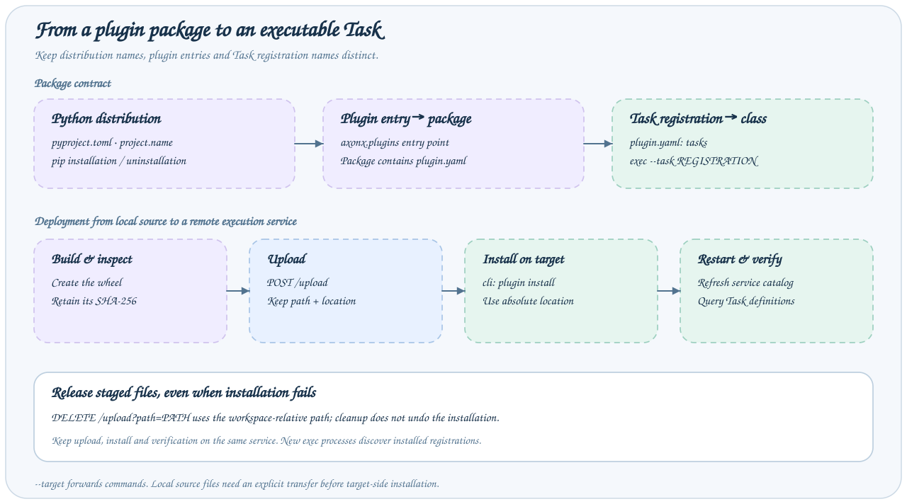

# 插件 Manifest



上方对应插件使用的三种名称；下方说明该包如何部署到远程执行环境。

## 名称与包布局

distribution 发布 `axonx.plugins` 入口，值为含 `plugin.yaml` 的 Python 包。注册名是映射键，类目标使用 `module:Class`。

```text
example/
  pyproject.toml
  example_plugin/
    __init__.py
    plugin.yaml
    task.py
```

```toml
[project]
name = "axonx-example"
version = "0.1.0"
dependencies = ["axonx>=0.3.0"]

[project.entry-points."axonx.plugins"]
example = "example_plugin"

[tool.setuptools.package-data]
example_plugin = ["plugin.yaml"]
```

```yaml
tasks:
  example_add: example_plugin.task:AddTask
```

Task 类使用[开发指南](../dev_guide.md)中的完整示例。注册名必须在所有已安装 distribution 和内置 Task 中唯一。

## Manifest 字段

唯一接受的字段是 `tasks`，将非空注册名映射到非空类目标，其他字段会被拒绝。发现阶段只读取 manifest，不加载 Task 代码；TaskCatalog 按需导入并校验子类。Task 类 docstring 作为定义描述，输入输出来自 Pydantic 模型 Schema。

## 框架扩展

Component 和 Job 通过应用配置以及 `Application(providers=...)` 显式装配，Task manifest 不注册它们。已安装包可独立提供 `axonx.configs` 配置入口，该入口不是 Task manifest 字段。

## 发现、安装与装配

将 distribution 安装到实际执行解释器。启动层在服务启动时固定 Task 注册快照，每次新 `exec` 构造新目录；类在各目录内部缓存。安装和卸载不刷新现有目录，也不串行协调环境变更。注册、Schema 或已加载依赖变化后重启常驻服务。

远程原生命令中的源码路径属于目标机。本地到远程部署显式构建、上传 `/upload`、安装 `location`、清理 `path`，重启后验证，详见[插件管理](../plugins/management.md)。

## Wheel 与内容指纹

| 字段             | 含义                           |
| ---------------- | ------------------------------ |
| `sha256`         | wheel 的确切字节               |
| `content_sha256` | 规范化插件内容                 |
| `requirements`   | 声明依赖元数据                 |
| `tasks`          | 注册名 → 类目标                |
| `wheel`          | build/inspect 输出中的制品位置 |

安装器安装 AxonX 自身之外的声明依赖，以 force-reinstall/no-deps 安装插件，再核验安装后来源和内容与目标 wheel 一致。接口不接收调用方预期哈希；验证传输时将返回的 `sha256` 与本地 wheel 比较。editable 导入钩子需要新解释器，常驻服务也可能需要重启。

## 命名配置贡献

```toml
[project.entry-points."axonx.configs"]
example = "example_plugin.config:service"
```

该入口在目标包目录定位 `service.yaml`、`.yml` 或 `.json`。配置文件应作为包数据发布。名称不得与内置或其他已安装提供方冲突。继承规则见[配置参考](configuration.md)。

源码：[manifest](../../../axonx/plugin/manifest.py)、[发现](../../../axonx/plugin/discovery.py)、[wheel 工具](../../../axonx/plugin/wheel.py)。
