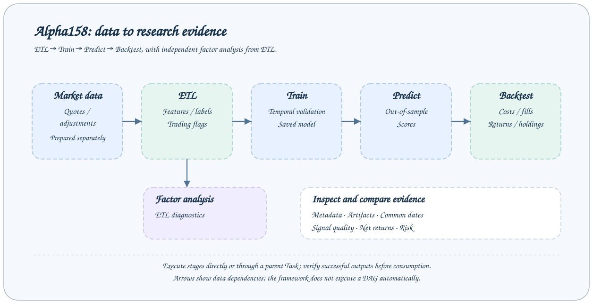

# Alpha158 研究流程

AxonX 提供研究任务的运行、记录、产物和 Studio 展示。本文使用仓库中适配 [Microsoft Qlib](https://github.com/microsoft/qlib) Alpha158 基线的 `plugins/qlib_a158/` 作为具体算法实现，建立从 Tushare 数据到回测结果的闭环。增强版 `qlib_factor` 使用独立的 `qlib_factor_*` 注册名，并增加训练特征组参数。两者共享研究阶段与基础产物形式，但跨插件复用上游前仍需检查 Task 定义、特征顺序和协议；具体用法见[Qlib Factor](../../../plugins/qlib_factor/README_ZH.md)。



## 开始前确认

- 已完成[快速开始](../getting-started/quickstart.md)，服务 token 与连接可用。
- 执行任务的服务环境已安装 qlib_a158 插件；本地 CLI 安装不会自动改变远程机器环境。
- 工作区已有覆盖训练和预测区间的 Tushare 历史数据，以及必要的主数据。
- 研究任务使用源工作区中的完整上游产物。[展示同步](../guides/task-sync.md)可能采样或省略文件，不能用于准备执行输入。

从 AxonX 源码仓库根目录执行（插件尚未发布到 PyPI）：

```bash
axonx plugin install ./plugins/qlib_a158
```

本机 Agent 修改插件时使用 `axonx plugin install -e ./plugins/qlib_a158`。远程部署需要本地构建、上传、目标机安装与清理；仅追加 `--target` 不会传输源码，详见[插件管理](../plugins/management.md)。

安装或 editable 源码变更后需重启常驻服务，以刷新 Task 注册快照和已缓存的定义。运行 `axonx list_task_defs` 查询任务目录。预期找到 `qlib_a158_etl`、`qlib_a158_analysis`、`qlib_a158_train`、`qlib_a158_predict`、`qlib_a158_backtest` 以及父任务 `qlib_a158_research`。

## 研究链中每一步产生什么

| 阶段     | 注册名                  | 输入来源          | 主要结果                        |
| -------- | ----------------------- | ----------------- | ------------------------------- |
| 下载     | `download_tushare_task` | Tushare 接口      | 工作区 `tushare/` 原始分区      |
| ETL      | `qlib_a158_etl`         | 原始分区与主数据  | `alpha158.parquet`、统计 CSV    |
| 因子分析 | `qlib_a158_analysis`    | 一个 ETL Task     | 因子诊断与分层收益 CSV          |
| 训练     | `qlib_a158_train`       | 一个 ETL Task     | LightGBM 模型、重要性、验证历史 |
| 预测     | `qlib_a158_predict`     | 一个 Train Task   | 全截面预测 Parquet              |
| 回测     | `qlib_a158_backtest`    | 一个 Predict Task | 日频与汇总 Parquet              |

因子分析是 ETL 的独立下游，训练不依赖因子分析成功。预测优先使用显式声明的 ETL 上游，否则从训练 metadata 解析；它固定经核验的模型集合和所选数据集快照。为便于复现，仍需保留源记录与产物。

## 执行并核验一个阶段

需要可预测 Task ID 时显式指定实例名：

```bash
axonx exec --task qlib_a158_etl --task-name experiment --start-date 20150101
axonx status --task-id 'etl#qlib_a158_etl#experiment' --detail full
```

Exec 等待完成、输出业务结果并返回 Task 退出码。从 metadata 记录 Task ID、started_at 和输入/产物修订，确认成功后再向下游传递 ID。另一个终端观察可用 Task ID 调用 wait_task，等待时重跑会报错。远程命令连接中断后先检查 metadata，再决定是否重试。

## 从 ETL 到样本外预测

```bash
# ETL 成功后，可独立做因子分析
axonx exec --task qlib_a158_analysis --upstream-task-ids '<ETL Task ID>'

# 训练结束日期不包含在训练区间内
axonx exec --task qlib_a158_train --upstream-task-ids '<ETL Task ID>' \
  --train-start 20150101 --train-end 20230101 \
  --label-column label_return_rank

# 训练成功后，预测开始日期必须不早于 train_end
axonx exec --task qlib_a158_predict --upstream-task-ids '<Train Task ID>' \
  --pred-start 20230101 --pred-end 20231231

# 预测成功后，生成回测产物
axonx exec --task qlib_a158_portfolio --upstream-task-ids '<Predict Task ID>'
axonx exec --task qlib_a158_backtest --upstream-task-ids '["<portfolio_task_id>"]' --buy-cost-rate 0.0005 --sell-cost-rate 0.0015
```

每条 `exec` 都等待完成，执行下一阶段前检查退出码与 metadata。`upstream_task_ids` 是 JSON 数组，CLI `exec` 也接受逗号分隔 ID；qlib_a158 各阶段要求相应类型的单个上游，不能任意添加同类型任务。

训练按交易日顺序保留末尾日期作验证，默认验证比例为 10%。先用验证集和早停选择轮数，再用训练窗口的全部有效样本拟合最终模型。保存的训练曲线来自调参阶段，不能将它当成最终模型在独立测试集上的表现。

## 数据范围与标签边界

ETL 默认输出从 `20140101` 开始的可用数据，滚动特征会读取更早的历史。下载最近 7 个自然日不能满足多年训练，更不足以生成完整滚动窗口。

qlib_a158 独立发布特征、原始标签、行情和日历产物。标签固定为次一市场日同一时刻的收益，停牌或缺行情使标签无效，不延长期限。训练排除目标日期达到或超过截止日的标签，在样本筛选后计算 Rank/CSZ 目标。预测保留全截面，不关联未来标签。回测按信号日资格选择候选，逐市场日估值真实持仓；无法卖出时继续占用资金。

默认训练目标 `label_return_rank` 是截面排名标签，预测 `pred` 是模型评分，不能直接解释为收益率或上涨概率。

## 在 Studio 查看结果

各阶段的 Studio 0.3.0 完整截图见[结果解读](results.md)：数据处理、因子分析、模型训练与离线预测分别展示日期、指标与产物。截图使用 Playground 合成数据说明界面，不是执行本文命令得到的结果。

依次进入数据处理、因子分析、模型训练、离线预测和离线回测页面，选中对应任务。研究列表读取成功任务的 `metadata.json`，运行中任务应去任务页面查看状态和日志。

阅读顺序建议是：先检查数据处理结果的日期、行数和特征列，再检查训练验证信息，随后检查预测覆盖，最后解读回测协议、成本与收益。不同策略的比较见[策略比较](strategy-comparison.md)。

## 从运行研究链到设计实验

一次完整执行提供参数与产物；评估改进还需要控制变量、消融、筛选与独立确认。按[实验设计与确认](experiments.md)制定比较方案，再用[策略比较](strategy-comparison.md)检查共同窗口。Agent 开发增强特征的具体过程与复现入口见 [Qlib Factor](../../../plugins/qlib_factor/README_ZH.md)。

## 执行研究 Task

先安装插件并准备历史数据，再通过嵌套参数配置各阶段：

```bash
axonx get_task_def --task qlib_a158_research
axonx exec --task qlib_a158_research --task-name pipeline-01 \
  --etl.start-date 20150101 --train.train-end 20230101 \
  --predict.pred-end 20231231 --portfolio.top-ns '[20,30]'
```

父 Task 管理子实例名和 `upstream_task_ids`，依次运行 ETL → Train → Predict → Portfolio → Backtest，返回 `stage_task_ids`。添加 `--analysis '{}'` 会在 ETL 后执行因子分析，默认不启用。`predict.pred_start` 默认采用 `train.train_end`。嵌套阶段名、依赖以及显式回测输入文件覆盖会被拒绝；复用已有上游时使用叶子 Task。子任务与父任务共享进程，并继承父实例名，详见[组合 Task](../guides/composite-tasks.md)。

## 常见失败与处理

| 现象                            | 优先检查                                          |
| ------------------------------- | ------------------------------------------------- |
| 注册名不存在                    | 执行服务的插件环境与重启状态                      |
| 缺少 daily、adj_factor 或主数据 | `tushare/` 分区和静态文件                         |
| 训练区间没有有效标签            | ETL 日期、交易状态、退出标签与训练边界            |
| 预测开始早于训练结束            | `pred_start` 与 metadata 的 `train_end_exclusive` |
| 模型校验失败                    | 训练目录内 model 文件是否被替换                   |
| 回测缺少字段                    | 是否为匹配 qlib_a158 协议的预测产物               |

血缘图记录显式上游关系，不自动调度、补齐或重跑研究链。使用固定 `task_name` 重跑会替换已结束任务的目录记录；需要比较实验时使用不同名称并保留产物。

## 相关文档与实现

- [Tushare 数据](tushare.md)、[结果解读](results.md)、[回测解读](backtest.md)
- [研究产物协议](../reference/research-artifacts.md)
- [`qlib_a158 插件清单`](../../../plugins/qlib_a158/axonx_qlib_a158/plugin.yaml)
- [`训练实现`](../../../plugins/qlib_a158/axonx_qlib_a158/train.py)、[`预测实现`](../../../plugins/qlib_a158/axonx_qlib_a158/predict.py)
