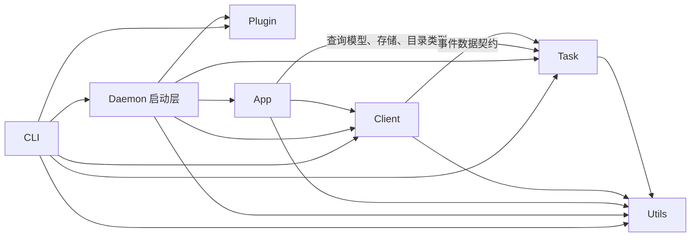
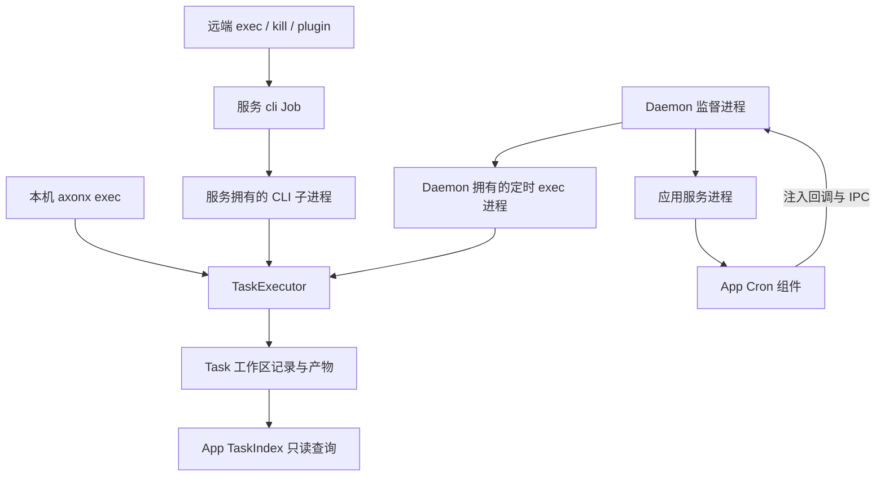

# AxonX 模块依赖明细

核对版本：`axonx/_version.py` 中的 **0.3.0**；核对日期：2026-10-28。本文基于当前工作区代码，包含未提交修改，汇总 `app`、`client`、`cli`、`utils`、`daemon`、`plugin`、`task` 七个包之间的实际依赖。

依赖方向为“具体调用方 → 被依赖的子模块”。下文汇总跨包直接导入，以及 CLI 子进程入口、注入式更新后端两项运行时依赖。Cron 由 App 组件调度，Daemon 负责定时执行进程。模块路径均省略 `axonx.` 前缀，同包内部导入、第三方库和测试代码不计入跨包明细。函数内导入仍计为直接导入，仅用于类型检查的导入单独注明。

## 包边界与执行路径

箭头表示调用方依赖被调用方。下图汇总跨包源码导入（含延迟导入）；App 对 Task 的依赖限于模型、存储和目录类型，Client 只复用 Task 事件契约。

Task 执行与查询分别由运行时和 App 组件承担；进程归属如下：

服务重启会停止其拥有的手动 CLI 子进程，Daemon 拥有的定时进程继续运行。TaskIndex 读取记录，不接管执行器。具体边界由 `tests/unit/test_module_boundaries.py` 验证。

## 跨包依赖明细

- [utils.async_work](axonx/utils/async_work.py)（`utils`）：`complete_on_cancel` 和 `run_blocking`；自有异步清理和线程工作完成后再传播取消，由 App、Client 和 Daemon 共用。

  调用方：[app.components.agent.claude.backend](axonx/app/components/agent/claude/backend.py)、[app.components.agent.session_store](axonx/app/components/agent/session_store.py)、[app.components.job.command](axonx/app/components/job/command.py)、[app.components.job.pipeline](axonx/app/components/job/pipeline.py)、[app.components.machine.local](axonx/app/components/machine/local.py)、[app.components.machine.python](axonx/app/components/machine/python.py)、[app.components.proxy.base](axonx/app/components/proxy/base.py)、[app.components.sync.local](axonx/app/components/sync/local.py)、[app.components.task_index.local](axonx/app/components/task_index/local.py)、[app.components.updater.local](axonx/app/components/updater/local.py)、[app.core.application](axonx/app/core/application.py)、[app.steps.sync](axonx/app/steps/sync.py)、[app.steps.task](axonx/app/steps/task.py)、[app.workspace.uploads](axonx/app/workspace/uploads.py)、[client.base](axonx/client/base.py)、[client.http](axonx/client/http.py)、[daemon.launcher](axonx/daemon/launcher.py)。

- [app.core.application](axonx/app/core/application.py)（`app`）：延迟导入 `Application`，直接创建应用并注入更新后端。Workspace 提供通用文件操作，TaskIndex 只读观察记录。

  调用方：[daemon.launcher](axonx/daemon/launcher.py)。

- [client.base](axonx/client/base.py)（`client`）：客户端生命周期和远程错误分类；App 与 CLI 直接引用错误类型。

  调用方：[app.components.service.http.service](axonx/app/components/service/http/service.py)、[app.components.sync.local](axonx/app/components/sync/local.py)、[cli.commands](axonx/cli/commands.py)。

- [client.config](axonx/client/config.py)（`client`）：`ConnectionOptions`、地址规范化、连接默认值、环境变量、路由、鉴权头和 SSE 约定；由 Client、CLI 与服务端配置共用。

  调用方：[app.components.agent.claude.tools](axonx/app/components/agent/claude/tools.py)、[app.components.job.base](axonx/app/components/job/base.py)、[app.components.job.command](axonx/app/components/job/command.py)、[app.components.service.http.service](axonx/app/components/service/http/service.py)、[app.components.service.http.files](axonx/app/components/service/http/files.py)、[app.components.service.http.jobs](axonx/app/components/service/http/jobs.py)、[app.components.service.http.middleware](axonx/app/components/service/http/middleware.py)、[app.config.models](axonx/app/config/models.py)、[app.core.banner](axonx/app/core/banner.py)、[cli.main](axonx/cli/main.py)、[cli.parser](axonx/cli/parser.py)、[daemon.launcher](axonx/daemon/launcher.py)。

- [client.events](axonx/client/events.py)（`client`）：公开 Job 事件、Agent 消息补丁及统一事件解析；Task 事件继续复用原领域定义。

  调用方：[app.components.agent.base](axonx/app/components/agent/base.py)、[app.components.agent.claude.backend](axonx/app/components/agent/claude/backend.py)、[app.components.agent.claude.projector](axonx/app/components/agent/claude/projector.py)、[app.components.agent.models](axonx/app/components/agent/models.py)、[app.components.job.base](axonx/app/components/job/base.py)、[app.components.job.command](axonx/app/components/job/command.py)、[app.components.job.pipeline](axonx/app/components/job/pipeline.py)、[app.components.service.http.jobs](axonx/app/components/service/http/jobs.py)、[app.core.application](axonx/app/core/application.py)、[app.core.dispatch](axonx/app/core/dispatch.py)、[app.steps.agent](axonx/app/steps/agent.py)、[app.steps.base](axonx/app/steps/base.py)、[cli.remote](axonx/cli/remote.py)、[cli.rendering](axonx/cli/rendering.py)。

- [client.http](axonx/client/http.py)（`client`）：`HttpClient`、`run_remote_job`、`stream_remote_job`；远程转发、同步、健康检查和 CLI 调用。

  调用方：[app.components.machine.local](axonx/app/components/machine/local.py)、[app.components.service.http.jobs](axonx/app/components/service/http/jobs.py)、[app.core.dispatch](axonx/app/core/dispatch.py)、[cli.commands](axonx/cli/commands.py)、[cli.remote](axonx/cli/remote.py)。

- [client.models](axonx/client/models.py)（`client`）：`JobResponse`、`JobInfo`、`JobCatalog`、`StagedFile`；接口模型只有一份定义。

  调用方：[app.components.agent.base](axonx/app/components/agent/base.py)、[app.components.job.base](axonx/app/components/job/base.py)、[app.components.job.pipeline](axonx/app/components/job/pipeline.py)、[app.components.service.http.files](axonx/app/components/service/http/files.py)、[app.components.service.http.jobs](axonx/app/components/service/http/jobs.py)、[app.core.application](axonx/app/core/application.py)、[app.core.dispatch](axonx/app/core/dispatch.py)、[app.workspace.uploads](axonx/app/workspace/uploads.py)。

- [app.config.models](axonx/app/config/models.py)（`app`）：`ApplicationConfig`、`CronConfig`；统一校验应用配置和定时条目，取得服务、工作区等启动参数。

  调用方：[daemon.launcher](axonx/daemon/launcher.py)。

- [app.config.loader](axonx/app/config/loader.py)（`app`）：`ConfigLoader.resolve`；解析应用配置来源并合并启动覆盖参数。

  调用方：[daemon.launcher](axonx/daemon/launcher.py)。

- [app.core.banner](axonx/app/core/banner.py)（`app`）：`print_logo`；在服务启动时显示应用及服务信息。

  调用方：[daemon.launcher](axonx/daemon/launcher.py)。

- [cli.main](axonx/cli/main.py)（`cli`）：**运行时子进程调用，无跨包直接导入。** App 的 CommandStep 创建随服务停止的 CLI 子进程，Daemon 只守护一个服务进程，并按服务内 Cron 组件经异步回调发送的 IPC 请求创建独立 exec 进程；这些定时任务跨服务重启继续运行，不自动重跑。

  调用方：[app.components.job.command](axonx/app/components/job/command.py)、[daemon.supervisor](axonx/daemon/supervisor.py)。

- [utils.env](axonx/utils/env.py)（`utils`）：`load_env` 显式发现、解析并应用 `.env`；`expand_env_vars` 统一处理环境变量插值、默认值和缺失变量检查。

  调用方：[app.config.loader](axonx/app/config/loader.py)、[cli.commands](axonx/cli/commands.py)、[cli.remote](axonx/cli/remote.py)、[daemon.launcher](axonx/daemon/launcher.py)。

- [utils.logging](axonx/utils/logging.py)（`utils`）：`get_logger`、日志配置和格式化；同步索引记录无效副本，App、CLI 和 Task 复用共享日志能力。

  调用方：[app.components.base](axonx/app/components/base.py)、[app.components.service.http.files](axonx/app/components/service/http/files.py)、[app.components.service.http.shutdown](axonx/app/components/service/http/shutdown.py)、[app.components.sync.applier](axonx/app/components/sync/applier.py)、[app.config.loader](axonx/app/config/loader.py)、[app.core.application](axonx/app/core/application.py)、[app.core.composition](axonx/app/core/composition.py)、[app.core.dispatch](axonx/app/core/dispatch.py)、[cli.commands](axonx/cli/commands.py)、[task.core.base](axonx/task/core/base.py)、[task.runtime.executor](axonx/task/runtime/executor.py)、[task.runtime.lifecycle](axonx/task/runtime/lifecycle.py)。

- [utils.values](axonx/utils/values.py)（`utils`）：`convert_value` 统一 CLI 参数与环境插值的标量转换；`utils.env` 在包内复用同一实现。

  调用方：[cli.parser](axonx/cli/parser.py)。

- [daemon.launcher](axonx/daemon/launcher.py)（`daemon`）：延迟导入 `start`；通过 `--config` 统一解析应用配置和顶层 `cron` 列表，使用 CLI 注入的校验函数检查全部命令。`launch_scheduled` 回调单独注入 App，由组合根创建 Cron 组件；Daemon 保存原始启动命令，重启后重新读取配置。

  调用方：[cli.commands](axonx/cli/commands.py)。

- [daemon.client](axonx/daemon/client.py)（`daemon`）：**运行时接口调用，无 App → Daemon 直接导入。** `daemon.launcher` 将 `DaemonClient` 注入应用；App 通过自身定义的 `UpdateBackend` 协议调用 `prepare`、`commit`、`status`，由后端与 Daemon 通信并读取更新状态。

  调用方：[app.components.updater.local.LocalUpdaterComponent.request](axonx/app/components/updater/local.py#L19)、[app.components.updater.local.LocalUpdaterComponent.status](axonx/app/components/updater/local.py#L37)。

- [task.runtime.catalog](axonx/task/runtime/catalog.py)（`task`）：`TaskCatalog` 合并内置与外部注册，检查重名、按需解析类并生成定义和 Schema。CLI 与服务启动层分别构建进程内目录快照；App 复用注入目录，执行器接收其 `resolve`。

  调用方：[app.core.application](axonx/app/core/application.py)、[app.core.composition](axonx/app/core/composition.py)、[app.core.context](axonx/app/core/context.py)、[cli.commands](axonx/cli/commands.py)、[daemon.launcher](axonx/daemon/launcher.py)。

- [plugin.discovery](axonx/plugin/discovery.py)（`plugin`）：`discover_task_registrations` 只读取 Task 名称、类路径和所属分发包，不计算内容指纹。`get_installed_plugin`、`list_installed_plugins` 保留完整安装信息、指纹和故障诊断；两条路径共用清单读取和分发包优先级。

  调用方：[cli.commands](axonx/cli/commands.py)、[daemon.launcher](axonx/daemon/launcher.py)。

- [plugin.installer](axonx/plugin/installer.py)（`plugin`）：`prepare_artifact`、`install_plugin`、`uninstall_plugin`；准备构建产物、安装和卸载插件。内部使用 `discovery`、`wheel`、`models`；Wheel 处理复用 `manifest` 和 `fingerprint`，pip 安装与卸载统一归 Installer。

  调用方：[cli.commands](axonx/cli/commands.py)。

- [task.models.events](axonx/task/models/events.py)（`task`）：Task 日志和进度契约；Client 组合公开事件流，CLI 和 App 的日志查询继续复用。

  调用方：[app.components.task_index.base](axonx/app/components/task_index/base.py)、[app.components.task_index.local](axonx/app/components/task_index/local.py)、[app.components.task_index.stream](axonx/app/components/task_index/stream.py)、[app.steps.task](axonx/app/steps/task.py)、[cli.remote](axonx/cli/remote.py)、[client.events](axonx/client/events.py)。

- [task.storage.files](axonx/task/storage/files.py)（`task`）：`snapshot_file`；准备副本和补齐增量时复用 Task 文件快照能力。

  调用方：[app.components.sync.applier](axonx/app/components/sync/applier.py)、[app.components.sync.replica](axonx/app/components/sync/replica.py)。

- [task.models.artifacts](axonx/task/models/artifacts.py)（`task`）：`fingerprint`；同步组件根据 Task 和文件元数据计算源版本与快照来源标识。

  调用方：[app.components.sync.artifacts](axonx/app/components/sync/artifacts.py)、[app.components.sync.replica](axonx/app/components/sync/replica.py)。

- [task.models.lifecycle](axonx/task/models/lifecycle.py)（`task`）：同步组件使用 `DisplayReplica`、`LiveSnapshot`、`ReplicaFile`、`ReplicaLog` 和 `TaskMetadata` 描述副本；TaskIndex 使用 `TaskMetadata` 表达运行元数据。

  调用方：[app.components.sync.artifacts](axonx/app/components/sync/artifacts.py)、[app.components.sync.local](axonx/app/components/sync/local.py)、[app.components.sync.replica](axonx/app/components/sync/replica.py)、[app.components.task_index.base](axonx/app/components/task_index/base.py)、[app.components.task_index.local](axonx/app/components/task_index/local.py)、[app.components.task_index.query](axonx/app/components/task_index/query.py)、[app.components.task_index.stream](axonx/app/components/task_index/stream.py)。

- [task.models.query](axonx/task/models/query.py)（`task`）：TaskIndex 使用 `TaskSummary`、`TaskGraph`、`TaskContextSnapshot`；Task 目录在包内复用 `TaskDefinition`、`TaskInfo`。

  调用方：[app.components.task_index.base](axonx/app/components/task_index/base.py)、[app.components.task_index.local](axonx/app/components/task_index/local.py)、[app.components.task_index.query](axonx/app/components/task_index/query.py)。

- [task.runtime.executor](axonx/task/runtime/executor.py)（`task`）：延迟导入 `TaskExecutor`；CLI 解析注册名并构造 Task，再调用 `TaskExecutor(resolve_task=catalog.resolve).execute(task)`；执行器只为子任务保留注入的解析器，不导入 Plugin。

  调用方：[cli.commands](axonx/cli/commands.py)。

- [task.runtime.settings](axonx/task/runtime/settings.py)（`task`）：`ExecutionSettings`；统一执行字段、默认值与校验。CLI 依次合并 get_config 返回值和显式参数，不读取 Task 专用环境变量；Daemon 复用字段校验。

  调用方：[cli.commands](axonx/cli/commands.py)、[daemon.launcher](axonx/daemon/launcher.py)。

- [task.storage.logs](axonx/task/storage/logs.py)（`task`）：`TaskLogReader`；为副本准备日志，App 本地索引也直接使用同一日志读取能力。

  调用方：[app.components.sync.artifacts](axonx/app/components/sync/artifacts.py)、[app.components.sync.local](axonx/app/components/sync/local.py)、[app.components.sync.replica](axonx/app/components/sync/replica.py)、[app.components.task_index.local](axonx/app/components/task_index/local.py)、[app.components.task_index.stream](axonx/app/components/task_index/stream.py)。

- [task.runtime.lifecycle](axonx/task/runtime/lifecycle.py)（`task`）：延迟导入 `kill_task`，显式终止本机 Task 并收尾已退出的执行记录。

  调用方：[cli.commands](axonx/cli/commands.py)。

- [task.storage.workspace](axonx/task/storage/workspace.py)（`task`）：同步组件复用元数据读取与写入、Task 目录定位、扫描和路径校验；TaskIndex 直接使用 `FileVersion`、`read_entry`、`scan_metadata` 观察任务。

  调用方：[app.components.sync.applier](axonx/app/components/sync/applier.py)、[app.components.sync.archive](axonx/app/components/sync/archive.py)、[app.components.sync.artifacts](axonx/app/components/sync/artifacts.py)、[app.components.sync.local](axonx/app/components/sync/local.py)、[app.components.sync.replica](axonx/app/components/sync/replica.py)、[app.components.task_index.local](axonx/app/components/task_index/local.py)、[app.components.task_index.query](axonx/app/components/task_index/query.py)、[app.components.task_index.stream](axonx/app/components/task_index/stream.py)。

- [task.models.identity](axonx/task/models/identity.py)（`task`）：App 查询使用 Task 枚举；同步组件和索引 Step 复用任务名称和 ID 校验、名称匹配；Task 目录在包内复用 Task 类型。

  调用方：[app.components.sync.applier](axonx/app/components/sync/applier.py)、[app.components.sync.local](axonx/app/components/sync/local.py)、[app.components.task_index.query](axonx/app/components/task_index/query.py)、[app.steps.sync](axonx/app/steps/sync.py)、[app.steps.task](axonx/app/steps/task.py)。

`utils` 不依赖另外六个包；`task` 的跨包直接依赖只有 `utils.logging`。`plugin` 不依赖 Task 或 App。`app` 的定义查询使用注入的 Task 目录，仅在类型检查时导入目录类型；不直接导入 `plugin`、`cli` 或 `daemon`，通过命令子进程和注入后端与它们交互。`daemon` 对 App、Task 和 Plugin 发现的导入集中在启动装配层，独立监督进程 `daemon.supervisor` 只导入标准库。Client 只依赖 Task 事件数据契约和共享工具，不依赖 App；App 直接使用 Client 的公开连接与通信模型。取消安全工具归 `utils.async_work`。App 能力包入口显式导入并导出直接子模块；具体实现从所属模块显式导入。边界测试在全新解释器中检查实际 HTTP/MCP 客户端不会加载任何 App 模块，Task 模型和 App 配置模型的导入也不会触发客户端传输实现。

`task/` 的一级内容只有 `__init__.py` 和 `models`、`core`、`runtime`、`storage`、`builtins` 五个能力包。枚举、身份规则和纯值校验归 models；进程识别、显式终止、失效记录收尾、进度收尾与回放归 runtime。所有 Task 通过执行器在执行期间绑定的回调运行子任务；解析器只由运行时持有，由同一个执行器递归执行子任务时复用。Storage 不管理进程，在线存储对 `core.clock.DeadlineBudget` 只保留类型检查导入。Task 包内的运行时依赖方向为：`runtime → builtins/core/storage/models`、`builtins → core/storage/models`、`core → storage/models`、`storage → models`。

`task/core` 按编写职责保留五个文件：`base.py` 管理 `BaseTask`、`ChildTaskError`、子任务调用接口、步骤契约与统一的有类型输出发布；调用身份与子任务结果归 `models.lifecycle`；`research.py` 集中标准研究基类和预测对比；`windows.py` 集中通用窗口、实时采集和固定模型推理；`clock.py` 提供真实业务时钟与截止预算，回放时钟和事件驱动归 `runtime.replay`，回放文件访问归 `storage.replay`；`__init__.py` 逐项说明全部直接子模块，显式导入并通过 `__all__` 导出。窗口资源通过执行器调用的 `BaseTask.close()` 统一清理。

共享调用身份、子任务结果与持久化状态统一归 `models.lifecycle`；输入参数、窗口输入和输出结构归 `models.params`；训练曲线、预测对比、窗口结果、回测报告及历史节点格式归 `models.reports`。股票报告与信号格式规则归 `builtins.stock`；通用 models 不依赖股票业务。BaseTask 的来源任务和输入路径检查委托 `storage.inputs`。回放输入描述、文件快照、时钟驱动分别归 models、storage、runtime。任务身份集合校验统一归 models。副本准备、采样、归档、传输、索引和应用统一归 `app/components/sync`，内部计划和两种同步结果归该目录的 `models.py`。Task 保留副本数据契约与只读约束；接收和索引入口无需配置发送组件或目标。

任务摘要、排序、血缘图、查询上下文和进度与日志跟踪统一归 `app/components/task_index`，由该组件直接使用 Task 模型与存储接口。

任务关系分为两个独立维度：`upstream_task_ids` 声明输入依赖，TaskIndex 由此构建 upstream/downstream 血缘，并查询 `direct_upstream`、`all_upstream`、`direct_downstream`；`parent_task_id` 和 `children` 记录任务的 parent/child 调用，每条调用记录使用 `reg_name` 和 `child_task_id`，执行器据此管理执行层级，并统一根据自身退出码和全部子任务结果收尾。父子调用和步骤顺序不会自动产生输入依赖。

`async_work` 归 `utils`，Task 日志、进度和产物协议归 Task。公开 Job/Agent 消息与上传结果归 Client；事件折叠、鉴权路由策略、Agent 调用深度和 Workspace 操作归 App。Client 与 App 根包仅作命名空间。Workspace 从 `app.workspace.core` 导入，HTTP/MCP 客户端从 `client.http`、`client.mcp` 导入。

执行配置由 `app.steps.common.GetConfigStep` 提供，CLI 通过 `client.run_remote_job` 请求；CLI 显式参数优先于 Job，其次为模型默认值。配置中的 workspace/log 路径在服务端转为绝对路径，Cron 的运行回调不进入 JSON。普通远程 Job 直接通过 Client 请求；远程 exec/kill/plugin 继续通过 CLI 子进程执行。

`app/` 一级只有 `__init__.py` 与 `components`、`config`、`core`、`steps`、`workspace`。五个能力包及其子包逐项说明、显式导入并通过 `__all__` 导出全部直接子模块与子包；`app/` 根包入口只包含职责说明。运行时依赖为 `core → components/config/steps/workspace`、`steps → components/config/workspace`、`components → config/workspace`；Pipeline 仅依赖 `steps.base` 接口，具体 Step 由组合根选择。组件对 Application 类型的引用只在类型检查时导入。配置和 Workspace 不反向依赖应用装配或组件实现。领域模型源码只包含数据、纯校验和纯计算，不直接导入执行实现；实现领域包入口会加载其导出的子模块。配置包保持独立，导入配置模型不会加载应用装配、组件或传输实现。 `steps/` 按能力使用单文件模块。

机器指标、GPU 探测、远程健康检查、环境诊断、构建身份读取和 Python 执行归 `components/machine`，对应 Step 只适配调用。`BuildInfo`、机器信息和采集结果归该领域的 `models.py`。服务拥有的 CLI 子进程执行与取消清理归 `components/job/command.py`，响应完成回调与终态响应收集归 `components/job/base.py`。共享上下文、依赖声明和受管生命周期归 `components/base.py`；组件基类直接声明字符串类型，依赖和 Step 从基类取得该类型。Provider 声明、查找和冻结归 `components/registry.py`。Cron 配置模型归 `config/models.py`，统一使用配置加载链；调度循环归 `components/cron`，启动回调单独注入运行时。更新组件基类与宿主后端接口归 `components/updater/base.py`，Agent 本地存储归 `session_store.py`，展示模型与持久化记录统一归 `models.py`，HTTP 请求信封与路由统一归 `components/service/http/jobs.py`。

## 组件基类与实现

九个组件领域均在 `base.py` 定义继承 `BaseComponent` 的抽象契约，由具体实现持有资源与行为。Step 依赖基类，不依赖某个内置后端。宿主进程的更新操作与组件更新准入分别承担进程管理和响应交接职责。

| 目录       | 抽象基类             | 具体实现              |
| ---------- | -------------------- | --------------------- |
| agent      | BaseAgentComponent   | ClaudeAgentComponent  |
| cron       | BaseCronComponent    | CronComponent         |
| job        | BaseJob              | PipelineJob           |
| machine    | BaseMachineComponent | LocalMachineComponent |
| proxy      | BaseProxyComponent   | HttpProxyComponent    |
| service    | BaseService          | HttpService           |
| sync       | BaseSyncComponent    | LocalSyncComponent    |
| task_index | BaseTaskIndex        | LocalTaskIndex        |
| updater    | BaseUpdaterComponent | LocalUpdaterComponent |

HTTP 应用由 `HttpService` 装配；同步规划和归档由 `sync/archive.py` 实现，同步错误由 `sync/models.py` 定义。副本准备、采样、接收和对账保持各自职责。

## App 文件职责

以下清单覆盖当前 `axonx/app` 的全部源码和随包资源。`app/__init__.py` 只作职责说明；五个能力包及其子包说明、显式导入并通过 `__all__` 导出全部直接子模块与子包。

### app

| 文件                                 | 能力                               |
| ------------------------------------ | ---------------------------------- |
| [**init**.py](axonx/app/__init__.py) | 说明五个一级能力包和显式导入规则。 |

### core

核心保留应用入口、装配、运行上下文、调用分发和终端展示五项职责。依赖图只是装配过程中的算法，统一放在 `composition.py`；普通组件、Job 和 Service 共用依赖校验、注入和生命周期排序。上下文一次发布完整的只读索引并冻结 Provider 注册表，应用按装配顺序启动、逆序关闭。`jobs`、`service` 和 Job 的 `steps` 分别使用专属配置入口。

| 文件                                                 | 能力                                                                                                                                         |
| ---------------------------------------------------- | -------------------------------------------------------------------------------------------------------------------------------------------- |
| [core/**init**.py](axonx/app/core/__init__.py)       | 说明 core 的直接子模块与能力边界；显式导入并通过 **all** 导出全部直接子模块与子包。                                                          |
| [core/application.py](axonx/app/core/application.py) | Application 对外入口，管理幂等启停、启动失败回滚、逆序清理、日志清理任务和 Job 调用；进入关闭流程即拒绝新调用。                              |
| [core/banner.py](axonx/app/core/banner.py)           | 启动 Logo、实际服务后端、服务地址及依赖版本的终端展示，支持 IPv6 地址。                                                                      |
| [core/composition.py](axonx/app/core/composition.py) | 内置 Provider 清单、配置驱动的实例化、Cron 回调注入和完整应用装配；统一检查全部组件、Job 和 Service 的依赖类型、缺失和循环，稳定排序后注入。 |
| [core/context.py](axonx/app/core/context.py)         | ApplicationContext 持有工作区、更新后端、Task 目录、运行状态和分发器；一次发布组件/Job 的稳定只读视图与 Service，并冻结注册表。              |
| [core/dispatch.py](axonx/app/core/dispatch.py)       | JobDispatcher 统一普通/流式调用的参数校验、维护期准入和日志记录；解析已配置远端的地址与凭据，禁止转发系统参数。                              |

### config

| 文件                                                 | 能力                                                                                                                                      |
| ---------------------------------------------------- | ----------------------------------------------------------------------------------------------------------------------------------------- |
| [config/**init**.py](axonx/app/config/__init__.py)   | 逐项介绍 loader、models，显式导入并通过 **all** 导出两个公共子模块。                                                                      |
| [config/default.yaml](axonx/app/config/default.yaml) | 内置服务、组件、Job 参数 Schema 和 Step 流水线的默认配置。                                                                                |
| [config/loader.py](axonx/app/config/loader.py)       | ConfigLoader 统一处理文件/内置名称/插件入口定位、JSON/YAML 加载、继承、环境展开和覆盖；共享递归合并函数供 Job 使用。                      |
| [config/models.py](axonx/app/config/models.py)       | 应用、组件、Job、目标服务和 Cron 配置模型；ApplicationConfig 使用可配置字段维护监听地址与传输预算，Cron 校验五字段表达式并解析命令 argv。 |
| [config/remote.yaml](axonx/app/config/remote.yaml)   | 继承默认配置并注入远端服务地址和凭据的配置。                                                                                              |

### workspace

| 文件                                                     | 能力                                                                                     |
| -------------------------------------------------------- | ---------------------------------------------------------------------------------------- |
| [workspace/**init**.py](axonx/app/workspace/__init__.py) | 说明 workspace 的直接子模块与能力边界；显式导入并通过 **all** 导出全部直接子模块与子包。 |
| [workspace/core.py](axonx/app/workspace/core.py)         | Workspace 的路径边界、目录浏览、删除和预览入口，并持有 UploadStore。                     |
| [workspace/models.py](axonx/app/workspace/models.py)     | 工作区条目、列表、删除结果及各种文件预览的数据契约。                                     |
| [workspace/preview.py](axonx/app/workspace/preview.py)   | 有界文本、Markdown、JSON/YAML、JSONL、CSV 和 Parquet 预览。                              |
| [workspace/uploads.py](axonx/app/workspace/uploads.py)   | UploadStore 的名称/目录约束、同步与流式上传、原子发布和幂等清理。                        |

### components

| 文件                                                                                           | 能力                                                                                                                                                          |
| ---------------------------------------------------------------------------------------------- | ------------------------------------------------------------------------------------------------------------------------------------------------------------- |
| [components/**init**.py](axonx/app/components/__init__.py)                                     | 说明本包职责，显式导入并通过 `__all__` 导出全部直接子模块与子包。                                                                                             |
| [components/agent/**init**.py](axonx/app/components/agent/__init__.py)                         | 说明本包职责，显式导入并通过 `__all__` 导出全部直接子模块与子包。                                                                                             |
| [components/agent/base.py](axonx/app/components/agent/base.py)                                 | BaseAgentComponent：定义流式回复与会话管理契约，共享指南加载和非流式结果收集。                                                                                |
| [components/agent/claude/**init**.py](axonx/app/components/agent/claude/__init__.py)           | 说明本包职责，显式导入并通过 `__all__` 导出全部直接子模块与子包。                                                                                             |
| [components/agent/claude/backend.py](axonx/app/components/agent/claude/backend.py)             | ClaudeAgentComponent：组装 SDK 配置、解析 Job 依赖，调度轮次与会话操作，按会话串行运行并统一清理连接；空闲会话不保留运行锁。                                  |
| [components/agent/claude/projector.py](axonx/app/components/agent/claude/projector.py)         | ClaudeMessageProjector：统一转换 SDK 消息事件、最终结果、实时展示块和历史消息；用 block_id、delta 和状态表达工具身份、增量与结果。                            |
| [components/agent/claude/session_store.py](axonx/app/components/agent/claude/session_store.py) | ClaudeSessionStore：继承本地存储，在同一会话锁内追加记录并增量维护 Claude 摘要，跳过重复写入并重建缺失或过期的摘要。                                          |
| [components/agent/claude/tools.py](axonx/app/components/agent/claude/tools.py)                 | JobToolServer：把已解析的 Job 适配为 Claude 进程内 MCP 工具，生成参数结构、转发目标并注入嵌套调用深度。                                                       |
| [components/agent/guides/en.md](axonx/app/components/agent/guides/en.md)                       | 由 docs/en/dev_guide.md 生成的独立英文资源，说明命令发现、执行观察、Task/Plugin 开发约定；wheel 安装后无需外部文档路径。                                      |
| [components/agent/guides/zh.md](axonx/app/components/agent/guides/zh.md)                       | 由 docs/zh/dev_guide.md 生成的独立中文资源，与英文版本承担相同的操作与开发说明。                                                                              |
| [components/agent/models.py](axonx/app/components/agent/models.py)                             | 会话信息、展示块与修改结果模型，以及 SessionKey、SessionEntry、SessionRecord、SessionSummary 存储记录。                                                       |
| [components/agent/session_store.py](axonx/app/components/agent/session_store.py)               | LocalAgentSessionStore：本地 JSONL 存储、UUID 去重、路径约束、原子摘要及取消安全的磁盘操作。                                                                  |
| [components/base.py](axonx/app/components/base.py)                                             | Component 提供身份、配置和上下文访问；Dependency 描述待注入属性；BaseComponent 管理依赖、幂等启停与失败回滚。                                                 |
| [components/cron/**init**.py](axonx/app/components/cron/__init__.py)                           | 说明本包职责，显式导入并通过 `__all__` 导出全部直接子模块与子包。                                                                                             |
| [components/cron/base.py](axonx/app/components/cron/base.py)                                   | BaseCronComponent：定义时区明确的到期调度契约；ScheduledLaunch 描述宿主注入的异步进程启动回调。                                                               |
| [components/cron/scheduler.py](axonx/app/components/cron/scheduler.py)                         | CronComponent：快照配置、计算下一次触发、合并错过的时隙、隔离启动错误并管理调度循环。                                                                         |
| [components/job/**init**.py](axonx/app/components/job/__init__.py)                             | 说明本包职责，显式导入并通过 `__all__` 导出全部直接子模块与子包。                                                                                             |
| [components/job/base.py](axonx/app/components/job/base.py)                                     | BaseJob：统一输入与系统参数 Schema 校验、公开策略和目录信息；将事件流收集为终态响应，并提供调用级响应完成回调。                                               |
| [components/job/command.py](axonx/app/components/job/command.py)                               | 执行服务拥有的 CLI 子进程，流式转发完整日志并有界保留响应内容，传递调用身份，在取消或结束时回收进程组。                                                       |
| [components/job/pipeline.py](axonx/app/components/job/pipeline.py)                             | PipelineJob：预先解析 Step 实现和配置，每次调用新建上下文和 Step；顺序执行、控制事件背压，并统一取消和等待清理，避免重复取消中断收尾。                        |
| [components/machine/**init**.py](axonx/app/components/machine/__init__.py)                     | 说明本包职责，显式导入并通过 `__all__` 导出全部直接子模块与子包。                                                                                             |
| [components/machine/base.py](axonx/app/components/machine/base.py)                             | BaseMachineComponent：定义状态采集、诊断、目标健康检查及 Python 执行的异步组件契约。                                                                          |
| [components/machine/build_info.py](axonx/app/components/machine/build_info.py)                 | 读取并缓存当前进程的安装版本、环境变量和 Git 构建身份。                                                                                                       |
| [components/machine/gpu.py](axonx/app/components/machine/gpu.py)                               | 探测 NVIDIA/AMD 命令行工具，共用数值与显存归一化逻辑和告警出口，隔离厂商工具失败并报告无效输出。                                                              |
| [components/machine/local.py](axonx/app/components/machine/local.py)                           | LocalMachineComponent：在线程中采集资源，诊断复用同一份资源模型并检查运行环境和工作区；用 TaskGroup 并发检查目标健康，取消时等待全部连接关闭。                |
| [components/machine/models.py](axonx/app/components/machine/models.py)                         | 构建身份、资源快照、诊断、目标健康和 Python 输出的数据模型及一致性校验；诊断继承资源快照，私有基类统一模型配置。                                              |
| [components/machine/python.py](axonx/app/components/machine/python.py)                         | 在当前解释器的独立子进程中执行 Python，限制输出并校验超时；通过共享取消安全工具等待启动，取消或正常结束时均清理进程组并回收主进程。                           |
| [components/proxy/**init**.py](axonx/app/components/proxy/__init__.py)                         | 说明本包职责，显式导入并通过 `__all__` 导出全部直接子模块与子包。                                                                                             |
| [components/proxy/base.py](axonx/app/components/proxy/base.py)                                 | BaseProxyComponent 定义转发契约；ProxyResponse 管理流式响应与取消时的资源释放；统一的 ProxyError 携带 HTTP 状态。                                             |
| [components/proxy/http.py](axonx/app/components/proxy/http.py)                                 | HttpProxyComponent 管理上游连接池、构造前缀受限的请求 URL、过滤逐跳头并保留重复头，统一超时与上游错误；逐次构造请求，避免继承共享客户端 Cookie 和默认请求头。 |
| [components/registry.py](axonx/app/components/registry.py)                                     | 声明 Provider 名称，检查实现冲突和组件类型，提供应用独立的后端查找及冻结。                                                                                    |
| [components/service/**init**.py](axonx/app/components/service/__init__.py)                     | 说明本包职责，显式导入并通过 `__all__` 导出全部直接子模块与子包。                                                                                             |
| [components/service/base.py](axonx/app/components/service/base.py)                             | BaseService：定义服务应用的构建与阻塞运行契约。                                                                                                               |
| [components/service/http/**init**.py](axonx/app/components/service/http/__init__.py)           | 说明本包职责，显式导入并通过 `__all__` 导出全部直接子模块与子包。                                                                                             |
| [components/service/http/files.py](axonx/app/components/service/http/files.py)                 | FileRoutes：统一上传预算与存储后端，提供原始与 multipart 上传、暂存删除，并保证解析资源释放。                                                                 |
| [components/service/http/jobs.py](axonx/app/components/service/http/jobs.py)                   | JobRoutes：以同一公开目录提供健康、Job 目录、普通调用、SSE 和 MCP；JobInvocation 定义请求信封。                                                               |
| [components/service/http/middleware.py](axonx/app/components/service/http/middleware.py)       | 统一协议鉴权，并在 HTTP/MCP 响应实际发送完成后执行调用级提交回调。                                                                                            |
| [components/service/http/proxy.py](axonx/app/components/service/http/proxy.py)                 | 使用同一转发处理器将具名代理的根路径与子路径适配到代理组件，保留流式请求、响应和重复头，并将 ProxyError 转换为 HTTP 错误。                                    |
| [components/service/http/service.py](axonx/app/components/service/http/service.py)             | HttpService：配置监听地址，装配 FastAPI/MCP、lifespan、路由、中间件和 Studio，运行 Uvicorn 并管理关闭。                                                       |
| [components/service/http/shutdown.py](axonx/app/components/service/http/shutdown.py)           | ShutdownServer 与 ShutdownDeadline：在服务器收到退出信号时通知应用，以独立线程约束清理期限。                                                                  |
| [components/service/http/studio.py](axonx/app/components/service/http/studio.py)               | 发现并挂载 Studio 静态资源，提供 SPA 回退，并在资源运行中丢失时返回明确响应。                                                                                 |
| [components/sync/**init**.py](axonx/app/components/sync/__init__.py)                           | 说明本包职责，显式导入并通过 `__all__` 导出全部直接子模块与子包。                                                                                             |
| [components/sync/applier.py](axonx/app/components/sync/applier.py)                             | TaskArchiveApplier：验证归档和快照身份、补齐增量基础文件，原子替换或回滚任务目录；snapshot_index 生成已安装副本的对账索引。                                   |
| [components/sync/archive.py](axonx/app/components/sync/archive.py)                             | 核算归档预算，按真实任务组大小打包批次、隔离共享子任务，并生成确定性压缩归档。                                                                                |
| [components/sync/artifacts.py](axonx/app/components/sync/artifacts.py)                         | 统一产物路径校验、已发布产物及清单依赖遍历、源与策略版本、副本清单验证，以及按完整交易日进行的有界 Parquet 采样。                                             |
| [components/sync/base.py](axonx/app/components/sync/base.py)                                   | BaseSyncComponent：定义向配置目标刷新展示副本的异步 flush 契约。                                                                                              |
| [components/sync/local.py](axonx/app/components/sync/local.py)                                 | LocalSyncComponent：订阅任务变化、协调远端预算与索引，轮转准备和传输副本，管理延后、拒绝及重试队列。                                                          |
| [components/sync/models.py](axonx/app/components/sync/models.py)                               | TaskFile 与 TaskPlan 统一捕获文件版本、验证变化和核算 tar 空间；定义发送与接收结果，以及源快照变化、预算不足两类错误。                                        |
| [components/sync/replica.py](axonx/app/components/sync/replica.py)                             | ReplicaBuilder：分阶段捕获日志、按完整交易日控制预算、生成或刷新清单并验证源；构建身份一致的实时任务组。                                                      |
| [components/task_index/**init**.py](axonx/app/components/task_index/__init__.py)               | 说明本包职责，显式导入并通过 `__all__` 导出全部直接子模块与子包。                                                                                             |
| [components/task_index/base.py](axonx/app/components/task_index/base.py)                       | BaseTaskIndex：定义只读状态、筛选、摘要、血缘图、日志、订阅和事件跟踪契约。                                                                                   |
| [components/task_index/local.py](axonx/app/components/task_index/local.py)                     | LocalTaskIndex：增量轮询并发布查询快照、隔离订阅者错误、读取实时状态和日志，并管理观察任务的启停。                                                            |
| [components/task_index/query.py](axonx/app/components/task_index/query.py)                     | TaskQuery 与摘要函数：统一筛选、独立元数据副本、排序和有界摘要；按需缓存血缘图，查询上下文时覆盖所选任务的实时元数据。                                        |
| [components/task_index/stream.py](axonx/app/components/task_index/stream.py)                   | TaskEventStream：合并持久化进度与日志，每个跟随者独立维护游标，并在执行身份变化时停止。                                                                       |
| [components/updater/**init**.py](axonx/app/components/updater/__init__.py)                     | 说明本包职责，显式导入并通过 `__all__` 导出全部直接子模块与子包。                                                                                             |
| [components/updater/base.py](axonx/app/components/updater/base.py)                             | BaseUpdaterComponent 定义更新申请与状态查询契约；UpdateBackend 描述宿主提供的 prepare、commit、status 操作。                                                  |
| [components/updater/local.py](axonx/app/components/updater/local.py)                           | LocalUpdaterComponent：共享应用维护准入，在工作线程准备更新，将提交交给响应完成边界；准备失败或取消后释放准入。                                               |

### steps

| 文件                                               | 能力                                                                                                         |
| -------------------------------------------------- | ------------------------------------------------------------------------------------------------------------ |
| [steps/**init**.py](axonx/app/steps/__init__.py)   | 说明 steps 的直接子模块与能力边界；显式导入并通过 **all** 导出全部直接子模块。                               |
| [steps/agent.py](axonx/app/steps/agent.py)         | Agent 轮次、嵌套深度限制、事件转发和终态结果校验；会话列表、历史、重命名、标记、删除、分叉与取消的调用适配。 |
| [steps/base.py](axonx/app/steps/base.py)           | 单次调用状态、类型化具名组件解析和事件发送的 Step 基类。                                                     |
| [steps/common.py](axonx/app/steps/common.py)       | CLI 执行、运行配置、Job 帮助和版本查询的调用适配。                                                           |
| [steps/machine.py](axonx/app/steps/machine.py)     | 通过 BaseMachineComponent 解析具名机器组件，适配状态、诊断、健康列表和 Python 执行。                         |
| [steps/sync.py](axonx/app/steps/sync.py)           | 副本接收、暂存清理、发送 flush 和对账索引的调用适配。                                                        |
| [steps/task.py](axonx/app/steps/task.py)           | Task 定义与参数 Schema，以及状态、目录、日志、等待、事件流、血缘和上下文查询。                               |
| [steps/update.py](axonx/app/steps/update.py)       | Git/Pip 更新、服务重启及更新状态查询的调用适配。                                                             |
| [steps/workspace.py](axonx/app/steps/workspace.py) | 工作区列表、预览和删除的调用适配。                                                                           |

## 其他能力包职责

| 包              | 文件与职责                                                                                                                                                                                                   |
| --------------- | ------------------------------------------------------------------------------------------------------------------------------------------------------------------------------------------------------------ |
| `task/models`   | `identity` 定义身份与枚举，`params` 定义输入输出，`lifecycle` 定义调用身份和持久化状态，`artifacts` 定义产物引用，`events` 定义日志/进度，`query` 定义查询响应，`reports` 定义研究报告。模型不依赖执行实现。 |
| `task/core`     | `base` 提供 Task/步骤/子任务与输出契约；`research` 提供研究阶段基类；`windows` 提供窗口、在线采集和推理；`clock` 提供业务时钟与截止预算。                                                                    |
| `task/runtime`  | `catalog` 解析注册和 Schema，`executor` 同步执行并绑定子任务回调，`lifecycle` 收尾/终止任务，`process` 校验进程身份，`progress` 持久化进度，`settings` 定义执行配置，`replay` 驱动回放。                     |
| `task/storage`  | `workspace` 定位目录和元数据，`artifacts` 发布产物，`inputs` 校验来源，`logs` 读取日志，`files` 提供文件快照，`online` 提交在线产物，`replay` 访问回放文件。                                                 |
| `task/builtins` | `demo` 提供无外部凭据的示例；`tushare` 下载行情，`dingtalk` 发送通知，`stock` 提供股票数据契约、账本、撮合与报告。插件复用这些契约并实现研究算法。                                                           |
| `client`        | `config` 定义地址/鉴权/路由约定，`models` 定义 Job 和上传模型，`events` 组合公开事件，`base` 管理连接生命周期，`http`/`mcp` 实现传输。库客户端不隐式读取 CLI token 环境变量。                                |
| `cli`           | `parser` 定义命令与连接选项，`commands` 适配本地 app/exec/kill/plugin，`remote` 适配远程 Job/CLI 调用，`rendering` 输出结果与事件，`main` 路由并转换退出码，`__main__` 提供模块入口。                        |
| `daemon`        | `launcher` 加载配置、校验 Cron、发现 Task 并注入宿主能力；`supervisor` 管理服务和定时进程；`client` 提供宿主 IPC；`update` 执行更新。后三者只依赖标准库和 Daemon 内部模块。                                  |
| `plugin`        | `manifest` 校验清单，`discovery` 从 `axonx.plugins` 发现注册，`fingerprint` 计算内容身份，`wheel` 校验构建产物，`installer` 负责构建/安装/卸载，`models` 定义安装结果。插件发现不负责执行 Task。             |
| `utils`         | `env` 显式加载 `.env` 并展开变量，`values` 转换标量，`logging` 管理日志，`async_work` 在传播取消前完成自有清理；不依赖其他 AxonX 包。                                                                        |

## 配置、生成资源与打包

`ConfigLoader` 先定位文件、内置名或 `axonx.configs` 入口，再展开环境变量并按顺序合并父配置，最后应用显式覆盖。支持 YAML/YML/JSON；字典递归合并，列表和标量替换；循环继承及重复命名来源报错。自定义文件不会隐式继承 `default`。相对父文件按声明文件目录定位，工作区与日志路径按执行进程的工作目录解析。

`utils.env.load_env` 从当前目录或最多五级父目录发现最近的 `.env`，不覆盖已有进程变量。`example.env` 列出内置配置和下载/通知功能使用的变量。`AXONX_TARGET` 只用于内置 `remote` 配置，CLI 目的地通过 `--target` 选择。Task 执行设置按 CLI 显式参数、服务 `get_config`、`ExecutionSettings` 默认值的顺序生效；只有连接不可用才回退默认值。

| 规范来源                              | 生成或使用方                                                              | 同步/检查                                                                                                         |
| ------------------------------------- | ------------------------------------------------------------------------- | ----------------------------------------------------------------------------------------------------------------- |
| `axonx/_version.py`                   | 主包动态版本、诊断、默认 Job 的 Playground 版本                           | 发布前更新版本并重新生成契约。                                                                                    |
| Python 序列化模型                     | `axonx_studio/src/shared/api/contracts.ts`                                | `npm --prefix axonx_studio run contracts:generate` / `contracts:check`。                                          |
| `axonx/app/config/default.yaml`       | `axonx_studio/src/playground/job-contracts.json`                          | 与 TypeScript 契约由同一生成命令更新。                                                                            |
| `docs/{en,zh}/dev_guide.md`           | `axonx/app/components/agent/guides/{en,zh}.md` 与 `skills/axonx/SKILL.md` | `python -m scripts.sync_agent_guides`；`--check` 校验。独立文件随代码提交，避免依赖源码仓库的相对路径。           |
| `pyproject.toml`                      | 主包 wheel/sdist                                                          | 仅发现有 `__init__.py` 的 `axonx` 包，显式包含应用 YAML 与 Agent Markdown 资源；排除 Studio、研究插件和运行数据。 |
| 根目录/插件 README、贡献指南、`docs/` | `github-pages/.generated/site/` → `github-pages/dist/`                    | 安装两组前端依赖后执行站点测试与构建；生成文件不手改。                                                            |
| `vercel.json`                         | 静态文档与 Playground 根路径部署                                          | `DOCS_BASE=/`、独立站点 origin、无扩展名 URL；不启动 Python 后端。                                                |

`.pre-commit-config.yaml` 检查配置语法、凭据、Python 风格、前端/文档格式、Studio 契约和 Agent 资源一致性。Black 的 Python 版本与行宽统一放在 `pyproject.toml`；生成的指南副本通过 `.prettierignore` 跳过，由规范文档和同步检查管理格式。
